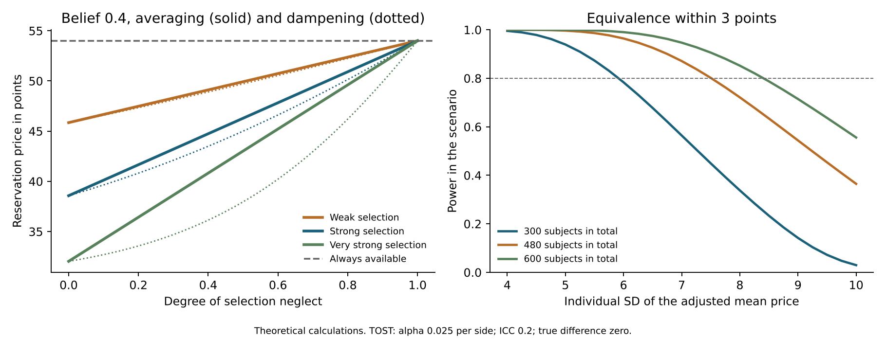

# 10 Hypotheses and preregistered analysis

## 10.1 First hypothesis

The first hypothesis is a positive mean degree of selection neglect in protocol S. It uses the first and only intermediate measurement foreseen in each trial, in the twelve joint trials and in the six single-seller trials together, so that the pull of Section 6.1 is estimated and removed. The prices of a list and the two persons of a pair are not aggregated as independent observations. The estimand is the cross-person mean of the coefficient $\chi_i$ in the static restriction of Section 4, with the rule weight of Section 6.2 at zero.

A noisy price is not divided directly by another noisy price to then compute a t test. The ratio is nonlinear and carries error in the variable used to build the benchmark. The primary plan uses an interval-censored likelihood, based jointly on the two thresholds. Calibration and grid effects enter the estimation and are re-estimated in every inferential replication.

The minimal specification is declared before the pilot. The logit of the subjective posterior is a combination of the logit of the prior and of the log likelihood ratios of the certificates already seen, with weights to be estimated and an individual intercept, as in the regressions of Grether (1980). A certificate not yet observed contributes zero. The two latent economic prices are $U=30+60\widetilde\pi$ and $S=C(\widetilde\pi)+\chi_iD(\widetilde\pi)$. In a joint trial the second moves toward the first by the pull, $S+\kappa(U-S)$, and in a single-seller trial it does not. The individual intercept and $\chi_i$ are jointly normal with free correlation.

The stated thresholds have mean $(1-z)P+zc-u_i$, where $P$ is the latent economic price, $c$ the center of the grid and $u_i$ the individual understatement of Section 9.4. A zero-mean bivariate normal error is added for the pair of lists, with a component common to the two lists of the same trial. The coefficient $z$ in the Bayesian problems is estimated from the grid randomization, and the one in the lists with an announced value is estimated separately. The error scales can differ between sellers. The main specification transports the error component and the understatement of the lists with an announced value, while the sensitivity analyses vary their scale and allow an additional task-specific component.

The contribution to the likelihood is the probability of the rectangle defined by the two observed intervals, integrated over the individual effects. In a single-seller trial the rectangle reduces to one interval. The test on the mean of $\chi_i$ is one-sided. The estimate of the coefficient is left free even outside the interval from zero to one. Such values are not truncated and are not interpreted as a valid cursed distribution. They serve to detect overreaction, inconsistency or inadequacy of the restriction.

The primary test is the one-sided likelihood-ratio test of a zero mean of $\chi_i$ against a positive mean. The hypothesis is supported when the estimated mean is positive and the likelihood-ratio statistic exceeds a critical value calibrated by parametric bootstrap under the null. Data are generated from the declared model at the restricted estimates of all nuisance parameters, with zero mean degree, and both models are re-estimated on each of 999 bootstrap samples. The critical value is the smallest value at which the share of samples with a positive estimate and a statistic above it does not exceed 0.025. Calibration parameters are re-estimated in every bootstrap sample and are not treated as known. The simulation of Section 12.4 motivates this choice: at this sample size the chi-square threshold is mildly liberal, while the calibrated threshold has a verified level.

The studentized bootstrap over pairs, blocked by session, with 1,999 replications, is reported as a robustness check. A one-sided 97.5 percent lower bound above zero supports the hypothesis without relying on the parametric form of the measurement model. Two rules are declared in advance. First, the parametric calibration is valid only if the measurement model fits, and two checks decide this before the primary result is read: a goodness-of-fit test of the joint distribution of the observed interval pairs across trial cells, calibrated by 199 parametric bootstrap samples from the unrestricted fit, and the independent placebo, whose mean gap $U-S$ must be zero for any degree. If either check rejects at the 5 percent level, the bootstrap over pairs becomes the primary procedure. Second, if the checks pass and the two procedures disagree, the calibrated test decides and the disagreement is reported with both results.

The mandatory checks also include a model with different coefficients for the three intensities, sensitivity of the posterior to individual slopes and to more flexible specifications of the inputs, transport of error and attraction by factors 0.5, 1 and 2, and a logit kernel on complete purchase policies. The last one computes the value of each policy through the actual random draw of the row. It does not treat the rows filled by a single threshold as independent logits.

The test is run under the averaging rule. If the simulation of Section 12.4 shows that its level fails when neglect and overreaction cancel on average while prices follow the dampening rule, the critical value is calibrated under the less favorable of the two rules.

This procedure does not provide identification independent of the measurement model. If the sign depends on the specification of the posterior or on the transported error, the conclusion is that the neglect is not robustly separated from those alternatives. The algebraic ratio remains useful to explain the mechanism, but it does not replace this check.

## 10.2 Second hypothesis

The second hypothesis is the equivalence between F and R of the final price for the selective seller in the twelve joint trials, with a margin of three points. The margin concerns an observable outcome of the task, not a bound on every individual difference or on the parameter $\chi$.

To avoid imputing the latent price, the policy index on the common grid is defined as

$$P^{\mathrm{obs}}=30+\sum_{p=31}^{90}\mathbf{1}\{\text{purchase at price }p\}.$$

For a monotone list interior to the economic range, it equals the highest accepted price. It is defined also for policies that decline or accept all prices and uses exactly the same sixty decisions in the two formats. It deliberately discards information on answers outside the range 30 to 90, which is kept in the diagnostics and in the likelihood of H1.

For each person $P^{\mathrm{obs}}-C_{a,b}(\pi)$ is averaged over the twelve joint trials, using the objective final posterior for the adjustment. Subtracting the known benchmark removes part of the mechanical variation of the information histories without conditioning on a variable produced by the treatment. The effect of interest is the mean difference F minus R in this statistic, with equal weights for priors and intensities.

The main analysis compares the means of pairs with session fixed effects. The TOST uses alpha 0.025 on each side, so it requires the two-sided 95 percent interval to lie entirely within $[-3,3]$. Together with the level 0.025 of the first hypothesis, this choice conservatively controls the family of the two primary claims at 5 percent.

Three points are 5 percent of the distance between the values 30 and 90 and about a fifth of the gap between the benchmark prices averaged over the joint trials, 15.9 points. The margin is wide for a small neglect. A mean degree of 0.15 raises the same outcome by 2.4 points, less than the margin. With 100 persons per protocol a margin of two points would be sustained only if the individual standard deviation of the outcome did not exceed 3.9 points, in place of 5.9 (Section 12.2). The margin of three points is kept, and its adequacy is one of the points on which the judgment of an experimentalist is sought.

The result is average equivalence of the protocols in the task and under the incentives adopted. It is not proof that measuring is harmless in every condition. The three intensities, the two priors, the price for the always-available seller and the dispersion of the effects are shown separately. An interval that crosses the margin is inconclusive about equivalence, even if the difference from zero is not significant.

## 10.3 Third hypothesis and the rule weight

The third hypothesis concerns the form of the neglect and is examined only if the first is rejected, since the form matters only when the neglect is present. It asks whether the share of the gap that buyers fail to cover stays the same when the selection becomes stronger or shrinks. In the statistical model the two rules of Section 6.2 are connected by the rule weight, common to all participants. The null hypothesis is a weight of zero, that is, the averaging rule, against the alternative that the dampening rule has positive weight. The test is a likelihood-ratio test at 5 percent with a critical value calibrated by simulation, on all the intensities.

Whether this question is a preregistered hypothesis or an estimate reported with its confidence interval is decided by a rule fixed in advance. It becomes a hypothesis only if the simulation shows a power of at least 80 percent to reject the averaging rule when the dampening rule is true and the mean degree is 0.25, the weight being estimated in either case. The analysis with the rule weight is the one the authors intend to implement, if the time limits of the course project allow. The analysis with the averaging rule alone is the fallback.

## 10.4 Secondary analyses

The secondary analyses comprise the independence, revelation and announced-value placebos, order effects, the comparison of S with F and R, the persistence of the coefficients between the first measurement and the final one, sensitivity to the grid center, and the urn choices. When the question of Section 10.3 is reported as an estimate, the rule weight joins this family. Estimates and intervals are reported, with a false discovery rate control separate and declared for this family. None of these results can retroactively replace a failed primary.

Two comparisons do not depend on the model. In the first, for each pair, the mean gap between partners in the single-seller trials is set against the mean gap within persons in the joint trials. A positive difference on average indicates that stating the prices together compresses them. The second bears on the neglect itself. In the single-seller trials the price that one partner states for the selective seller is set against the correct price at the belief revealed by the price that the other states for the always-available seller. Both prices are first corrected for the attraction measured by the two formats and for the understatement measured on the lists with an announced value. The correction subtracts from each price the attraction times the center of its list and the average understatement, and divides by one minus the attraction. The attraction is one tenth of the mean difference, net of the benchmark, between the prices of the two formats. A positive mean difference across pairs indicates neglect without the model of beliefs and of errors on which the likelihood rests.

The correction is necessary. In a preliminary simulation of 1,000 samples of 50 pairs, with an attraction of 10 percent and no neglect, the uncorrected comparison rejects at the 2.5 percent level in 97 percent of the samples. With the correction it rejects in 3 percent, and it detects a mean degree of 0.15 in 93 percent. The program is `partner_comparison_check.py` and its results are in `design_data/partner_comparison_check.csv`. The simulation of Section 12.4 will have to confirm these figures and calibrate the critical value.

The predictive comparison on the paths in R is kept as exploratory. Model E uses public information, T adds the last intermediate price pair, P adds both ordered pairs, and U uses the two pairs without time labels. All have access to the final public information. None receives a final price as a regressor to predict the final selective price of the same trial.

Validation is outside the training sample, with five groups of pairs and internal selection of hyperparameters. The score is the log probability of the observed interval or choice category. The gain per decision and its distribution by pair are reported. The threshold of interest of 0.01 nats remains an exploratory convention, without certified power.

## 10.5 Diagnostics before interpreting parameters

For every structural specification the report includes parameter recovery on simulated data, coverage of intervals, likelihood profiles, correlations between parameters, eigenvalues of the observed information and efficient information after the nuisance parameters. Final choices alone and additional measurements are compared keeping the same unit of observation and the same payoff normalization.

A numerically full rank is not enough. A direction with a very large standard error is weakly informative, and the rule weight and the pull are the first candidates. A precise estimate under a wrong measurement model does not resolve substantive identification.

# 11 Dynamics

The benchmark for the always-available seller is $B_t=30+60\pi_t$. Under the announced information structure it is a martingale. This makes the economic scale of the Bayesian revisions observable and allows comparing it with the revisions of the thresholds. Protocol R observes initial prices, prices after the first certificate and prices after the second.

The operational test compares the direction and size of the price revision with those of $B_t$. The order of the certificates is randomized. Inertia, over-revision and possible persistence of the initial deviation are analyzed, distinguishing them from the effect of the interface and from serial noise.

That the benchmark is a martingale does not imply that the collected prices are one. For example, if $Y_t=B_t+e_t$ with independent errors of variance $\sigma^2$, at a fixed prior and with two increments,

$$\mathbb E\!\left[(Y_1-Y_0)^2+(Y_2-Y_1)^2\right]=\operatorname{Var}(B_2)+4\sigma^2,$$

while $\operatorname{Var}(Y_2)=\operatorname{Var}(B_2)+\sigma^2$. Comparing the two quantities directly produces a gap of $3\sigma^2$ even when the benchmark is perfectly Bayesian. Heteroskedasticity, serial errors and censoring change the comparison further.

The test of the variation therefore uses the measurement model and is carried out within prior, avoiding mixing the initial variance of the priors 0.4 and 0.6 with the variance produced by the signals. It remains a martingale restriction, not an identification of the Bass lift. Moreover, the variation of the price of the good concerns a belief coordinate on the value, not directly the depth coordinate of the preprint.

A correlation between initial and final deviation is compatible with a stable trait, but also with attraction toward the center or serial error. The stability test reports these alternatives and does not automatically attribute persistence to the individual parameter alone.

# 12 Sample and pilot rule

## 12.1 Numbers and organization

The design base comprises 300 persons in 150 pairs, 50 pairs per protocol. Ten main sessions of thirty persons have five F pairs, five S pairs and five R pairs. The pilot comprises 36 persons in two sessions of eighteen, with three pairs per protocol in each session. The pilot does not enter the main analysis. Pairs are formed after the quiz, so the realized numbers can fall short of the base (Section 13).

The main sample is sized on the aggregated person and on the randomized pair, not on the number of prices, clicks or trials. The claim that a continuous measure is worth two or three times a binary outcome is not used to justify N. The gain depends on the distribution, noise, censoring and the effect of interest.

## 12.2 Equivalence scenarios

The table assumes 100 persons per protocol, within-pair correlation 0.2, normal means of pairs and equal variances, without additional session effects. It uses the actual joint probability of passing both TOST tests, integrating the uncertainty of the pooled variance. The standard deviation is that of the individual statistic, already averaged over trials and adjusted for the benchmark.

| Individual standard deviation | Power if the true difference is zero | Power if the true difference is one point |
|--:|--:|--:|
| 4 | 99.5% | 89.2% |
| 5 | 93.9% | 72.4% |
| 6 | 78.3% | 55.7% |
| 7 | 56.4% | 40.1% |
| 8 | 33.8% | 25.0% |
| 10 | 3.0% | 2.4% |

In the scenario with zero true difference, 80 percent is reached only for an individual standard deviation of about 5.92 points or less. With a margin of two points the same power would require 3.94 points or less. This condition makes the constraint on the sample of 300 transparent. The numerical file also includes 480 and 600 persons. The table is an analytic calculation on the individual statistic. A full simulation of the procedure with a structural generator is reported in Section 12.4 for the design with two intensities.

## 12.3 Criterion before freezing

The pilot checks comprehension, completion of the windows, censoring, sensitivity to the grid, differences in error between the lists with an announced value and the task, variability of the final mean and plausibility of the measurement specifications. It also fixes the length of the windows by the rule of Section 8. Comprehension interviews follow the decisions. The sign of the preliminary effect is not used to select the primary hypothesis.

The entire analysis procedure is then simulated, including pairs, sessions, signals, grids, errors, missing values and refitting. For H1 the grid of effects of interest includes a mean degree of 0.15 and 0.25, with heterogeneity, attraction and pull alternatives, under the two rules of Section 6.2. For H2 it includes true differences of zero and one point. The nuisance parameters use pilot estimates and conservative scenarios of dispersion and dependence.

The criterion requires at least 80 percent power for H1 at 0.15 with the pull estimated, and for H2 at zero difference, and at least 60 percent for H2 at a difference of one point. The simulations have at least 2,000 replications and the threshold is applied to the lower bound of the 95 percent Monte Carlo interval. Type-one error is also checked, including the scenarios with attraction or pull and without neglect. The design tolerance for a nominal 0.025 test is a rejection rate not above 0.035 at the upper bound of the Monte Carlo interval. If H1 fails the power criterion with the pull estimated, placebo and revelation trials are converted into single-seller trials and the simulation is repeated.

If N equal to 300 does not pass the criterion, increments of sixty persons up to 600 are considered, keeping balance across protocols and sessions. If even the maximum does not pass the criteria, the design is revised before the main data and the project is updated. The equivalence margin is not widened after seeing the data, and an incapable test is not presented as confirmatory.

The pilot has not been run. The full simulation at the design parameters has been run for the design as it stood before the single-seller trials and the third intensity were added, and is reported in Section 12.4. The simulation of the present design is in preparation under the plan stated there. At the pilot stage it is repeated with the nuisance parameters estimated from the pilot, and that run decides the final sample size.

## 12.4 Simulation of the analysis procedure

The certifying run described here concerns the design with two intensities and without single-seller trials. Its generator has eight joint trials per person, with the weak or the strong rule, no pull and no understatement. Its numbers do not carry over to the present design without a new run. By the identity of Section 6.1 that analysis would have attributed a positive pull to the neglect, which makes the single-seller trials a condition for the validity of the first test.

The program full_simulation.py generates data from the measurement model of that design and applies the entire procedure. Individual intercepts and individual degrees are bivariate normal. The logit of the subjective posterior combines the prior and the certificates seen so far with estimated weights. Stated thresholds load on the center of the price grid through an attraction coefficient, identified by the random assignment of the 20-90 and 30-100 formats. The error of each list has a factor common to the two lists of the same trial, with true correlation 0.30, and responses are censored to unit intervals and to the grid edges. In S the intermediate measurement falls at the prior or after the first certificate, balanced over priors and intensities.

For H1 the estimator is the interval-censored likelihood, integrated by Gauss-Hermite quadrature with seven nodes for each individual effect and five for the common error factor, and the test is the one-sided likelihood-ratio test. For H2 the generator adds pair and session effects, builds the observable index of Section 10.2, averages it by pair, and applies the session fixed-effects regression with the two one-sided tests. The pilot rule is simulated on 36 persons with the analytic power of Section 12.2. The bootstrap over pairs is computed on one example dataset, because repeating it inside every replication would require about four million likelihood maximizations.

The certifying run uses 2,000 replications for each scenario of H1 and H2, 2,000 simulated pilots and 1,999 bootstrap replications, with fixed seeds independent of the number of worker processes. It ran on eight processes of an Apple silicon laptop, about two hours per H1 scenario. A second complete execution of H1 with the same seeds reproduced every number exactly.

| H1 scenario, 100 persons in S | Asymptotic threshold 3.841 | Calibrated threshold 4.279 | Mean estimate |
|:--|--:|--:|--:|
| No neglect, no attraction | 3.20% | 2.50% | -0.003 |
| No neglect, attraction 0.10 | 3.20% | 2.25% | -0.003 |
| Degree 0.15, attraction 0.10 | 99.60% | 99.45% | 0.147 |
| Degree 0.25, attraction 0.10 | 100% | 100% | 0.248 |
| Degree 0.15, list error 6 | 90.05% | 87.95% | 0.145 |

| H2 scenario, 300 persons | True difference zero | True difference one point | Implied individual SD | Correlation within pairs |
|:--|--:|--:|--:|--:|
| List error 4, pair effect 2 | 99.7% | 90.1% | 3.9 | 0.21 |
| List error 6, pair effect 3 | 95.9% | 76.4% | 4.6 | 0.32 |

The asymptotic test rejects a true null in 3.2 percent of replications, with Monte Carlo upper bound 0.040, above the tolerance of 0.035 of Section 12.3. The chi-square approximation is mildly liberal with ten nuisance parameters and 100 persons. The critical value is therefore calibrated by simulation: it is the value at which, among the null replications without attraction, the share of positive estimates with a likelihood-ratio statistic above it equals 2.5 percent, and it equals 4.279. Applied to the 2,000 independent null replications with attraction, which played no role in the calibration, the calibrated test rejects in 2.25 percent of cases with upper bound 0.029. Power at a degree of 0.15 falls only from 99.60 to 99.45 percent. With real data this calibration becomes the parametric bootstrap under the null that Section 10.1 declares as the primary test.

Estimates of the degree are centered, with absolute bias at most 0.006 and root mean squared error about 0.03, and the attraction coefficient is recovered at 0.10 in every scenario. The error correlation between the two lists is estimated between 0.07 and 0.13 against a true value of 0.30. It is weakly identified by eight trials per person and does not move the estimate of the degree. On the example dataset with true degree 0.15 the point estimate is 0.129, the likelihood-ratio statistic is 15.7, and the 2.5 percent lower bounds of the bootstrap over pairs are 0.061 in the basic version and 0.052 in the percentile version, both above zero.

The pilot rule selects 300 in all 2,000 simulated pilots, with mean realized power 0.997, because the individual standard deviation implied by the model stays below the threshold of 5.92 in both scenarios. The constraint on the sample binds only if the list error exceeds roughly eight points, which is the quantity the pilot estimates in the lists with an announced value. Every criterion of Section 12.3 is met with the calibrated critical value. The command `python3 full_simulation.py criteria` prints the full list, the per-replication values are in `design_data/replications_H1_*.csv`, and the calibration is in `design_data/calibrated_H1.csv`.

Two limits remain. The level of the bootstrap over pairs is not certified by this run, for the computational reason given above, which is why Section 10.1 uses it as a robustness check rather than as the primary test. The quadrature grid is fixed rather than adaptive. A second version of the program with an analytic gradient and adaptive quadrature in the sense of Pinheiro and Bates (1995) would reduce the run time by about an order of magnitude and would make a certification of the bootstrap feasible.

{width=6.2in}

The simulation of the present design is in preparation, with a plan and rules of reading fixed beforehand. Eight scenarios combine a mean degree of 0, 0.15 and 0.25 with a pull of 0 and 0.10 and with the two rules of Section 6.2, with an attraction toward the center of 10 percent, a noise of four points per list and an understatement of one point. The test of the first hypothesis must keep its size when the mean degree is zero and the pull is positive, and it must keep a power of at least 80 percent for a mean degree of 0.15 with the pull estimated. Its size must also hold when neglect and overreaction cancel on average while prices follow the dampening rule, the case in which testing under the averaging rule is not exact. The same run decides the status of the third hypothesis by the rule of Section 10.3, confirms the corrected comparison between partners of Section 10.4, and covers the shorter variant of Section 4.1.
