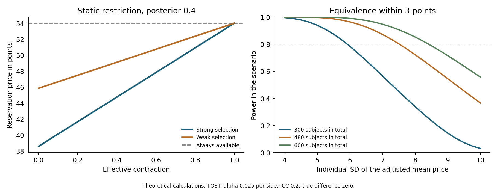

# 10 Ipotesi e analisi preregistrata

## 10.1 Prima ipotesi

La prima ipotesi è una contrazione effettiva media positiva nelle otto prove dipendenti di S. Si usa la prima e unica rilevazione intermedia prevista in ciascuna prova. Non si aggregano come osservazioni indipendenti i prezzi di una lista o le due persone della diade. L'estimando è la media fra persone del coefficiente $\psi$ nella restrizione statica della sezione 4.

Non si divide direttamente un prezzo rumoroso per un altro prezzo rumoroso per poi calcolare un test t. Il rapporto è non lineare e incorpora errore nella variabile usata per costruire il benchmark. Il piano primario usa una likelihood con censura per intervalli, basata congiuntamente sulle due soglie. La calibrazione e gli effetti della griglia entrano nella stima e vengono ristimati in ogni replica di inferenza.

La specificazione minima è dichiarata prima del pilota. Il logit del posterior soggettivo è una combinazione del logit del prior e dei log likelihood ratio dei certificati già visti, con pesi da stimare e un'intercetta individuale. Un certificato non ancora osservato contribuisce zero. I due prezzi economici latenti sono $U=30+60\widetilde\pi$ e $S=C(\widetilde\pi)+\psi_iD(\widetilde\pi)$. Intercetta individuale e $\psi_i$ hanno una distribuzione normale con correlazione libera.

Le soglie espresse hanno media $(1-z)P+zc$, dove $P$ è il prezzo economico latente e $c$ il centro della griglia. Si aggiunge un errore normale bivariato a media zero per la coppia di liste. Il coefficiente $z$ nei problemi bayesiani viene stimato usando la randomizzazione della griglia; quello nei valori certi viene stimato separatamente. Le scale dell'errore possono differire tra venditori. La specificazione principale trasporta la componente di errore della calibrazione, mentre le analisi di sensibilità ne variano la scala e consentono un'ulteriore componente specifica del compito.

La contribuzione alla likelihood è la probabilità del rettangolo definito dai due intervalli osservati, integrata sugli effetti individuali. Il test sulla media di $\psi_i$ è unilaterale. La stima del coefficiente effettivo è lasciata libera anche fuori dall'intervallo zero a uno. Questi valori non vengono troncati e non vengono interpretati come una distribuzione cursed valida. Servono a rilevare sovrareazione, incoerenza o inadeguatezza della restrizione.

Si usa un bootstrap studentizzato per diade, bloccato per sessione, con 1.999 repliche. La prima soglia di significatività è 0,025. Un limite inferiore unilaterale al 97,5% maggiore di zero sostiene l'ipotesi nel modello dichiarato. I parametri di calibrazione devono essere ristimati e non trattati come noti.

Le verifiche obbligatorie comprendono un modello con coefficienti diversi nelle due intensità, sensibilità del posterior a pendenze individuali e a specificazioni più flessibili degli input, trasporto dell'errore e dell'ancoraggio per fattori 0,5, 1 e 2, e un kernel logit sulle politiche complete di acquisto. Quest'ultimo calcola il valore di ogni politica attraverso l'effettiva estrazione casuale della riga. Non tratta le righe compilate da un'unica soglia come logit indipendenti.

Questa procedura non dà un'identificazione indipendente dal modello di misura. Se il segno dipende dalla specificazione del posterior o dall'errore trasportato, la conclusione è che la contrazione non è separata in modo robusto da tali alternative. Il rapporto algebrico resta utile per spiegare il meccanismo, ma non sostituisce questa verifica.

## 10.2 Seconda ipotesi

La seconda ipotesi è l'equivalenza tra F e R del prezzo finale per il venditore selettivo nelle otto prove dipendenti, con margine di tre punti. Tre punti sono il 5% della distanza tra i valori 30 e 90. Il margine riguarda un esito osservabile del compito, non un limite su ogni differenza individuale o sul parametro $\chi$.

Per evitare un'imputazione del prezzo latente, si definisce l'indice della politica nella griglia comune

$$P^{\mathrm{obs}}=30+\sum_{p=31}^{90}\mathbf{1}\{\text{acquisto al prezzo }p\}.$$

Con una lista monotona interna all'intervallo economico, coincide con il massimo prezzo accettato. È definito anche per le politiche che rifiutano o accettano tutti i prezzi e usa esattamente le stesse sessanta decisioni nei due formati. Perde intenzionalmente informazione sulle risposte esterne al range 30 a 90, che viene comunque conservata nelle diagnostiche e nella likelihood di H1.

Per ciascuna persona si media $P^{\mathrm{obs}}-C_{a,b}(\pi)$ sulle otto prove dipendenti, usando il posterior oggettivo finale per l'aggiustamento. Sottrarre il benchmark noto elimina parte della variazione meccanica delle storie informative senza condizionare su una variabile prodotta dal trattamento. L'effetto di interesse è la differenza media F meno R su questa statistica, con pesi uguali per prior e intensità.

L'analisi principale confronta le medie di diade con effetti fissi di sessione. Il TOST usa alfa 0,025 per ciascun lato, quindi richiede che l'intervallo bilaterale al 95% sia interamente contenuto in $[-3,3]$. Insieme al livello 0,025 della prima ipotesi, questa scelta controlla conservativamente al 5% la famiglia delle due affermazioni primarie.

Il risultato è equivalenza media dei protocolli nel compito e negli incentivi adottati. Non è prova che misurare sia innocuo in ogni condizione. Si mostrano separatamente le due intensità, i due prior, il prezzo del venditore sempre disponibile e la dispersione degli effetti. Un intervallo che oltrepassa il margine è inconcludente sull'equivalenza, anche se la differenza da zero non è significativa.

## 10.3 Analisi secondarie

La prima analisi secondaria è la restrizione di pendenza comune tra le intensità, seguita dai placebo di indipendenza, rivelazione e valore certo. Seguono gli effetti d'ordine, il confronto S con F e R, la persistenza dei coefficienti tra prima rilevazione e finale e la sensibilità al centro della griglia. Si riportano stime e intervalli, con un controllo del false discovery rate separato e dichiarato per questa famiglia. Nessuno di questi risultati può sostituire retroattivamente una primaria non riuscita.

Per K si confrontano livelli ricorsivi, gerarchia cognitiva e versioni con precisioni e lapse separati. Si distingue $\tau$ delle scelte proprie dalla profondità attribuita al partner. La conversione delle scommesse in credenze viene confrontata con una trasformazione affine della probabilità, vincolata a rimanere tra zero e uno, e con le diagnostiche sugli eventi complementari.

Si conserva il confronto predittivo sui percorsi in R come esplorativo. Il modello E usa informazioni pubbliche; T aggiunge l'ultima coppia di prezzi intermedia; P aggiunge entrambe le coppie ordinate; U usa le due coppie senza etichette temporali. Tutti hanno accesso alle informazioni pubbliche finali. Nessuno riceve un prezzo finale come regressore per prevedere il prezzo selettivo finale della stessa prova.

La validazione è esterna al campione di addestramento, con cinque gruppi di diadi e selezione interna degli iperparametri. Il punteggio è la log probabilità dell'intervallo o della categoria di scelta osservata. Si riporta il guadagno per decisione e la sua distribuzione per diade. La soglia di interesse di 0,01 nats resta una convenzione esplorativa, senza una potenza già certificata.

## 10.4 Diagnostiche prima di interpretare i parametri

Per ogni specificazione strutturale si riportano recupero dei parametri su dati simulati, copertura degli intervalli, profili di likelihood, correlazioni tra parametri, autovalori dell'informazione osservata e informazione efficiente dopo i nuisance. Si confrontano scelte finali sole e misure aggiuntive mantenendo la stessa unità di osservazione e la stessa normalizzazione dei payoff.

Non basta un rango numericamente pieno. Una direzione di profondità con errore standard molto grande è debolmente informativa. Una stima sensibile a lapse, ambiguità o definizione di livello zero non dimostra una profondità stabile. Una stima precisa sotto un modello di misura errato non risolve l'identificazione sostanziale.

# 11 Dinamica

Il benchmark del venditore sempre disponibile è $B_t=30+60\pi_t$. Con la struttura informativa annunciata è una martingala. Questo rende osservabile la scala economica delle revisioni bayesiane e permette di confrontarla con le revisioni delle soglie. Nel protocollo R si osservano prezzi iniziali, dopo il primo certificato e dopo il secondo.

Il test operativo confronta direzione e dimensione della revisione del prezzo con quelle di $B_t$. L'ordine dei certificati viene randomizzato. Si analizzano inerzia, eccesso di revisione ed eventuale persistenza dello scarto iniziale, distinguendole dall'effetto dell'interfaccia e dal rumore seriale.

La martingala del benchmark non implica che i prezzi raccolti siano una martingala. Per esempio, se $Y_t=B_t+e_t$ con errori indipendenti di varianza $\sigma^2$, a prior fissato e con due incrementi si ha

$$\mathbb E\!\left[(Y_1-Y_0)^2+(Y_2-Y_1)^2\right]=\operatorname{Var}(B_2)+4\sigma^2,$$

mentre $\operatorname{Var}(Y_2)=\operatorname{Var}(B_2)+\sigma^2$. Confrontare direttamente le due quantità produce uno scarto di $3\sigma^2$ anche quando il benchmark è perfettamente bayesiano. Eteroschedasticità, errori seriali e censura cambiano ulteriormente il confronto.

La verifica della variazione usa quindi il modello di misura e si conduce entro prior, evitando di mescolare la varianza iniziale dei prior 0,4 e 0,6 con quella prodotta dai segnali. Rimane una restrizione martingala, non un'identificazione del Bass lift. Inoltre, la variazione del prezzo del bene riguarda una coordinata di credenza sul valore, non direttamente la coordinata di profondità del preprint.

Una correlazione tra scarto iniziale e finale è compatibile con un tratto stabile, ma anche con ancoraggio o errore seriale. Il test di stabilità riporta queste alternative e non attribuisce automaticamente persistenza al solo parametro individuale.

# 12 Campione e regola del pilota

## 12.1 Numeri e organizzazione

La base di progetto comprende 300 persone in 150 diadi, 50 diadi per protocollo. Dieci sessioni principali da trenta persone hanno cinque diadi F, cinque S e cinque R. Il pilota comprende 36 persone in due sessioni da diciotto, con tre diadi per protocollo in ogni sessione. Il pilota non entra nell'analisi principale.

Il campione principale è dimensionato sulla persona aggregata e sulla diade randomizzata, non sul numero di prezzi, clic o prove. L'affermazione che una misura continua valga due o tre volte un esito binario non viene usata per giustificare N. Il guadagno dipende da distribuzione, rumore, censura ed effetto di interesse.

## 12.2 Scenari di equivalenza

La tabella assume 100 persone per protocollo, correlazione entro diade 0,2, medie di diade normali e varianze uguali, senza effetti aggiuntivi di sessione. Usa l'effettiva probabilità congiunta di superare i due test TOST, integrando l'incertezza della varianza pooled. La deviazione standard è quella della statistica individuale già mediata sulle prove e aggiustata per il benchmark.

| Deviazione standard individuale | Potenza se la differenza vera è zero | Potenza se la differenza vera è un punto |
|--:|--:|--:|
| 4 | 99,5% | 89,2% |
| 5 | 93,9% | 72,4% |
| 6 | 78,3% | 55,7% |
| 7 | 56,4% | 40,1% |
| 8 | 33,8% | 25,0% |
| 10 | 3,0% | 2,4% |

Nello scenario con differenza vera zero, l'80% è raggiunto soltanto per una deviazione standard individuale di circa 5,92 punti o meno. Questa condizione rende trasparente il vincolo del campione da 300. Il file numerico include anche 480 e 600 persone. La tabella non è una simulazione completa del nuovo protocollo.

## 12.3 Criterio prima del congelamento

Il pilota verifica comprensione, completamento delle finestre, censura, sensibilità alla griglia, differenze di errore tra calibrazione e compito, variabilità della media finale e plausibilità delle specificazioni di misura. Le interviste di comprensione seguono le decisioni. Non si usa il segno dell'effetto preliminare per selezionare la primaria.

Si simula quindi l'intera procedura di analisi, inclusi diadi, sessioni, segnali, griglie, errori, missing e rifitting. Per H1 la griglia degli effetti di interesse include una contrazione effettiva media di 0,15 e 0,25, con eterogeneità e alternative di ancoraggio. Per H2 include differenze vere di zero e di un punto. I nuisance usano stime del pilota e scenari conservativi di dispersione e dipendenza.

Il criterio richiede almeno l'80% di potenza per H1 a 0,15 e per H2 a differenza zero, e almeno il 60% per H2 a differenza di un punto. Le simulazioni hanno almeno 2.000 repliche e la soglia è applicata al limite inferiore dell'intervallo Monte Carlo al 95%. Si verifica anche l'errore di primo tipo, inclusi gli scenari di ancoraggio senza contrazione. La tolleranza di progetto per un test nominale 0,025 è un tasso di rifiuto non superiore a 0,035 nel limite superiore dell'intervallo Monte Carlo.

Se N pari a 300 non supera il criterio, si considerano incrementi di sessanta persone fino a 600, mantenendo bilanciamento tra protocolli e sessioni. Se neppure il massimo supera i criteri, si ridisegna prima dei dati principali e si aggiorna il progetto. Non si amplia il margine di equivalenza dopo aver visto i dati e non si presenta un test incapace come confermativo.

Queste simulazioni complete e il pilota non sono stati eseguiti. La consegna contiene le identità verificate, il codice della batteria preliminare e gli scenari analitici. La regola rende il disegno valutabile per il corso senza inventare un'esecuzione o una garanzia empirica.

# 13 Dati ed esclusioni

Il campione principale comprende gli assegnati che superano la comprensione prima dei compiti principali. Un secondo tentativo di quiz segue una spiegazione standard identica per tutti. Chi non supera il secondo tentativo riceve la quota fissa e non inizia le prove. Il numero di esclusi e il motivo vengono riportati per sessione, senza sostituire persone sulla base delle risposte economiche.

Una scelta insolita, una soglia ai bordi o un coefficiente fuori da zero a uno non è motivo di esclusione. Si separano risposta economica, timeout e guasto. Il protocollo conserva gli assegnati nella descrizione dei flussi. L'analisi dei dati osservati viene accompagnata da sensibilità ai missing. Per l'equivalenza si calcolano anche limiti usando gli estremi dell'indice osservabile, da 30 a 90. Se i missing impediscono di sostenere l'equivalenza senza ipotesi forti, la conclusione viene qualificata.

I dati sono pseudonimi. La tabella di pagamento con identità reali è separata dalle risposte. Non si raccolgono registrazioni audio, video o tracciamento oculare. I tempi e le modifiche delle soglie descrivono l'interazione con l'interfaccia e non sono trattati come misura diretta del ragionamento.

| Gruppo di campi | Contenuto minimo |
|:--|:--|
| Assegnazione | Persona, diade, sessione, protocollo, ordine dei moduli e ruolo |
| Ambiente X | Prior, valore estratto, disponibilità, intensità, accuratezze, segnali e ordine |
| Misura X | Momento, griglia, venditore, ultima riga acquistata, intervallo, censura e conferma |
| Ambiente K | Gioco, ruolo, matrici normalizzate, soglie degli eventi e identità pseudonima del partner |
| Misura K | Numero finale, scelte contingenti nelle scommesse, intervalli e complemento |
| Controlli | Valore certo, disponibilità annunciata, composizione urne e politica del computer |
| Operatività | Inizio e fine finestre, timeout, problemi tecnici, consultazione dettagli e tentativi di quiz |
| Pagamento | Categoria, prova, lista, riga, esito e probabilità applicata |
| Riproducibilità | Versione delle istruzioni, configurazione, semi casuali e impronta del codice |

Lo stato e i segnali vengono generati prima delle risposte. La disponibilità resta la stessa fra le liste temporali della medesima prova. Le estrazioni di pagamento sono indipendenti dalle risposte. Il programma registra la sequenza necessaria a ricostruire ogni benchmark e ogni pagamento.
