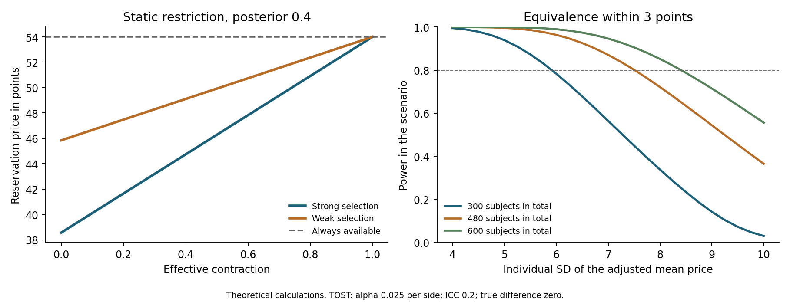

# Design decision

The core of the experiment is a pair of purchase decisions. One seller is always available. Another is available more often when the good is worth little. Comparing the reservation prices separates a valuation of the good from a valuation of the selection. Two certificates, 60 and 70 percent accurate, leave enough residual information to observe both. No probability distributions are elicited and no scoring rule is used.

The main question is whether the gap between the two prices is smaller than the gap implied by the selection, once the individual valuation of the good is taken into account. The second question is whether asking for intermediate decisions changes the final price. Reasoning depth and the dynamic bridge of the preprint remain exploratory extensions. This hierarchy keeps the project discussable even if the identification of depth stays weak.

The revision keeps three protocols assigned at the dyad level. F collects only final decisions. S adds one intermediate measurement, drawn between two moments. R collects both. The last intermediate measurement ends before the second certificate and at least thirty seconds before the final decision opens.

The planning sample is 300 persons, 50 dyads per protocol, with a separate pilot of 36. The final number follows a power rule declared below. Three hundred persons are not automatically enough for equivalence within three points.

The project introduces four corrections to the initial price proposal. The main grid has step one and is treated as an interval measurement. Its position varies at random to test anchoring. An inactive slot keeps a reserve lottery instead of raising the weight of the final decision. Bets on the partner are read as equivalent probabilities, which can be affected by ambiguity.

The defensible thesis is precise. An additional decision can inform about a mechanism that the final action hides, but its contribution depends on the technology used to measure it. Theoretical identities, restrictions on the measurement model and causal effects of the protocols are distinct objects.

This dossier contains a designed experiment. The numbers in its tables are theoretical calculations, diagnostics on a benchmark, power scenarios or simulations of the analysis procedure. No human data have been collected, no pilot has been run and the Schrödinger-Bass bridge has not been estimated.

# 1 Motivation and relation to the course

The apparatus starts from a recognizable economic problem, selection in the purchase of a good of uncertain quality. The link with the work of Di Cagno, Güth, Lohse, Marazzi and Spadoni (2022) is the acquisition environment with asymmetric information. Here the seller's rule is programmed and declared. This removes unobserved strategic intentions and makes the benchmark computable. The price of this simplification is that the design studies selection neglect directly, not the whole strategic relation with a human seller.

The link with the course materials lies in the sequence from economic question to controlled variation, incentivized decision and empirical comparison. The distinction between known risk, beliefs about the partner and preferences over the source of uncertainty also makes the reference to the materials on beliefs, risk and ambiguity substantive. No personal preferences are attributed to the evaluators. The presentation should let them check the mechanism without first having to accept the whole preprint.

The preprint asks, in its Section 10.3, its Section 12.4 and its conclusions, for an experiment with randomized report timing, a passive arm and repeated reports at unchanged information from which response noise can be estimated, and the present design implements that request, since protocol F is the passive arm, protocol R the active arm with two intermediate measurements, protocol S the intermediate treatment with a single measurement per trial, while the certain-value calibration estimates the noise at unchanged information and the second hypothesis tests the systematic elicitation effect formalized in equation (94) of the preprint. The dossier implements the measurement theory of Sections 9 and 10, while the three-game battery of Section 12 remains a distinct experimental venue, and the selective seller carries the state-action association studied in that battery into the form of a purchase decision with reservation prices.

Danz, Vesterlund and Wilson (2022) document systematic deviations toward the center under a binarized scoring rule and a decline in truthfulness when more information about incentives is provided. This is a relevant reason to drop the calculator of the previous version and the example of the uniform answer. Their result does not show that every price measure is free of distortion. That second claim would be an unjustified leap.

The new architecture abandons the scoring rule but keeps a binary monetary prize. Using a lottery to pay a purchase decision does not mean scoring a stated probability. The distinction is substantive, even though comprehension of compound lotteries remains an assumption to be checked.

# 2 Check of the critique of the previous version

The eight dependent templates of version 1.1 combined priors 0.4 and 0.6 and prices 45 and 65, with two repetitions. Enumerating the four certificate pairs confirms the reported problem.

| Quantity in the old apparatus | Certificates 70% and 85% | Certificates 60% and 70% |
|:--|--:|--:|
| Final choices discriminating rational from fully cursed over eight trials | 1.05 | 3.40 |
| Reports equivalent to posterior 0.5 in the old S | 4.4755 | 6.2225 |
| Minimum and maximum final posterior | 0.048 and 0.952 | 0.160 and 0.840 |

The second row averages over the three old measurement moments and over the random order of the certificates. It does not concern only the final reports. Assuming independent and homoskedastic errors across cells, the information ratio is 1.3904 and the ratio of standard errors is 0.8481. These are 39.0 percent more information and 15.2 percent smaller standard error, within that measurement technology. They are not a power forecast for the new price lists.

The example with threshold 5/12 was correct before the certificates but carried little information about the final choice. It is removed from the central slide. The new example shows three prices directly and their link with the contraction, without keeping a threshold that belongs to a different information schedule.

# 3 Observed objects and levels of evidence

The value of the good is 30 or 90 points. Let $\pi$ denote the probability of the high value given the available information. The reservation price for the always-available seller is $U$. The one for the selective seller is $S$. Availability of the selective seller is the event $J=1$.

| Level | What is claimed |
|:--|:--|
| Design identity | Bayes, payments, optimal prices and properties of the mechanism under explicit assumptions |
| Behavioral evidence | Prices, revisions and differences between protocols, defined even without estimating the bridge |
| Structural interpretation | Effective contraction and depth, conditional on the choice and measurement models |
| Dynamics of the preprint | Restrictions on the latent process and comparison between path models |

We use $\psi$ for the effective contraction recovered from the price restriction. We reserve $\chi$ for the contraction parameter of the preprint. In the static benchmark with a correct posterior, $\psi=\chi$. If the posterior is subjective, the same equality requires applying the transformation to the subjective joint law built from that posterior and from the announced conditional probabilities. This is a declared measurement extension. In the dynamic model, moreover, the perceived process moves toward a transformed target and need not equal that target at every instant. A ratio of prices does not automatically identify the drift parameter.

The precision of choices in the urns, in the price lists and in the games is first estimated separately. A common precision has meaning only after the payoffs and the corresponding observation kernel have been specified and normalized. Equality of these parameters is a restriction to be tested.

# 4 Module X

## 4.1 Trial generation

Each trial has an announced prior of 0.4 or 0.6 on the value 90. The value is drawn and two certificates are generated, conditionally independent given the value. The weak certificate reports the correct value in 60 percent of cases. The strong one does so in 70 percent. Accuracies are symmetric between low and high value, always visible, and the order is random.

Each pair of lists refers to the same good and the same information. The seller's availability is generated by the announced rule and does not depend on the price, on the answer or on the moment drawn for payment. The two sellers are not put in competition with each other. At the end only one list and one row can be implemented.

| Seller type | Available if value 30 | Available if value 90 |
|:--|--:|--:|
| Always available | 1 | 1 |
| Strong selection | 0.80 | 0.20 |
| Weak selection | 0.65 | 0.35 |
| Independent placebo | 0.50 | 0.50 |

The sixteen trials comprise eight dependent trials, four independent placebos and four revelation trials. The eight dependent trials are the product of two priors, two intensities and two repetitions. Each trial presents the always-available seller and one of the other sellers. The order of the two lists is balanced within person.

In the four revelation trials the realized availability is shown after the second certificate and before the final list. The sample is not artificially conditioned on $J=1$. If the seller is not available, its list is disabled and no non-existent threshold is interpreted. The test on the conditional selective price uses only the available cases, with a random number of observations. The software and the analysis plan keep track of this known selection.

## 4.2 The price decision

The interface asks at which prices the participant would buy. Choosing a threshold fills a monotone list, buying up to the threshold and declining above it. Before confirmation the summary shows both regions. There is no preselected value and no slider initialized at the center. The choices of declining at all prices or buying at all prices are also available.

The grid has a step of one point. In half of the trials it runs from 20 to 90, in the other half from 30 to 100. Both have 71 rows and cover every economically possible price between 30 and 90. The numerical center moves from 55 to 65. The assignment is balanced and random within person, independent of prior, selection and certificates. It stays the same across the moments of the same trial.

The interface lets the participant answer the list with a single threshold. This does not turn 71 rows into 71 independent observations. What is observed is a purchase policy, not a sequence of autonomous choices. Imposing monotonicity is consistent with the dominance of a lower price under identical conditions. It does, however, give up the possibility of using reversals within the list as an error indicator.

If the last accepted row is $k$ and the next one is declined, the latent price lies in the interval $[k,k+1]$, up to endpoint conventions that do not change the continuous analysis. Estimation uses the interval. The midpoint serves only for descriptive plots. Responses at the edges are censored, without extrapolating a point price. The equivalence test instead uses the observable index defined in Section 10.

The step of five proposed initially was too coarse for an individual ratio. For example, $U=54$ and $S=42.43$ correspond to $\psi=0.25$ under strong selection. Observing only $U\in[50,55]$ and $S\in[40,45]$ is compatible with values of $\psi$ roughly between 0.057 and 0.625, even without stochastic error.

{width=6.2in}

## 4.3 Benchmarks and the price identity

Let $a$ denote availability if the value is high and $b$ availability if it is low. The probability of availability is

$$A(\pi)=a\pi+b(1-\pi).$$

The unconditional price and the correctly conditioned price are

$$U(\pi)=30+60\pi,\qquad C_{a,b}(\pi)=30+60\frac{a\pi}{a\pi+b(1-\pi)}.$$

The transformation of the preprint mixes the joint law with the product of its marginals, keeping the latter. Under this restriction the selective price is exactly

$$S(\pi,\chi)=C_{a,b}(\pi)+\chi\,[U(\pi)-C_{a,b}(\pi)].$$

If the first price measures the subjective posterior $\widetilde\pi=(U-30)/60$, and the conditional probabilities $a,b$ are represented correctly, the effective contraction is

$$\psi=\frac{S-C_{a,b}(\widetilde\pi)}{U-C_{a,b}(\widetilde\pi)}.$$

The conditional benchmark must be recomputed from the posterior implied by the first price. Inserting the objective posterior directly into the denominator would not remove the error on the posterior. The separation also requires that the two lists share the same marginal belief and the same valuation criterion.

The gap available to identify the contraction is

$$D_{a,b}(\pi)=U(\pi)-C_{a,b}(\pi)=60\frac{(b-a)\pi(1-\pi)}{a\pi+b(1-\pi)}.$$

It is positive under negative selection and an interior posterior. The map from posterior and contraction to the two prices has Jacobian determinant $60D_{a,b}(\pi)$, hence rank two in these cases. This is local identification in the static restriction. Empirical precision depends on the size of the gap and on measurement error.

| Example with posterior 0.4 | Rational price | Price with contraction 0.25 | Price with contraction 1 |
|:--|--:|--:|--:|
| Always available | 54.00 | 54.00 | 54.00 |
| Strong selection | 38.57 | 42.43 | 54.00 |
| Weak selection | 45.85 | 47.89 | 54.00 |

The identity is verified in the code on the transformed joint law, not merely by substituting numbers into the same formula. The largest numerical error is below $3\times10^{-14}$.

## 4.4 Testable restrictions

With a common parameter, the gaps $U-S$ are proportional to the respective $D_{a,b}(\widetilde\pi)$ with slope $1-\psi$. The common restriction is compared with two distinct coefficients for strong and weak selection. The intensities are not two simultaneous measures of the same mental state, because each trial presents two sellers, not three. Comparability requires stability of the coefficient and control of the different information histories.

In the independent placebo the theoretical gap is zero for every contraction. No ratio with a zero denominator is computed. After revelation of $J=1$, the conditional value becomes the new expected value for both lists. The two prices must coincide at the correctly updated level, and the further distortion of the dependence has no room left in the static restriction. The event $J=0$ also informs the price for the always-available seller. Comparing behavior with these predictions checks the role of hypothetical selection, and it is not a complete test of every model of sequential cursedness.

Finally, the same final information produces the same Bayesian posterior under both orders of the certificates. The order comparison is therefore a path test. The design keeps this variation, while accepting that weaker certificates may reduce the differences between intermediate paths.

# 5 Alternative interpretations of the prices

Removing the four boxes removes one specific occasion for flattening, but it does not remove every attraction toward the center. Suppose a true price $P$ is expressed as $(1-z)P+zc$, where $c$ is a salient reference. With posterior 0.4, $z=0.10$ and $c=57.5$, a subject who incorporates the selection correctly produces apparent values of $\psi$ equal to 0.1098 under strong selection and 0.1072 under weak selection. The restriction across the two intensities barely distinguishes this case from a common contraction.

The protocol answers by combining a check on the same instrument with a variation in the main task. Eight final calibration trials present a certain value of 36, 48, 66 or 78 points, once for each grid. Each trial uses an always-available seller and one with announced availability of 20, 65, 35 or 80 percent for the four values respectively. The reservation price equals the announced value for both. Selection cannot create a different conditional value when the value is certain. The trials use the same interface and the same payment as the X decisions.

The random ten-point difference between the grid centers is also used in the Bayesian problems themselves. In the simple anchoring model, a ten-point shift of the center moves the price by $10z$. A drift of 10 percent implies a difference of one point. This variation tests the transport of the calibration to the difficult task, instead of taking it for granted.

The grid variation keeps constant the number of rows and the probability of drawing each common price. The additional rows below 30 or above 90 are dominated in known directions and do not change the optimal reservation price. They do change the presentation and some outcomes of the overall lottery. A grid effect is interpreted as sensitivity to the measurement technology, without attributing it solely to a psychological anchoring mechanism.

No control excludes every possible difficulty-dependent distortion. Analyses are reported that multiply by 0.5, 1 and 2 the error and anchoring components transported from the calibration. Inference on the contraction must be accompanied by its sensitivity to these restrictions.

# 6 Module K

## 6.1 Game and preliminary battery

Two persons of the same dyad simultaneously choose an integer in the displayed ranges. The payoff increases as one's own number approaches a coefficient times the partner's number. A quadratic loss is used, normalized by the payoff span of the specific matrix. It is an adaptation of the family of guessing games, not an exact replica of the payoff function of Costa-Gomes and Crawford (2006).

Level zero is fixed as a uniform distribution over the allowed numbers. Each subsequent level best responds to the policy of the previous level. Ties split the probability equally. Level zero is a distribution, not a point to be separated on the grid. The table shows the means of the policies of the first three levels and the single pure equilibrium, verified on the integer grid.

| Game and role | Range | Coefficient | L1 | L2 | L3 | Equilibrium |
|:--|:--|--:|--:|--:|--:|--:|
| K1 A | 10 to 90 | 0.5 | 25 | 32.5 | 16 | 10 |
| K1 B | 10 to 90 | 1.3 | 65 | 32.5 | 42 | 13 |
| K2 A | 10 to 50 | 0.5 | 25 | 22.5 | 19 | 10 |
| K2 B | 10 to 90 | 1.5 | 45 | 37.5 | 34 | 15 |
| K3 A | 10 to 50 | 0.5 | 25 | 19.5 | 16 | 10 |
| K3 B | 10 to 90 | 1.3 | 39 | 32.5 | 25 | 13 |

A mean halfway between two integers represents a policy with two optimal actions. The separation constraint is checked on the supports, not on the means alone. Every pair among L1, L2, L3 and equilibrium is at least two units apart in both roles. Each game is repeated with roles exchanged, for six trials in total. No feedback is given and the partner stays the same.

The code considers ranges with lower bound 10 or 30 and upper bound 50 or 90, coefficients 0.5, 0.7, 1.3 and 1.5, and excludes duplicates by role exchange. Twenty games satisfy the constraint. A greedy selection picks three games by maximizing the minimum efficient information on $\tau$, after profiling precision and lapse. The design grid uses precisions 4, 12 and 30, depths 0.7, 1.5 and 2.5, and lapse 0.02 and 0.10.

The benchmark mixes the recursive responses with Poisson weights truncated to levels zero to six, adding a normalized logit emission. It assumes independent draws of the level across games and excludes the bridge, bets and source preferences. It is a preliminary criterion, to be compared with persistent levels in the pilot. At the worst point of the grid, the efficient information per person is about 0.0122 and the ideal bound on the standard error of $\tau$ with 300 persons is about 0.524, before within-dyad dependence and further nuisance parameters. This diagnostic is a reason to keep the analysis exploratory.

The 11-20 game remains a candidate for external validation. In its standard form the initial levels follow 20, 19, 18 and 17, so they are one step apart, and the equilibrium is mixed. It does not meet the requirement of five distinct points stated in the proposal. The game is not modified merely to declare the constraint satisfied.

## 6.2 Equivalent probabilities

For each game three thresholds are chosen among the supports of the predictions on the partner's number. For example, for player B in K1 they are 23, 38 and 54. The person in role A can choose a bet that pays the prize if B chooses at least 38, or an objective lottery with announced probability.

Each list compares the event with probabilities from 5 to 95 percent in steps of 5 percent. These are nineteen contingent decisions, not three or four. The interface allows summarizing them with a threshold and confirming the whole list. No adaptive search is used that would make later offers depend on earlier answers. If the list is drawn, each row has probability 1/19 of being implemented.

The three lists estimate intervals of equivalent probability. They do not reconstruct a complete distribution of actions or levels. The thresholds concern the distribution of the partner's role, not that of the respondent's role. The lists are presented in random order and without preselected values. Consistency across different thresholds is not forced and remains a diagnostic.

In the two rounds of K1 the bet on the complement of the central threshold is added. This checks whether the equivalent probabilities of the event and of its complement sum to one, accounting for censoring. The check can reveal source preferences or inconsistency, but it does not identify every model of ambiguity.

The mechanism is compatible with a probabilistic belief when the participant evaluates both prospects through the same increasing function of the probability of the same prize, without an additional preference for the source. Monotonicity in the probabilities of the objective lotteries alone is not enough. The literature on matching probabilities shows precisely that these measures can also reflect ambiguity.

Consequently, three points of a cumulative distribution do not automatically become three points of the distribution of levels. Inferring $\tau$ requires specified level policies, an error model and a map from beliefs about the partner to the relevant depth. One's own depth and the depth attributed to the partner are initially kept separate. Their equality is a restriction, not a definition.

## 6.3 Computer controls

After the six trials with a human partner, everyone faces four trials with a computer. Two declare a known uniform distribution. Two declare a deterministic number corresponding to a level-one response. A concrete explanation of the rule is used, without cognitive labels in the participant instructions.

In K1, best responding to a uniform role B implies choosing 25 in role A, and best responding to a uniform role A implies 65 in role B. If B surely chooses 65, the best responses of A are 32 and 33. If a computer in role A of K3 chooses 25, the best responses of B are 32 and 33. The quiz checks the reading of the rules before these decisions.

These cases remove uncertainty about the partner's policy. A residual error can depend on calculation, attention, misunderstanding or choice noise. On its own it does not demonstrate a cognitive inability. The comparison is motivated by the distinction between manifested depth and expectations about others' sophistication discussed by Agranov and coauthors (2012).

# 7 Anchoring precision

Sixteen decisions compare two urns with one hundred tokens and visible counts. The winning token gives the same prize as the rest of the experiment. The differences in winning probability range from one to sixteen percentage points, once per difference. The better side is balanced and the baseline probabilities vary. The design duration is three minutes, to be verified in the pilot.

The benchmark is the choice of the urn with more winning tokens. A response curve to the probability difference is estimated, with a possible lapse, pooled or hierarchical. Sixteen answers do not justify a precise individual estimate of several free parameters.

The slope is not automatically an upper bound on the noise in modules X and K. The task may be easier, the perception of probabilities may change, and the number of alternatives is not the same. It is a reference on objective choices. Equality of precisions is tested after an explicit normalization, also comparing models with separate precisions.

The eight certain-value trials of Section 5 instead anchor the error and the sensitivity to the center within the same price instrument. They are necessary because good performance with the urns does not exclude a distortion specific to purchase thresholds.

# 8 Protocols and timing

Randomization is at the dyad level and blocked by session. Both members receive F, S or R. Module X is individual, while K uses the real partner. The common assignment avoids mixing different protocols within the interaction.

| Protocol | First intermediate moment | Second intermediate moment | Final decision |
|:--|:--|:--|:--|
| F | No measurement | No measurement | Always |
| S | One of the two moments, balanced | One of the two moments, balanced | Always |
| R | Measurement | Measurement | Always |

In S a single moment is drawn per trial. Of the eight dependent X trials, four are assigned to the first moment and four to the second, balancing prior and intensity. In inactive windows the information and the time remain available. No distraction task is introduced, since it would further change the treatment.

| Event in module X | Seconds from the start of the trial |
|:--|--:|
| Reading of prior, value and seller rule | 0 to 10 |
| First possible pair of lists | 10 to 30 |
| First certificate | 40 |
| Second possible pair of lists | 50 to 70 |
| Second certificate | 85 |
| Availability revealed, only in the planned controls | 90 |
| Pair of final decisions for everyone | 100 to 120 |

The pause between the close of the last measurement and the opening of the final decision is thirty seconds and includes a new certificate. No window is extended for one protocol only. Every technical extension is logged and, if needed for a session, applied to everyone.

In K there are no certificates about the partner's mind. The windows for the bets are 10 to 30 and 40 to 60 seconds, while the final number is chosen from 80 to 100 seconds. No feedback arrives during the pauses. There is no objective Bayesian posterior about the human partner. The correct benchmarks are conditional on the declared models or on the known policy of the computer.

The two main modules are counterbalanced across dyads. Computer controls, price calibration and urns follow both main modules, before results and payment. In this way the explanation of the computer's responses does not train the human game. Possible fatigue in the controls is also recorded and modeled by protocol.

The expected duration is about 85 to 95 minutes, with an announced organizational limit of 105. The sixteen X trials take 32 minutes and the six K trials ten. Controls and calibrations take about thirteen minutes. Instructions, quiz, practice, break and payment complete the session. These are design durations, not observed times.

# 9 Payment

## 9.1 Drawing the decision and the prize

Each participant receives 8 euros fixed and can receive a single additional prize of 16 euros. The drawing procedure is published before the session. A category is selected, then a trial, the seller or bet where relevant, and a row. The decision so selected determines the outcome of the prize. The other tasks produce no further payments. The final draw of the prize, where present, is distinct from the selection of the decision and creates no multiple payments.

| Category | Drawing probability |
|:--|--:|
| Final X decision | 30% |
| Final K number | 20% |
| First intermediate X slot | 8% |
| Second intermediate X slot | 8% |
| First K betting slot | 6% |
| Second K betting slot | 6% |
| Price calibration | 10% |
| Urns | 6% |
| Computer | 6% |

The probabilities sum to one and are equal across the three protocols. Within a category the trial is drawn uniformly. In the X pairs the sellers have probability 1/2 each and each price of the grid has probability 1/71. In the K bets one of the three lists is drawn uniformly, or one of four where the complement is present, and one of the nineteen rows. Differences in the number of decisions are identical across protocols.

## 9.2 Purchases and risk

The purchase gain in points is $J(V-P)$. If the participant declines or the seller is not available, it is zero. The prize probability is

$$w=0.5+\frac{J(V-P)}{200}$$

for a purchase row, and 0.5 for a refusal. With the two grids and the values 30 and 90, the probabilities stay between 0.15 and 0.85. The certain-value controls use the same scheme. A completed decision can therefore preserve the baseline lottery by declining, and it can improve on it by choosing purchases with positive expected gain.

If the participant correctly reduces the compound lottery and prefers a higher probability of the same prize, maximizing the probability is equivalent to maximizing the expected gain in points. The optimal prices are then the expected values given in Section 4, without imposing linear utility in euros.

If instead the monetary outcomes of the purchase were paid directly, risk aversion could shift the reservation price. The first list would no longer measure the posterior on its own. The conversion into prize probability is therefore part of the identification, not an accounting detail. Reduction of lotteries and source neutrality remain behavioral assumptions, checked but not guaranteed by the algebra.

## 9.3 Games and bets

In the games, writing $d=|x-py|$ for the distance from the target and $D_g$ for the maximum distance in the matrix of that role, the probability is $0.9-0.8(d/D_g)^2$. The selected matrices allow a distance of zero and are normalized exactly as in the selection code. The same rule applies in the computer trials.

A bet chosen on the partner pays the prize if the event occurs. The alternative lottery pays it with the stated probability. No score is attached to the accuracy of a statement. A choice between urns uses directly the visible composition of the selected urn.

## 9.4 Inactive slots and missing answers

A slot not foreseen by the protocol assigns a reserve lottery with probability 0.5. This replaces the proposal to pay the final decision again. With three equiprobable slots, redirecting to the final decision would give it weight 1 in F, 2/3 in S and 1/3 in R. The comparison of F with R would mix measurement with a final incentive three times as large.

The reserve now has an operational benchmark. In X it is equivalent to declining all purchases. In the K lists it is equivalent to always choosing the objective lottery, because the mean of the probabilities from 5 to 95 percent is 50 percent. An optimal policy can do at least as well. The empty slot does not dominate informative answers, as the 75 percent reserve of the original version could.

A timeout on a question that is actually foreseen gives probability zero if that question is drawn. A documented technical failure gives the reserve, without penalizing the participant. A missing answer is not confused with random assignment to an inactive slot.

This scheme keeps the marginal incentives of the common decisions equal. It does not make the total expected earnings of the protocols identical, because additional measurements offer further occasions to improve on the reserve. A perfect neutralization of every income effect or perception of compensation is not claimed.

The instructions explain purchase, refusal, drawing and prize operationally. The optimization calculator is omitted and no uniform answer is shown as a fallback strategy. The complete formulas remain available to everyone in the same way, and their opening and consultation time are recorded. The quiz uses examples of dominance and availability, without suggesting the behavior under test.

# 10 Hypotheses and preregistered analysis

## 10.1 First hypothesis

The first hypothesis is a positive mean effective contraction in the eight dependent trials of S. It uses the first and only intermediate measurement foreseen in each trial. The prices of a list and the two persons of a dyad are not aggregated as independent observations. The estimand is the cross-person mean of the coefficient $\psi$ in the static restriction of Section 4.

A noisy price is not divided directly by another noisy price to then compute a t test. The ratio is nonlinear and carries error in the variable used to build the benchmark. The primary plan uses an interval-censored likelihood, based jointly on the two thresholds. Calibration and grid effects enter the estimation and are re-estimated in every inferential replication.

The minimal specification is declared before the pilot. The logit of the subjective posterior is a combination of the logit of the prior and of the log likelihood ratios of the certificates already seen, with weights to be estimated and an individual intercept. A certificate not yet observed contributes zero. The two latent economic prices are $U=30+60\widetilde\pi$ and $S=C(\widetilde\pi)+\psi_iD(\widetilde\pi)$. The individual intercept and $\psi_i$ are jointly normal with free correlation.

The stated thresholds have mean $(1-z)P+zc$, where $P$ is the latent economic price and $c$ the center of the grid. A zero-mean bivariate normal error is added for the pair of lists, with a component common to the two lists of the same trial. The coefficient $z$ in the Bayesian problems is estimated from the grid randomization, and the one in the certain values is estimated separately. The error scales can differ between sellers. The main specification transports the error component of the calibration, while the sensitivity analyses vary its scale and allow an additional task-specific component.

The contribution to the likelihood is the probability of the rectangle defined by the two observed intervals, integrated over the individual effects. The test on the mean of $\psi_i$ is one-sided. The estimate of the effective coefficient is left free even outside the interval from zero to one. Such values are not truncated and are not interpreted as a valid cursed distribution. They serve to detect overreaction, inconsistency or inadequacy of the restriction.

The primary test is the one-sided likelihood-ratio test of a zero mean of $\psi_i$ against a positive mean. The hypothesis is supported when the estimated mean is positive and the likelihood-ratio statistic exceeds a critical value calibrated by parametric bootstrap under the null. Data are generated from the declared model at the restricted estimates of all nuisance parameters, with zero mean contraction, and both models are re-estimated on each of 999 bootstrap samples. The critical value is the smallest value at which the share of samples with a positive estimate and a statistic above it does not exceed 0.025. Calibration parameters are re-estimated in every bootstrap sample and are not treated as known. The simulation of Section 12.4 motivates this choice: at this sample size the chi-square threshold is mildly liberal, while the calibrated threshold has a verified level.

The studentized dyad bootstrap, blocked by session, with 1,999 replications, is reported as a robustness check. A one-sided 97.5 percent lower bound above zero supports the hypothesis without relying on the parametric form of the measurement model. Two rules are declared in advance. First, the parametric calibration is valid only if the measurement model fits, and two checks decide this before the primary result is read: a goodness-of-fit test of the joint distribution of the observed interval pairs across trial cells, calibrated by 199 parametric bootstrap samples from the unrestricted fit, and the independent placebo, whose mean gap $U-S$ must be zero for any contraction. If either check rejects at the 5 percent level, the dyad bootstrap becomes the primary procedure. Second, if the checks pass and the two procedures disagree, the calibrated test decides and the disagreement is reported with both results.

The mandatory checks also include a model with different coefficients for the two intensities, sensitivity of the posterior to individual slopes and to more flexible specifications of the inputs, transport of error and anchoring by factors 0.5, 1 and 2, and a logit kernel on complete purchase policies. The last one computes the value of each policy through the actual random draw of the row. It does not treat the rows filled by a single threshold as independent logits.

This procedure does not provide identification independent of the measurement model. If the sign depends on the specification of the posterior or on the transported error, the conclusion is that the contraction is not robustly separated from those alternatives. The algebraic ratio remains useful to explain the mechanism, but it does not replace this check.

## 10.2 Second hypothesis

The second hypothesis is the equivalence between F and R of the final price for the selective seller in the eight dependent trials, with a margin of three points. Three points are 5 percent of the distance between the values 30 and 90. The margin concerns an observable outcome of the task, not a bound on every individual difference or on the parameter $\chi$.

To avoid imputing the latent price, the policy index on the common grid is defined as

$$P^{\mathrm{obs}}=30+\sum_{p=31}^{90}\mathbf{1}\{\text{purchase at price }p\}.$$

For a monotone list interior to the economic range, it equals the highest accepted price. It is defined also for policies that decline or accept all prices and uses exactly the same sixty decisions in the two formats. It deliberately discards information on answers outside the range 30 to 90, which is kept in the diagnostics and in the likelihood of H1.

For each person $P^{\mathrm{obs}}-C_{a,b}(\pi)$ is averaged over the eight dependent trials, using the objective final posterior for the adjustment. Subtracting the known benchmark removes part of the mechanical variation of the information histories without conditioning on a variable produced by the treatment. The effect of interest is the mean difference F minus R in this statistic, with equal weights for priors and intensities.

The main analysis compares dyad means with session fixed effects. The TOST uses alpha 0.025 on each side, so it requires the two-sided 95 percent interval to lie entirely within $[-3,3]$. Together with the level 0.025 of the first hypothesis, this choice conservatively controls the family of the two primary claims at 5 percent.

The result is average equivalence of the protocols in the task and under the incentives adopted. It is not proof that measuring is harmless in every condition. The two intensities, the two priors, the price for the always-available seller and the dispersion of the effects are shown separately. An interval that crosses the margin is inconclusive about equivalence, even if the difference from zero is not significant.

## 10.3 Secondary analyses

The first secondary analysis is the common-slope restriction across intensities, followed by the independence, revelation and certain-value placebos. Then come order effects, the comparison of S with F and R, the persistence of the coefficients between the first measurement and the final one, and sensitivity to the grid center. Estimates and intervals are reported, with a false discovery rate control separate and declared for this family. None of these results can retroactively replace a failed primary.

For K, recursive levels, cognitive hierarchy and versions with separate precisions and lapses are compared. The $\tau$ of one's own choices is distinguished from the depth attributed to the partner. The conversion of bets into beliefs is compared with an affine transformation of the probability, constrained to stay between zero and one, and with the diagnostics on complementary events.

The predictive comparison on the paths in R is kept as exploratory. Model E uses public information, T adds the last intermediate price pair, P adds both ordered pairs, and U uses the two pairs without time labels. All have access to the final public information. None receives a final price as a regressor to predict the final selective price of the same trial.

Validation is outside the training sample, with five groups of dyads and internal selection of hyperparameters. The score is the log probability of the observed interval or choice category. The gain per decision and its distribution by dyad are reported. The threshold of interest of 0.01 nats remains an exploratory convention, without certified power.

## 10.4 Diagnostics before interpreting parameters

For every structural specification the report includes parameter recovery on simulated data, coverage of intervals, likelihood profiles, correlations between parameters, eigenvalues of the observed information and efficient information after the nuisance parameters. Final choices alone and additional measurements are compared keeping the same unit of observation and the same payoff normalization.

A numerically full rank is not enough. A depth direction with a very large standard error is weakly informative. An estimate sensitive to lapse, ambiguity or the definition of level zero does not demonstrate a stable depth. A precise estimate under a wrong measurement model does not resolve substantive identification.

# 11 Dynamics

The benchmark for the always-available seller is $B_t=30+60\pi_t$. Under the announced information structure it is a martingale. This makes the economic scale of the Bayesian revisions observable and allows comparing it with the revisions of the thresholds. Protocol R observes initial prices, prices after the first certificate and prices after the second.

The operational test compares the direction and size of the price revision with those of $B_t$. The order of the certificates is randomized. Inertia, over-revision and possible persistence of the initial deviation are analyzed, distinguishing them from the effect of the interface and from serial noise.

That the benchmark is a martingale does not imply that the collected prices are one. For example, if $Y_t=B_t+e_t$ with independent errors of variance $\sigma^2$, at a fixed prior and with two increments,

$$\mathbb E\!\left[(Y_1-Y_0)^2+(Y_2-Y_1)^2\right]=\operatorname{Var}(B_2)+4\sigma^2,$$

while $\operatorname{Var}(Y_2)=\operatorname{Var}(B_2)+\sigma^2$. Comparing the two quantities directly produces a gap of $3\sigma^2$ even when the benchmark is perfectly Bayesian. Heteroskedasticity, serial errors and censoring change the comparison further.

The test of the variation therefore uses the measurement model and is carried out within prior, avoiding mixing the initial variance of the priors 0.4 and 0.6 with the variance produced by the signals. It remains a martingale restriction, not an identification of the Bass lift. Moreover, the variation of the price of the good concerns a belief coordinate on the value, not directly the depth coordinate of the preprint.

A correlation between initial and final deviation is compatible with a stable trait, but also with anchoring or serial error. The stability test reports these alternatives and does not automatically attribute persistence to the individual parameter alone.

# 12 Sample and pilot rule

## 12.1 Numbers and organization

The design base comprises 300 persons in 150 dyads, 50 dyads per protocol. Ten main sessions of thirty persons have five F dyads, five S dyads and five R dyads. The pilot comprises 36 persons in two sessions of eighteen, with three dyads per protocol in each session. The pilot does not enter the main analysis.

The main sample is sized on the aggregated person and on the randomized dyad, not on the number of prices, clicks or trials. The claim that a continuous measure is worth two or three times a binary outcome is not used to justify N. The gain depends on the distribution, noise, censoring and the effect of interest.

## 12.2 Equivalence scenarios

The table assumes 100 persons per protocol, within-dyad correlation 0.2, normal dyad means and equal variances, without additional session effects. It uses the actual joint probability of passing both TOST tests, integrating the uncertainty of the pooled variance. The standard deviation is that of the individual statistic, already averaged over trials and adjusted for the benchmark.

| Individual standard deviation | Power if the true difference is zero | Power if the true difference is one point |
|--:|--:|--:|
| 4 | 99.5% | 89.2% |
| 5 | 93.9% | 72.4% |
| 6 | 78.3% | 55.7% |
| 7 | 56.4% | 40.1% |
| 8 | 33.8% | 25.0% |
| 10 | 3.0% | 2.4% |

In the scenario with zero true difference, 80 percent is reached only for an individual standard deviation of about 5.92 points or less. This condition makes the constraint on the sample of 300 transparent. The numerical file also includes 480 and 600 persons. The table is an analytic calculation on the individual statistic. The full simulation of the procedure, with the structural generator declared in Section 10, is reported in Section 12.4.

## 12.3 Criterion before freezing

The pilot checks comprehension, completion of the windows, censoring, sensitivity to the grid, differences in error between calibration and task, variability of the final mean and plausibility of the measurement specifications. Comprehension interviews follow the decisions. The sign of the preliminary effect is not used to select the primary hypothesis.

The entire analysis procedure is then simulated, including dyads, sessions, signals, grids, errors, missing values and refitting. For H1 the grid of effects of interest includes a mean effective contraction of 0.15 and 0.25, with heterogeneity and anchoring alternatives. For H2 it includes true differences of zero and one point. The nuisance parameters use pilot estimates and conservative scenarios of dispersion and dependence.

The criterion requires at least 80 percent power for H1 at 0.15 and for H2 at zero difference, and at least 60 percent for H2 at a difference of one point. The simulations have at least 2,000 replications and the threshold is applied to the lower bound of the 95 percent Monte Carlo interval. Type-one error is also checked, including the anchoring scenarios without contraction. The design tolerance for a nominal 0.025 test is a rejection rate not above 0.035 at the upper bound of the Monte Carlo interval.

If N equal to 300 does not pass the criterion, increments of sixty persons up to 600 are considered, keeping balance across protocols and sessions. If even the maximum does not pass the criteria, the design is revised before the main data and the project is updated. The equivalence margin is not widened after seeing the data, and an incapable test is not presented as confirmatory.

The pilot has not been run. The full simulation at the design parameters has been run and is reported in Section 12.4. At the pilot stage it is repeated with the nuisance parameters estimated from the pilot, and that run decides the final sample size.

## 12.4 Simulation of the analysis procedure

The program full_simulation.py generates data from the measurement model declared in Section 10.1 and applies the entire procedure. Individual intercepts and individual contractions are bivariate normal. The logit of the subjective posterior combines the prior and the certificates seen so far with estimated weights. Stated thresholds load on the center of the price grid through an anchoring coefficient, identified by the random assignment of the 20-90 and 30-100 formats. The error of each list has a factor common to the two lists of the same trial, with true correlation 0.30, and responses are censored to unit intervals and to the grid edges. In S the intermediate measurement falls at the prior or after the first certificate, balanced over priors and intensities.

For H1 the estimator is the interval-censored likelihood, integrated by Gauss-Hermite quadrature with seven nodes for each individual effect and five for the common error factor, and the test is the one-sided likelihood-ratio test. For H2 the generator adds dyad and session effects, builds the observable index of Section 10.2, averages it by dyad, and applies the session fixed-effects regression with the two one-sided tests. The pilot rule is simulated on 36 persons with the analytic power of Section 12.2. The dyad bootstrap is computed on one example dataset, because repeating it inside every replication would require about four million likelihood maximizations.

The certifying run uses 2,000 replications for each scenario of H1 and H2, 2,000 simulated pilots and 1,999 bootstrap replications, with fixed seeds independent of the number of worker processes. It ran on eight processes of an Apple silicon laptop, about two hours per H1 scenario. A second complete execution of H1 with the same seeds reproduced every number exactly.

| H1 scenario, 100 persons in S | Asymptotic threshold 3.841 | Calibrated threshold 4.279 | Mean estimate |
|:--|--:|--:|--:|
| No contraction, no anchoring | 3.20% | 2.50% | -0.003 |
| No contraction, anchoring 0.10 | 3.20% | 2.25% | -0.003 |
| Contraction 0.15, anchoring 0.10 | 99.60% | 99.45% | 0.147 |
| Contraction 0.25, anchoring 0.10 | 100% | 100% | 0.248 |
| Contraction 0.15, list error 6 | 90.05% | 87.95% | 0.145 |

| H2 scenario, 300 persons | True difference zero | True difference one point | Implied individual SD | Dyad ICC |
|:--|--:|--:|--:|--:|
| List error 4, dyad effect 2 | 99.7% | 90.1% | 3.9 | 0.21 |
| List error 6, dyad effect 3 | 95.9% | 76.4% | 4.6 | 0.32 |

The asymptotic test rejects a true null in 3.2 percent of replications, with Monte Carlo upper bound 0.040, above the tolerance of 0.035 of Section 12.3. The chi-square approximation is mildly liberal with ten nuisance parameters and 100 persons. The critical value is therefore calibrated by simulation: it is the value at which, among the null replications without anchoring, the share of positive estimates with a likelihood-ratio statistic above it equals 2.5 percent, and it equals 4.279. Applied to the 2,000 independent null replications with anchoring, which played no role in the calibration, the calibrated test rejects in 2.25 percent of cases with upper bound 0.029. Power at a contraction of 0.15 falls only from 99.60 to 99.45 percent. With real data this calibration becomes the parametric bootstrap under the null that Section 10.1 declares as the primary test.

Estimates of the contraction are centered, with absolute bias at most 0.006 and root mean squared error about 0.03, and the anchoring coefficient is recovered at 0.10 in every scenario. The error correlation between the two lists is estimated between 0.07 and 0.13 against a true value of 0.30. It is weakly identified by eight trials per person and does not move the contraction estimate. On the example dataset with true contraction 0.15 the point estimate is 0.129, the likelihood-ratio statistic is 15.7, and the 2.5 percent lower bounds of the dyad bootstrap are 0.061 in the basic version and 0.052 in the percentile version, both above zero.

The pilot rule selects 300 in all 2,000 simulated pilots, with mean realized power 0.997, because the individual standard deviation implied by the model stays below the threshold of 5.92 in both scenarios. The constraint on the sample binds only if the list error exceeds roughly eight points, which is the quantity the pilot estimates in the certain-value tasks. Every criterion of Section 12.3 is met with the calibrated critical value. The command `python3 full_simulation.py criteria` prints the full list, the per-replication values are in `design_data/replications_H1_*.csv`, and the calibration is in `design_data/calibrated_H1.csv`.

Two limits remain. The level of the dyad bootstrap is not certified by this run, for the computational reason given above, which is why Section 10.1 uses it as a robustness check rather than as the primary test. The quadrature grid is fixed rather than adaptive. A second version of the program with an analytic gradient and adaptive quadrature in the sense of Pinheiro and Bates (1995) would reduce the run time by about an order of magnitude and would make a certification of the bootstrap feasible.

{width=6.2in}

# 13 Data and exclusions

The main sample comprises the assigned persons who pass comprehension before the main tasks. A second quiz attempt follows a standard explanation, identical for everyone. Those who fail the second attempt receive the fixed fee and do not start the trials. The number of exclusions and their reason are reported by session, without replacing persons on the basis of their economic answers.

An unusual choice, a threshold at the edges or a coefficient outside zero to one is not a reason for exclusion. Economic answers, timeouts and failures are kept apart. The protocol keeps the assigned persons in the description of the flows. The analysis of the observed data is accompanied by sensitivity to missing values. For equivalence, bounds are also computed using the extremes of the observable index, from 30 to 90. If missing values prevent supporting equivalence without strong assumptions, the conclusion is qualified.

The data are pseudonymous. The payment table with real identities is kept separate from the answers. No audio, video or eye-tracking recordings are collected. Times and changes of thresholds describe the interaction with the interface and are not treated as a direct measure of reasoning.

| Group of fields | Minimal content |
|:--|:--|
| Assignment | Person, dyad, session, protocol, order of modules and role |
| X environment | Prior, drawn value, availability, intensity, accuracies, signals and order |
| X measurement | Moment, grid, seller, last purchased row, interval, censoring and confirmation |
| K environment | Game, role, normalized matrices, event thresholds and pseudonymous identity of the partner |
| K measurement | Final number, contingent choices in the bets, intervals and complement |
| Controls | Certain value, announced availability, urn composition and computer policy |
| Operations | Start and end of windows, timeouts, technical problems, consultation of details and quiz attempts |
| Payment | Category, trial, list, row, outcome and probability applied |
| Reproducibility | Version of the instructions, configuration, random seeds and code fingerprint |

State and signals are generated before the answers. Availability stays the same across the time-ordered lists of the same trial. Payment draws are independent of the answers. The program records the sequence needed to reconstruct every benchmark and every payment.

# 14 Project budget

The amounts are theoretical maxima, not a forecast of the average payment. The rates for assistance and development are planning assumptions. Laboratory availability is assumed without an additional fee.

| Item with 300 main participants | Calculation | Euros |
|:--|:--|--:|
| Main sample | 300 times 24 euros | 7,200 |
| Pilot | 36 times 24 euros | 864 |
| Reserve for thirty unused show-ups | 30 times 8 euros | 240 |
| Two assistants for twelve two-hour sessions | 48 hours at 20 euros | 960 |
| Software implementation and testing | 40 hours at 30 euros | 1,200 |
| Subtotal | | 10,464 |
| Organizational margin of 10% | | 1,046.40 |
| Project maximum | | 11,510.40 |

With 480 persons and eighteen sessions in total, the maximum under the same assumptions is 16,790.40 euros. With 600 and twenty-two sessions, it is 20,310.40 euros. The prize is not reduced retroactively to compensate for a larger sample. Any laboratory costs, local procedures or further development require an explicit item, not a hidden assumption of gratuity.

# 15 What is gained and what is lost

The main advantage is economic legibility. The first price gives a valuation of the good, the second a valuation of the selected good. Under the declared restriction, the difference separates marginal error from the treatment of selection. The controls are decisions of the same type, and the prediction has a scale in points.

What is lost is the four-cell joint law, and with it the direct check that both marginals are preserved. Announcing the selection in the instructions does not guarantee that its conditional probabilities are represented correctly. An error on them can resemble contraction. Quiz, placebo and revelation help, but they do not make the mechanism exclusive.

The three bets do not reconstruct the complete belief about the partner and introduce a question of ambiguity. The urns do not provide a universal precision. The thresholds have censoring and error. The variation of the price is not the variation of cognitive depth. These limits are declared before the results.

The strongest positive conclusion is therefore an effective contraction of selection robust to the specified controls, accompanied by an average equivalence of the protocols within an economically defined margin. Attribution to the parameter of the bridge requires a further structural step. The new version makes this step more transparent, without declaring it already taken.

# Appendix A Participant instructions

## A1 Common rules

You will receive 8 euros for taking part and can obtain an additional prize of 16 euros. During the session you will make purchase decisions, choose numbers and choose between bets or urns. At the end a single decision will be selected to determine the prize. The selection percentages of the different parts are given in the payment sheet. You cannot lose the 8 euros for taking part.

Work individually and do not communicate with other participants. In the trials involving another person, the partner is real and stays the same. In the trials with a computer, the computer's rule is stated. You will not receive results of the trials before the end of the decisions.

You can ask for clarifications about the rules by raising your hand. Additional technical explanations are available in the same format for everyone. You can withdraw at any time. The consent form specifies the treatment of data and of the payment in case of withdrawal.

## A2 Purchases

The good in each trial can be worth 30 or 90 points. The screen shows the initial probability of the high value. You will receive two certificates, one correct in 60 percent of cases and one correct in 70 percent. Each can indicate a high or a low value. No certificate makes the value of the good certain. The order can change.

You will find two sellers of the same good. The first is always available. The availability of the second follows the rule shown. If it is available, it accepts every price in the list; if it is not, no purchase takes place. Availability does not change in response to your decisions. The two lists refer to alternative possibilities, and only one of them can be selected.

Indicate up to which price you would buy. The summary shows all the prices at which you would buy and all those at which you would decline. Check it and confirm. You can also decline at all prices or accept them all. The threshold you indicate is not automatically the price you will pay. If the list is selected, the computer draws a price and applies your decision at that price.

If you buy and the seller is available, the result in points is the value of the good minus the drawn price. If you decline or the seller is not available, the result is zero. The result changes the probability of the prize: zero points correspond to 50 percent, each point gained adds half a percentage point and each point lost subtracts it. No euros are charged as losses.

In some trials availability is shown before the last decision. If the seller is not available, its list is disabled. In other control trials the value is certain and is stated clearly. The same drawing procedure applies in all trials.

## A3 Decision moments

Each trial has a schedule. When a request appears, answer using the information available at that moment. The information stays visible during the window. An earlier confirmation is not copied automatically into the next one and no answer is preselected.

Your protocol may include no intermediate request, a single request or two. Everyone takes the final decision. During the pauses you can keep reading the information. Requests can differ between groups, according to a random assignment.

A foreseen decision not confirmed in time gives zero probability of the prize if it is drawn. A slot that was not part of your protocol instead uses a reserve lottery at 50 percent. A technical problem must be reported immediately and is handled separately.

## A4 Numbers and partner

You and your partner simultaneously choose an integer in the ranges shown. A coefficient is indicated for each of you. Your target is that coefficient times your partner's number. The closer your number is to the target, the higher the probability of the prize. The game table and the payment details can be consulted. Your coefficient can differ from the other person's.

At some moments you will be able to choose between a bet on your partner's final number and a lottery. For example, a bet pays the prize if your partner's number reaches at least the stated threshold. The alternative lottery pays with the probability shown on the row.

Indicate which rows you prefer to play on the event and which on the lottery, then confirm the summary. If a list is drawn, each row has the same chance of being selected. If you choose the bet on the partner, the number actually chosen by the partner counts. If you choose the lottery, the stated probability is used. You do not have to state a probability or distribute points across outcomes.

The subsequent trials with a computer show exactly how its number is generated. The urn trials show the counts of winning tokens. Choose one of the two urns, and if that decision is selected, a token is drawn from the chosen urn.

# Appendix B Quiz and reserved script

The quiz precedes the main trials. It does not include the calculation of the posterior or of the selection, which are objects of measurement. It shows no examples of a correct price in the Bayesian problems. The following solutions are reserved for the experimenter.

| Comprehension question | Correct answer |
|:--|:--|
| If you indicate a threshold of 60 and the price 45 is drawn, which price determines the result if you buy? | 45 |
| If the seller is not available and you had chosen to buy, is there a loss? | No, the result is zero |
| If the good is worth 90 and you buy at 70, how many points do you obtain? | 20 |
| Does a certificate correct 70 percent of the time make the indicated value certain? | No |
| If one trial is selected, are the others paid as well? | No |
| If you choose the bet on the partner, does the outcome depend on your estimate or on the partner's actual number? | On the actual number |
| Does a computer declared uniform choose every allowed number with the same probability? | Yes |
| With urns, for the same prize and total number of tokens, which offers the higher probability of winning? | The one with more winning tokens |

The experimenter reads the common rules, leaves time for the quiz and uses a standard explanation for errors. After a second attempt, those who still do not understand do not start the main tasks. The criterion is applied before observing economic decisions. Failure is not interpreted as an estimated cognitive level.

The practice includes a certain-value list and a bet whose event is decided by a visible computer. It serves to use the interface and the summary, not to show the solution of the selection. It is not paid and is marked as practice.

During the session the hypotheses of contraction, level or anchoring are not explained. The instructions are not modified individually on the basis of apparently wrong choices. Requests for clarification and technical problems are recorded. At the end, retrospective comprehension questions are collected, the draw is applied and a verifiable payment summary is handed out.

The availability of the sellers actually follows the announced rule. Partners are real where declared and computers are declared where used. No deceptive messages or invented results are foreseen.

# Appendix C Outline of the oral presentation

**Slide 1. Economic question.** An excessive offer can come from too high a valuation of the good or from neglecting the seller's selection. The final choice alone does not necessarily separate the two explanations.

**Slide 2. The decision.** Show the good worth 30 or 90, the two sellers and a list. Explain that a price is drawn, and the threshold is not paid automatically. The certificates are 60 and 70 percent accurate.

**Slide 3. The prediction.** Use the table with posterior 0.4: price 54 for the always-available seller, 38.57 for the strong selective seller, 42.43 if the contraction is 0.25. Show the straight line between the two benchmarks. Do not use the old 5/12 example as a description of final behavior.

**Slide 4. The competing explanation.** A 10 percent attraction toward 57.5 produces nearly equal apparent coefficients in the two intensities. Show why certain values and the random grid shift are needed. This is a test of the model, not a decorative addition.

**Slide 5. Measurement as treatment.** Present F, S and R and the two windows. Highlight the new certificate and the pause before the final decision. Its payment probability stays equal across protocols.

**Slide 6. The two hypotheses.** Mean effective contraction in S and average equivalence of F and R within three points. Present the sample of 300 as a base subject to the pilot rule. A non-significant result is not enough for equivalence.

**Slide 7. Link with the preprint.** The design observes information that final choices can lose. Depth and the bridge are exploratory. Clearly separate static parameter, measurement error and latent dynamics.

In reserve keep the price identities, payments, the K battery, Fisher diagnostics, the TOST calculation and the limits of the martingale check. The main presentation starts from an understandable decision and arrives at identification, without starting from the bridge.

# Appendix D Materials and reproducibility

The package contains the complete editable text, extracts of instructions and analysis plan, a revision log, five Python programs and their numerical results. The CSV files report the enumeration of posteriors, the X templates, the K battery, the diagnostics, the power scenarios and the full simulation of the analysis. The code uses Python, numpy, scipy and matplotlib.

design_checks.py reconstructs the comparisons between signals, verifies the identity on the transformed joint law, produces the anchoring counterexample and computes the TOST power in the declared scenario. select_K_battery.py selects the K battery and profiles precision and lapse in the recursive benchmark. make_facsimile.py draws the illustrative task screen. full_simulation.py simulates the entire analysis procedure and calibrates the critical value of H1, as reported in Section 12.4. word_layout.py normalizes the layout of the Word version of this protocol. None of the programs produces results attributed to human participants.

A ready collection app, a completed pilot and the estimation of the main model are not included. The operational software must apply the specification of this dossier and pass checks of payment, timing, randomization and recording before any execution. For the course submission, the product is the complete design with an explicit rule for freezing it.

# References

Pinna, F. (2026). *Dynamic Identification of Behavioral Reasoning in Finite Games*. SSRN Working Paper 7251718, version of August 8, 2026. [SSRN](https://papers.ssrn.com/sol3/papers.cfm?abstract_id=7251718). The transformation of the joint law in Section 4.2, with Propositions 4.2 and 4.3, the observation of processes in Theorem 9.1 and the efficient information in equation (77) and Section 13.1 motivate the project. The present dossier does not modify the proofs of the preprint.

Di Cagno, D., Güth, W., Lohse, T., Marazzi, F., and Spadoni, L. (2022). *Who Cares When Value (Mis)reporting May Be Found Out? An Acquiring-a-Company Experiment with Value Messages and Information Leaks*. CEIS Research Paper 531. [SSRN](https://papers.ssrn.com/sol3/papers.cfm?abstract_id=4022439).

Teaching materials of the course Experimental and Behavioural Economics. *How to Design and Run an Economics Experiment*. *Eliciting beliefs*. *Eliciting risk and ambiguity*. *Deception*. *The Conditional Contribution experiment*. They are references for controlled variation, incentives, comprehension and consistency between measurement and hypothesis.

Danz, D., Vesterlund, L., and Wilson, A. J. (2022). Belief Elicitation and Behavioral Incentive Compatibility. *American Economic Review*, 112(9), 2851-2883. [DOI](https://doi.org/10.1257/aer.20201248).

Hossain, T., and Okui, R. (2013). The Binarized Scoring Rule. *Review of Economic Studies*, 80, 984-1001. [DOI](https://doi.org/10.1093/restud/rdt006). Reference for the previous version and for distinguishing the theoretical validity of the mechanism from its behavioral performance.

Eyster, E., and Rabin, M. (2005). Cursed Equilibrium. *Econometrica*, 73, 1623-1672. [DOI](https://doi.org/10.1111/j.1468-0262.2005.00631.x).

Enke, B., and Graeber, T. (2023). Cognitive Uncertainty. *Quarterly Journal of Economics*, 138(4), 2021-2067. [DOI](https://doi.org/10.1093/qje/qjad025). The linear anchoring of prices examined here is an operational specification of the project, not a result attributed to this article.

Costa-Gomes, M. A., and Crawford, V. P. (2006). Cognition and Behavior in Two-Person Guessing Games: An Experimental Study. *American Economic Review*, 96(5), 1737-1768. [Authors' text](https://econweb.ucsd.edu/~vcrawfor/CGCAER06.pdf).

Arad, A., and Rubinstein, A. (2012). The 11-20 Money Request Game: A Level-k Reasoning Study. *American Economic Review*, 102(7), 3561-3573. [Authors' text](https://arielrubinstein.org/papers/88.pdf).

Agranov, M., Potamites, E., Schotter, A., and Tergiman, C. (2012). Beliefs and endogenous cognitive levels: An experimental study. *Games and Economic Behavior*, 75(2), 449-463. [Institutional repository](https://authors.library.caltech.edu/records/2cjnm-s1q33).

Karni, E. (2009). A Mechanism for Eliciting Probabilities. *Econometrica*, 77(2), 603-606. [DOI](https://doi.org/10.3982/ECTA7833). The protocol uses fixed lists of contingent choices and declares separately the assumptions needed to interpret their thresholds.

Li, C., Turmunkh, U., and Wakker, P. P. (2019). Trust as a decision under ambiguity. *Experimental Economics*, 22, 51-75. [DOI](https://doi.org/10.1007/s10683-018-9582-3). The paper clarifies the joint role of beliefs and attitudes toward ambiguity in equivalent probabilities about a partner.

Camerer, C. F., Ho, T.-H., and Chong, J.-K. (2004). A Cognitive Hierarchy Model of Games. *Quarterly Journal of Economics*, 119, 861-898.

Pinheiro, J. C., and Bates, D. M. (1995). Approximations to the Log-Likelihood Function in the Nonlinear Mixed-Effects Model. *Journal of Computational and Graphical Statistics*, 4(1), 12-35.
