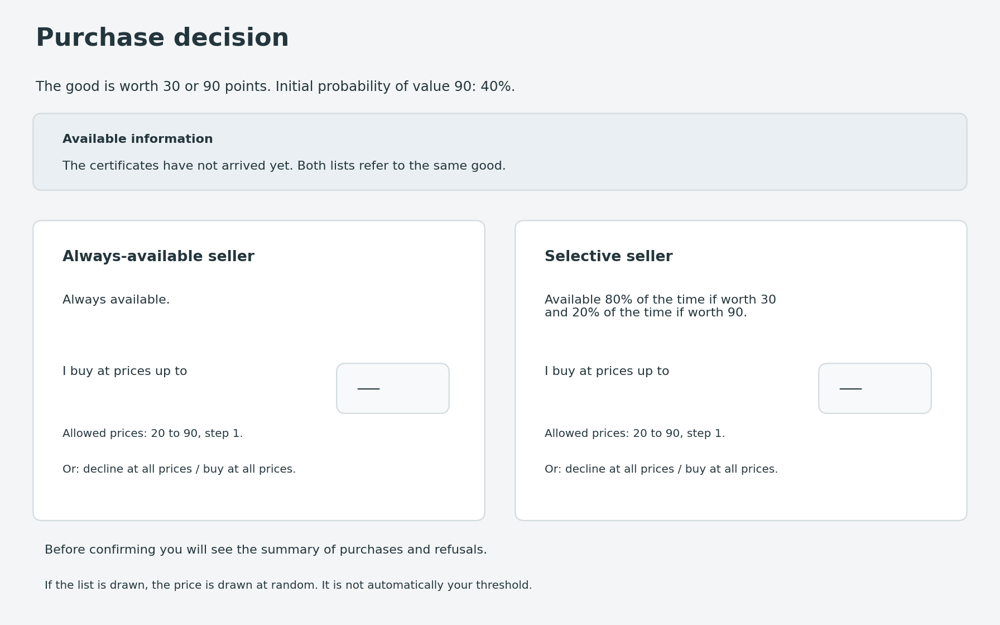
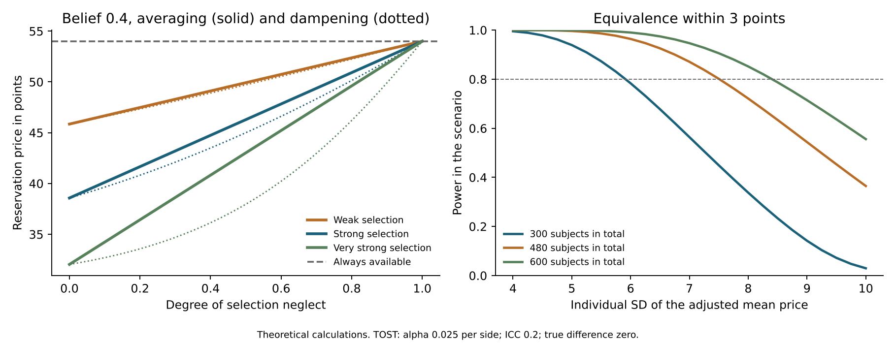

# Design decision

The core of the experiment is a pair of purchase decisions. One seller is always available. Another is available more often when the good is worth little. Comparing the reservation prices separates a valuation of the good from a valuation of the selection. Two certificates, 60 and 70 percent accurate, leave enough residual information to observe both. No probability distributions are elicited and no scoring rule is used.

The main question is whether the gap between the two prices is smaller than the gap implied by the selection, once the individual valuation of the good is taken into account. The second question is whether asking for intermediate decisions changes the final price. A third question, examined only if the first has a positive answer, is which of two descriptions of the neglect fits the prices better. The dynamic bridge of the preprint stays outside the confirmatory part.

Three protocols are assigned at the level of the pair. F collects only final decisions. S adds one intermediate measurement, drawn between two moments. R collects both. The last intermediate measurement ends before the second certificate and thirty seconds before the final decision opens.

The planning sample is 300 persons, 50 pairs per protocol, with a separate pilot of 36. The final number follows a power rule declared below. Three hundred persons are not automatically enough for equivalence within three points.

Four features of the measurement are stated at once. The price grid has step one and is treated as an interval measurement. Its position varies at random to measure the attraction toward its center. An inactive slot keeps a reserve lottery instead of raising the weight of the final decision. Trials in which each price is stated alone, by the two members of a pair on the same evidence, separate the neglect from the tendency to keep two prices stated together close to each other.

The defensible thesis is precise. An additional decision can inform about a mechanism that the final action hides, but its contribution depends on the technology used to measure it. Theoretical identities, restrictions on the measurement model and causal effects of the protocols are distinct objects.

This dossier contains a designed experiment. The numbers in its tables are theoretical calculations, diagnostics on a benchmark, power scenarios or simulations of the analysis procedure. No human data have been collected, no pilot has been run and the Schrödinger-Bass bridge has not been estimated.

The explanatory note in `documents/Same_Choices_Explanatory_Note.pdf` presents the same design to a reader of experimental economics, with one numerical example that runs through the text. This protocol is the complete source for the operational details, and the extracts of the dossier are generated from it.

# 1 Motivation and relation to the course

The apparatus starts from a recognizable economic problem, selection in the purchase of a good of uncertain quality. The link with the work of Di Cagno, Güth, Lohse, Marazzi and Spadoni (2024) is the acquisition environment with asymmetric information. Here the seller's rule is programmed and declared, as in Charness and Levin (2009). This removes unobserved strategic intentions and makes the benchmark computable. The price of this simplification is that the design studies selection neglect directly, not the whole strategic relation with a human seller.

The availability of the selective seller does not depend on the price. The selection is therefore given to the buyer, as in the settings of Esponda and Vespa (2014) and of Enke (2020), where the informative event does not respond to the subject's choice. In the acquiring-a-company problem, with a human or a programmed seller, the buyer's own offer also decides which goods she obtains. The design leaves that further step aside in order to isolate the inference from the sale.

The link with the course materials lies in the sequence from economic question to controlled variation, incentivized decision and empirical comparison. The reference to the materials on beliefs and risk is substantive, because the design reads beliefs from choices and pays through a lottery. No personal preferences are attributed to the evaluators. The presentation should let them check the mechanism without first having to accept the whole preprint.

The preprint asks, in its Section 10.3, its Section 12.4 and its conclusions, for an experiment with randomized report timing, a passive arm and repeated reports at unchanged information from which response noise can be estimated, and the present design implements that request, since protocol F is the passive arm, protocol R the active arm with two intermediate measurements, protocol S the intermediate treatment with a single measurement per trial, while the lists with an announced value estimate the noise at unchanged information and the second hypothesis tests the systematic elicitation effect formalized in equation (94) of the preprint. The dossier implements the measurement theory of Sections 9 and 10, while the three-game battery of Section 12 remains a distinct experimental venue, and the selective seller carries the state-action association studied in that battery into the form of a purchase decision with reservation prices.

Danz, Vesterlund and Wilson (2022) document systematic deviations toward the center under a binarized scoring rule and a decline in truthfulness when more information about incentives is provided. This is a relevant reason to use no scoring rule, no optimization calculator and no example of a uniform answer. Their result does not show that every price measure is free of distortion. That second claim would be an unjustified leap.

The design keeps a binary monetary prize. Using a lottery to pay a purchase decision does not mean scoring a stated probability. The distinction is substantive, even though comprehension of compound lotteries remains an assumption to be checked.

# 2 Choice of the certificates

Certificates that are too accurate leave little to measure, because a buyer who becomes almost certain of the value states nearly the same price for every seller. The table compares certificates of 70 and 85 percent with those adopted. The comparison uses eight binary purchases at prices 45 and 65, with priors 0.4 and 0.6 and two repetitions, and enumerates the four certificate pairs.

| Quantity | Certificates 70% and 85% | Certificates 60% and 70% |
|:--|--:|--:|
| Final choices discriminating rational from fully cursed over eight trials | 1.05 | 3.40 |
| Probability reports equivalent to posterior 0.5 over eight trials | 4.4755 | 6.2225 |
| Minimum and maximum final posterior | 0.048 and 0.952 | 0.160 and 0.840 |

The second row averages over three measurement moments and over the random order of the certificates. It does not concern only the final reports. Assuming independent and homoskedastic errors across cells, the information ratio is 1.3904 and the ratio of standard errors is 0.8481. These are 39.0 percent more information and 15.2 percent smaller standard error, within that measurement technology. They are not a power forecast for the price lists.

# 3 Observed objects and levels of evidence

The value of the good is 30 or 90 points. Let $\pi$ denote the probability of the high value given the available information. The reservation price for the always-available seller is $U$. The one for the selective seller is $S$. Availability of the selective seller is the event $J=1$. The explanatory note calls the two sellers Seller 1 and Seller 2 and calls this event the sale.

| Level | What is claimed |
|:--|:--|
| Design identity | Bayes, payments, optimal prices and properties of the mechanism under explicit assumptions |
| Behavioral evidence | Prices, revisions and differences between protocols, defined even without estimating the bridge |
| Structural interpretation | Degree of selection neglect, pull and rule weight, conditional on the measurement model |
| Dynamics of the preprint | Restrictions on the latent process and comparison between path models |

The degree of selection neglect recovered from the price restriction is written $\chi$, a number that is zero for a buyer who draws the correct inference from the sale and one for a buyer who ignores it. It is an effective quantity. In the static benchmark with a correct posterior it equals the parameter of the preprint. If the posterior is subjective, the same equality requires applying the transformation to the subjective joint law built from that posterior and from the announced conditional probabilities. This is a declared measurement extension. In the dynamic model, moreover, the perceived process moves toward a transformed target and need not equal that target at every instant. A ratio of prices does not automatically identify the drift parameter.

The precision of choices in the urns and in the price lists is first estimated separately. A common precision has meaning only after the payoffs and the corresponding observation kernel have been specified and normalized. Equality of these parameters is a restriction to be tested.

The programs and the data files keep shorter names for some of these objects, listed here once.

| Name in this protocol and in the explanatory note | Name in the programs and data files |
|:--|:--|
| Degree of selection neglect | contraction, chi |
| Attraction toward the center of the list | anchoring, shrinkage |
| Pair of participants | dyad |
| Lists with an announced value | price calibration, known value |
| Availability of the selective seller, the sale | availability |

# 4 The purchase task

## 4.1 Trial generation

Each trial has an announced prior of 0.4 or 0.6 on the value 90. The value is drawn and two certificates are generated, conditionally independent given the value. The weak certificate reports the correct value in 60 percent of cases. The strong one does so in 70 percent. Accuracies are symmetric between low and high value, always visible, and the order is random.

Each pair of lists refers to the same good and the same information. The seller's availability is generated by the announced rule and does not depend on the price, on the answer or on the moment drawn for payment. The two sellers are not put in competition with each other. At the end only one list and one row can be implemented.

| Seller type | Available if value 30 | Available if value 90 |
|:--|--:|--:|
| Always available | 1 | 1 |
| Weak selection | 0.65 | 0.35 |
| Strong selection | 0.80 | 0.20 |
| Very strong selection | 0.95 | 0.05 |
| Independent placebo | 0.50 | 0.50 |

The 22 purchase trials comprise twelve joint trials, six single-seller trials, two independent placebos and two revelation trials. The joint trials are the product of two priors, three intensities and two repetitions. Each presents the always-available seller and one selective seller, and the order of the two lists is balanced within person. The placebo and the revelation trials are one for each prior, and the revelation trials use the strong rule.

The single-seller trials cross the two priors with the three intensities once. In each of them the two members of a pair see the same good, the same prior and the same certificates. One states a price only for the always-available seller and the other only for the selective seller. Roles alternate, so that each participant prices each seller alone three times. The members of a pair never interact and never see each other's answers. The pair is a unit of shared evidence and of randomization and involves no strategic relation. Section 6.1 explains what these trials identify.

In the two revelation trials the realized availability is shown after the second certificate and before the final list. The sample is not artificially conditioned on $J=1$. If the seller is not available, its list is disabled and no non-existent threshold is interpreted. The test on the conditional selective price uses only the available cases, with a random number of observations. The software and the analysis plan keep track of this known selection.

A shorter variant keeps only the strong and the very strong intensity. It has eight joint trials, four single-seller trials, two placebos and two revelation trials, sixteen in all. It is adopted if the pilot calls for longer windows, by the rule of Section 8. The file `design_data/template_X.csv` lists the trials of both forms.

## 4.2 The price decision

The interface asks at which prices the participant would buy. The participant types a threshold in a field that shows the range of allowed prices. The threshold fills a monotone list, buying up to it and declining above it. Before confirmation the summary shows both regions. There is no preselected value and no slider initialized at the center. The choices of declining at all prices or buying at all prices are also available.

The grid has a step of one point. In half of the trials it runs from 20 to 90, in the other half from 30 to 100. Both have 71 rows and cover every economically possible price between 30 and 90. The numerical center moves from 55 to 65. The assignment is balanced and random within person, independent of prior, selection and certificates. It stays the same across the moments of the same trial.

The interface lets the participant answer the list with a single threshold. This does not turn 71 rows into 71 independent observations. What is observed is a purchase policy, not a sequence of autonomous choices. Imposing monotonicity is consistent with the dominance of a lower price under identical conditions. It does, however, give up the possibility of using reversals within the list as an error indicator.

If the last accepted row is $k$ and the next one is declined, the latent price lies in the interval $[k,k+1]$, up to endpoint conventions that do not change the continuous analysis. Estimation uses the interval. The midpoint serves only for descriptive plots. Responses at the edges are censored, without extrapolating a point price. The equivalence test instead uses the observable index defined in Section 10.

A step of five would be too coarse for an individual ratio. For example, $U=54$ and $S=42.43$ correspond to a degree of 0.25 under strong selection. Observing only $U\in[50,55]$ and $S\in[40,45]$ is compatible with degrees roughly between 0.057 and 0.625, even without stochastic error.

{width=6.2in}

## 4.3 Benchmarks and the price identity

Let $a$ denote availability if the value is high and $b$ availability if it is low. The probability of availability is

$$A(\pi)=a\pi+b(1-\pi).$$

The unconditional price and the correctly conditioned price are

$$U(\pi)=30+60\pi,\qquad C_{a,b}(\pi)=30+60\frac{a\pi}{a\pi+b(1-\pi)}.$$

The price $U$ is the correct price for the always-available seller and $C_{a,b}$ the correct price for the selective one. The transformation of the preprint mixes the joint law with the product of its marginals, keeping the latter. Under this restriction the price of a buyer with degree of neglect $\chi$ is exactly

$$S(\pi,\chi)=C_{a,b}(\pi)+\chi\,[U(\pi)-C_{a,b}(\pi)].$$

If the first price measures the subjective posterior $\widetilde\pi=(U-30)/60$, and the conditional probabilities $a,b$ are represented correctly, the degree implied by the two prices is

$$\widehat\chi=\frac{S-C_{a,b}(\widetilde\pi)}{U-C_{a,b}(\widetilde\pi)}.$$

The conditional benchmark must be recomputed from the posterior implied by the first price. Inserting the objective posterior directly into the denominator would not remove the error on the posterior. The separation also requires that the two lists share the same marginal belief and the same valuation criterion.

The gap available to identify the degree is

$$D_{a,b}(\pi)=U(\pi)-C_{a,b}(\pi)=60\frac{(b-a)\pi(1-\pi)}{a\pi+b(1-\pi)}.$$

It is positive under negative selection and an interior posterior. The map from posterior and degree to the two prices has Jacobian determinant $60D_{a,b}(\pi)$, hence rank two in these cases. This is local identification in the static restriction. Empirical precision depends on the size of the gap and on measurement error.

| Example with posterior 0.4 | Correct price | Price with degree 0.25 | Price with degree 1 |
|:--|--:|--:|--:|
| Always available | 54.00 | 54.00 | 54.00 |
| Weak selection | 45.85 | 47.89 | 54.00 |
| Strong selection | 38.57 | 42.43 | 54.00 |
| Very strong selection | 32.03 | 37.53 | 54.00 |

The identity is verified in the code on the transformed joint law, not merely by substituting numbers into the same formula. The largest numerical error is below $3\times10^{-14}$.

The table follows one participant of protocol R through a trial with prior 0.4 and the strong rule, in which both certificates read low and the more accurate one arrives first. The stated thresholds are those of a hypothetical buyer and are not data.

| Seconds | Information on the screen | $\pi$ | $U$ | $C$ | Stated thresholds | $\widehat\chi$ |
|:--|:--|--:|--:|--:|:--|--:|
| 10 to 40 | Prior and rule of the selective seller | 0.40 | 54.00 | 38.57 | 54 and 43 | 0.29 |
| 60 to 90 | First certificate reads low | 0.22 | 43.33 | 34.00 | 43 and 37 | 0.34 |
| 120 to 150 | Second certificate reads low | 0.16 | 39.60 | 32.73 | 39 and 35 | 0.38 |

## 4.4 Testable restrictions

With a common parameter, the gaps $U-S$ are proportional to the respective $D_{a,b}(\widetilde\pi)$ with slope $1-\chi$. The common restriction is compared with distinct coefficients for the three intensities. The intensities are not simultaneous measures of the same mental state, because each trial presents one selective seller. Comparability requires stability of the coefficient and control of the different information histories.

In the independent placebo the theoretical gap is zero for every degree. No ratio with a zero denominator is computed. After revelation of $J=1$, the conditional value becomes the new expected value for both lists. The two prices must coincide at the correctly updated level, and the further distortion of the dependence has no room left in the static restriction. The event $J=0$ also informs the price for the always-available seller. Comparing behavior with these predictions checks the role of hypothetical selection, and it is not a complete test of every model of sequential cursedness.

Finally, the same final information produces the same Bayesian posterior under both orders of the certificates. The order comparison is therefore a path test. The design keeps this variation, while accepting that weaker certificates may reduce the differences between intermediate paths.

# 5 Alternative interpretations of the prices

Answers on a price list can be attracted by its center. Suppose a true price $P$ is expressed as $(1-z)P+zc$, where $c$ is the center of the list. With posterior 0.4 and $z=0.10$, a subject who incorporates the selection correctly produces apparent degrees of 0.102, 0.103 and 0.104 under weak, strong and very strong selection when the list is centered at 55, and of 0.122, 0.130 and 0.137 when it is centered at 65. The restriction across the intensities barely distinguishes this case from a common degree.

The protocol answers by combining a check on the same instrument with a variation in the main task. Eight final lists announce a certain value of 36, 48, 66 or 78 points, once for each grid. Each uses an always-available seller and one with announced availability of 20, 65, 35 or 80 percent for the four values respectively. The reservation price equals the announced value for both. Selection cannot create a different conditional value when the value is certain. These lists use the same interface and the same payment as the purchase trials.

The random ten-point difference between the grid centers is also used in the Bayesian problems themselves. In the simple attraction model, a ten-point shift of the center moves the price by $10z$. An attraction of 10 percent implies a difference of one point. This variation tests the transport of the calibration to the difficult task, instead of taking it for granted.

The grid variation keeps constant the number of rows and the probability of drawing each common price. The additional rows below 30 or above 90 are dominated in known directions and do not change the optimal reservation price. They do change the presentation and some outcomes of the overall lottery. A grid effect is interpreted as sensitivity to the measurement technology, without attributing it solely to a psychological mechanism.

No control excludes every possible difficulty-dependent distortion. Analyses are reported that multiply by 0.5, 1 and 2 the error and attraction components transported from the lists with an announced value. Inference on the degree of neglect must be accompanied by its sensitivity to these restrictions.

| Threat or alternative reading | Element of the design that addresses it |
|:--|:--|
| Attraction toward the center of the list | Two list formats, lists with an announced value |
| Insufficient adjustment between joint prices | Single-seller trials within pairs |
| Misreading of the certificates | Belief revealed by the price for the always-available seller |
| Dampening in place of averaging | Third intensity of selection |
| Weak incentives and understatement | Steeper prize rule, practice, understatement term |
| Insensitivity to the probability of the prize | Urn choices |
| A gap unrelated to the selection | Placebo trials |
| Neglect tied to hypothetical reasoning | Revelation trials |

# 6 Joint statements and the form of the neglect

## 6.1 The pull between two prices stated together

A participant who states two prices on the same screen may keep them close for reasons unrelated to the selection, for instance by anchoring the second on the first. Suppose that in a joint statement the price for the selective seller moves toward the price for the always-available seller by a share $\kappa$ of the distance between them. This share is called the pull. If the price stated alone leaves uncovered a share $s$ of the gap $D_{a,b}$, the price stated jointly leaves uncovered the share

$$s+\kappa\,(1-s).$$

Under the averaging rule of Section 4.3 the share $s$ is the degree $\chi$, so the joint trials alone identify only $\chi+\kappa(1-\chi)$, and a positive pull would be read as neglect. The identity holds for any price stated alone and is verified in the code for both rules of Section 6.2.

The single-seller trials separate the two. The pull cannot operate when the two prices are stated by different persons. The gap between partners in the single-seller trials reflects the neglect alone, and the gap within persons in the joint trials reflects neglect and pull together. Differences in beliefs between partners add noise to the first measure without biasing it, since roles are assigned at random. The estimation of Section 10.1 uses both kinds of trial and treats the pull as a parameter common to all participants.

## 6.2 Two descriptions of the neglect

The price of Section 4.3 follows from a buyer who averages two probabilities, the correct one after a sale, $\pi^{\mathrm{sale}}=a\pi/A(\pi)$, and the one she held before, with weights $1-\chi$ and $\chi$. A second description, in the tradition of Grether (1980), has the buyer treat the sale as weaker evidence than it is and average on the scale of the log-odds. Let $\pi_{\mathrm A}(\chi)$ and $\pi_{\mathrm D}(\chi)$ denote the two probabilities of the high value after a sale. Then

$$\pi_{\mathrm A}(\chi)=(1-\chi)\,\pi^{\mathrm{sale}}+\chi\,\pi,\qquad \log\frac{\pi_{\mathrm D}(\chi)}{1-\pi_{\mathrm D}(\chi)}=\log\frac{\pi}{1-\pi}+(1-\chi)\log\frac{a}{b}.$$

The first is called the averaging rule and the second the dampening rule. The reservation price is 30 plus 60 times the probability in both cases. The two rules coincide without neglect and with full neglect. In between they stay close under weak selection and part ways when the selection becomes extreme. The table gives the prices for the selective seller at posterior 0.4, and the last column gives the share of the gap that a buyer who follows the dampening rule leaves uncovered. Under the averaging rule that share is the degree itself at every intensity.

| Intensity | Degree | Averaging rule | Dampening rule | Uncovered share under dampening |
|:--|--:|--:|--:|--:|
| Weak | 0.25 | 47.89 | 47.72 | 0.23 |
| Weak | 0.50 | 49.92 | 49.71 | 0.47 |
| Strong | 0.25 | 42.43 | 41.44 | 0.19 |
| Strong | 0.50 | 46.29 | 45.00 | 0.42 |
| Very strong | 0.25 | 37.53 | 34.10 | 0.09 |
| Very strong | 0.50 | 43.02 | 37.96 | 0.27 |

This is the reason for the third intensity. The weak and the strong rule determine the degree of neglect, and the very strong rule discriminates between the two forms. At a degree of 0.5 the price exceeds the correct one by 4.1, 7.7 and 11.0 points under the averaging rule and by 3.9, 6.4 and 5.9 points under the dampening rule. Against a seller who never parted with a good worth 90 the excess would be 12 points under the first and zero under the second.

The analysis does not choose between the two descriptions in advance. A weight between zero and one, called the rule weight and common to all participants, connects them. The probability assigned to the high value after a sale is

$$\pi_{\mathrm A}(\chi)+\text{rule weight}\times\big[\pi_{\mathrm D}(\chi)-\pi_{\mathrm A}(\chi)\big].$$

The first hypothesis is tested with the rule weight at zero. The simplification is exact when no participant neglects the selection, because the two rules then coincide. It is not exact when individual degrees are dispersed around zero. Under the dampening rule a degree of 0.15 raises the price by 1.6 points and a degree of -0.15 lowers it by 1.4, at posterior 0.4 and under strong selection. With a standard deviation of 0.15 across participants and a mean of zero, prices generated by the dampening rule would be read by the averaging rule as a mean degree of about 0.009. The simulation plan of Section 12.4 includes this case.

The dampening rule keeps the probability between zero and one for every degree. The averaging formula does not, and under very strong selection at posterior 0.4 it gives a negative probability for degrees below -0.09. The statistical model allows such degrees, because individual degrees are normally distributed around their mean.

The two rules are two solutions of one problem. A buyer looks for a single belief as close as possible to the correct one, with weight $1-\chi$, and to the one that ignores the sale, with weight $\chi$. The distance is relative entropy, and the two rules correspond to the two orders of its arguments. The preprint adopts the averaging rule on the joint law of value and sale and proves that the buyer then receives at most a share $1-\chi$ of the information that the sale carries. In the example with strong selection, posterior 0.4 and degree 0.25, the share is 55 percent. The counterpart on the scale of the log-odds is the normalized geometric mean of the joint law and of the product of its marginals, whose belief after a sale is the dampening rule. Appendix B of the explanatory note develops the comparison.

# 7 Urn choices

Sixteen decisions compare two urns with one hundred tokens and visible counts. The winning token gives the same prize as the rest of the experiment. The differences in winning probability range from one to sixteen percentage points, once per difference. The better side is balanced and the baseline probabilities vary. The design duration is three minutes, to be verified in the pilot.

The benchmark is the choice of the urn with more winning tokens. A response curve to the probability difference is estimated, with a possible lapse, pooled or hierarchical. Sixteen answers do not justify a precise individual estimate of several free parameters.

The urns have two uses. They check the premise of the prize rule, that a participant prefers the higher probability of the same prize even when the difference is small. They also give the frequency of inattentive answers when the correct choice is transparent.

The slope of the response curve is not automatically an upper bound on the noise in the purchase task. The task may be easier, the perception of probabilities may change, and the number of alternatives is not the same. It is a reference on objective choices. Equality of precisions is tested after an explicit normalization, also comparing models with separate precisions.

The eight lists with an announced value of Section 5 instead anchor the error and the sensitivity to the center within the same price instrument. They are necessary because good performance with the urns does not exclude a distortion specific to purchase thresholds.

# 8 Protocols and timing

Randomization is at the level of the pair and blocked by session. Both members receive F, S or R. Pairs are formed after the quiz, among the participants admitted to the trials (Section 13).

| Protocol | First intermediate moment | Second intermediate moment | Final decision |
|:--|:--|:--|:--|
| F | No measurement | No measurement | Always |
| S | One of the two moments, balanced | One of the two moments, balanced | Always |
| R | Measurement | Measurement | Always |

In S a single moment is drawn per trial. Of the twelve joint trials, six are assigned to the first moment and six to the second, balancing prior and intensity. The six single-seller trials are divided in the same way. In inactive windows the information and the time remain available. No distraction task is introduced, since it would further change the treatment.

| Event in a purchase trial | Seconds from the start of the trial |
|:--|--:|
| Reading of prior and seller rule | 0 to 10 |
| First possible request | 10 to 40 |
| First certificate | 50 |
| Second possible request | 60 to 90 |
| Second certificate | 105 |
| Availability revealed, only in the revelation trials | 110 |
| Final decision for everyone | 120 to 150 |

The pause between the close of the last measurement and the opening of the final decision is thirty seconds and includes a new certificate. No window is extended for one protocol only. Every technical extension is logged and, if needed for a session, applied to everyone.

The length of the windows is fixed by the pilot. The windows must not bind, because the first hypothesis is tested on answers given within them. Time pressure favors heuristics that ignore part of the available information, in the evidence surveyed by Spiliopoulos and Ortmann (2018). A tight deadline could therefore produce the very neglect that the experiment measures. Henckel, Menzies, Moffatt and Zizzo (2022) chose by piloting a limit of 60 seconds for a single typed probability, so that it would not bind subjects focused on the task. The same approach is followed here. The pilot is run with windows of 45 seconds. If 95 percent of its answers to the intermediate requests arrive within 30 seconds, the experiment keeps the calendar above. Otherwise it adopts windows of 45 seconds together with the shorter variant of Section 4.1.

| Calendar | Trial | Purchase trials | Purchase task | Wait before the final decision in F |
|:--|--:|--:|--:|--:|
| Windows of 30 seconds | 150 seconds | 22 | 55 minutes | 120 seconds per trial, 44 minutes in all |
| Windows of 45 seconds | 195 seconds | 16 | 52 minutes | 150 seconds per trial, 40 minutes in all |

With windows of 45 seconds, 22 trials would take more than 70 minutes and the session about two hours. This is why the longer windows come with the shorter variant, and why the pilot itself is run on it. Little is lost with the weak intensity. The information that a trial carries on the degree of neglect grows with the square of the gap between the benchmark prices, and the trials of weak intensity account for 6 percent of the total at the intermediate requests. Every second added to the windows is a second of waiting in protocol F, which is the cost of the rule.

The purchase trials come first. The lists with an announced value and the urns follow, before results and payment. Possible fatigue in these controls is recorded and modeled by protocol.

The expected duration is about 96 to 106 minutes, with an announced organizational limit of two hours. The 22 purchase trials take 55 minutes. The lists with an announced value and the urns take about ten minutes. Instructions, quiz, practice, break and payment complete the session. With the longer windows and the shorter variant the expected duration is about 93 to 103 minutes. These are design durations, not observed times.

# 9 Payment

## 9.1 Drawing the decision and the prize

Each participant receives 8 euros fixed and can receive a single additional prize of 16 euros. The drawing procedure is published before the session. A category is selected, then a trial, the seller where relevant, and a row. The decision so selected determines the outcome of the prize. The other tasks produce no further payments. The final draw of the prize, where present, is distinct from the selection of the decision and creates no multiple payments.

| Category | Drawing probability |
|:--|--:|
| Final decision of a purchase trial | 48% |
| First intermediate window | 13% |
| Second intermediate window | 13% |
| Lists with an announced value | 16% |
| Urns | 10% |

The probabilities sum to one and are equal across the three protocols. Within a category the trial is drawn uniformly. In the pairs of lists the sellers have probability 1/2 each, in the single-seller trials the list is the one the participant answered, and each price of the grid has probability 1/71. The probabilities do not depend on how many decisions a protocol collects.

## 9.2 Purchases and risk

The purchase gain in points is $J(V-P)$, where $V$ is the value of the good and $P$ the drawn price. If the participant declines or the seller is not available, it is zero. The probability of the prize is

$$\Pr(\text{prize})=0.5+\frac{J(V-P)}{140}$$

for a purchase row, and 0.5 for a refusal. With the two grids and the values 30 and 90, the probabilities span exactly the interval from zero to one, so the conversion is the steepest linear one available. The lists with an announced value use the same scheme. A completed decision can therefore preserve the baseline lottery by declining, and it can improve on it by choosing purchases with positive expected gain.

If the participant correctly reduces the compound lottery and prefers a higher probability of the same prize, maximizing the probability is equivalent to maximizing the expected gain in points. The optimal prices are then the expected values given in Section 4, without imposing linear utility in euros.

If instead the monetary outcomes of the purchase were paid directly, risk aversion could shift the reservation price. The first list would no longer measure the posterior on its own. The conversion into prize probability is therefore part of the identification, not an accounting detail. Reduction of lotteries and source neutrality remain behavioral assumptions that the algebra does not guarantee.

The design does not test the reduction of compound lotteries. Its failure would distort the belief read from the first price far more than the degree of neglect computed from it. With constant absolute risk aversion, a buyer without neglect who values at 55 points a good worth 30 or 90 with equal chances would state 49.40 and 36.45 at posterior 0.4 under strong selection, against benchmarks of 54.00 and 38.57. Her first price would reveal a belief of 0.32, the correct inference at that belief would give 36.40, and the implied degree would be 0.004. To a first approximation a risk premium multiplies the odds read from the first price by a constant, as the sale does, and the two operations can be exchanged. The apparent degree stays below 0.01 at every information state and intensity of the design for this buyer, and below 0.05 for one who values the same good at 50 points. The lists with an announced value check the instrument where no assumption on risk is needed.

## 9.3 Inactive slots and missing answers

A slot not foreseen by the protocol assigns a reserve lottery with probability 0.5. The alternative of paying the final decision in its place is not adopted. With the shares of Section 9.1, redirecting the inactive windows to the final decision would give it a weight of 74 percent in F, 61 percent in S and 48 percent in R. The comparison of F with R would mix measurement with a final incentive about one and a half times as large.

The reserve has an operational benchmark. It is equivalent to declining all purchases. An optimal policy can do at least as well. The empty slot does not dominate informative answers, as a reserve above 50 percent could.

A timeout on a question that is actually foreseen gives probability zero if that question is drawn. A documented technical failure gives the reserve, without penalizing the participant. A missing answer is not confused with random assignment to an inactive slot.

This scheme keeps the marginal incentives of the common decisions equal. It does not make the total expected earnings of the protocols identical, because additional measurements offer further occasions to improve on the reserve. A perfect neutralization of every income effect or perception of compensation is not claimed.

The instructions explain purchase, refusal, drawing and prize operationally. The optimization calculator is omitted and no uniform answer is shown as a fallback strategy. The complete formulas remain available to everyone in the same way, and their opening and consultation time are recorded. The quiz uses examples of dominance and availability, without suggesting the behavior under test.

## 9.4 Incentives near the optimum

The mechanism of Becker, DeGroot and Marschak (1964) makes the true reservation price optimal and punishes small departures from it very lightly, the flat maximum that Harrison (1989) pointed out for laboratory auctions. A threshold that exceeds a whole reservation price by $d$ points costs $d(d+1)/142$ points in expectation when the list is paid, since the draw is uniform over the 71 prices. One that falls short of it by $d$ points costs $d(d-1)/142$. For $d=5$ the loss is 0.21 points, that is, 0.15 percentage points of the probability of the prize and about 2.4 euro cents. With incentives of this size, systematic habits such as a cautious understatement of every price can survive.

The design does not remove the problem. It responds with the steepest linear conversion of Section 9.2. Before the paid part the participants complete unpaid practice lists after which the drawn price and the outcome are shown, a precaution suggested by the evidence of Cason and Plott (2014) that the mechanism is frequently mistaken for one in which the stated price is the price paid. The lists with an announced value measure for each participant the average distance between the stated threshold and the correct one. The model treats it as an individual tendency to understate or overstate, separate from the neglect.

# 10 Hypotheses and preregistered analysis

## 10.1 First hypothesis

The first hypothesis is a positive mean degree of selection neglect in protocol S. It uses the first and only intermediate measurement foreseen in each trial, in the twelve joint trials and in the six single-seller trials together, so that the pull of Section 6.1 is estimated and removed. The prices of a list and the two persons of a pair are not aggregated as independent observations. The estimand is the cross-person mean of the coefficient $\chi_i$ in the static restriction of Section 4, with the rule weight of Section 6.2 at zero.

A noisy price is not divided directly by another noisy price to then compute a t test. The ratio is nonlinear and carries error in the variable used to build the benchmark. The primary plan uses an interval-censored likelihood, based jointly on the two thresholds. Calibration and grid effects enter the estimation and are re-estimated in every inferential replication.

The minimal specification is declared before the pilot. The logit of the subjective posterior is a combination of the logit of the prior and of the log likelihood ratios of the certificates already seen, with weights to be estimated and an individual intercept, as in the regressions of Grether (1980). A certificate not yet observed contributes zero. The two latent economic prices are $U=30+60\widetilde\pi$ and $S=C(\widetilde\pi)+\chi_iD(\widetilde\pi)$. In a joint trial the second moves toward the first by the pull, $S+\kappa(U-S)$, and in a single-seller trial it does not. The individual intercept and $\chi_i$ are jointly normal with free correlation.

The stated thresholds have mean $(1-z)P+zc-u_i$, where $P$ is the latent economic price, $c$ the center of the grid and $u_i$ the individual understatement of Section 9.4. A zero-mean bivariate normal error is added for the pair of lists, with a component common to the two lists of the same trial. The coefficient $z$ in the Bayesian problems is estimated from the grid randomization, and the one in the lists with an announced value is estimated separately. The error scales can differ between sellers. The main specification transports the error component and the understatement of the lists with an announced value, while the sensitivity analyses vary their scale and allow an additional task-specific component.

The contribution to the likelihood is the probability of the rectangle defined by the two observed intervals, integrated over the individual effects. In a single-seller trial the rectangle reduces to one interval. The test on the mean of $\chi_i$ is one-sided. The estimate of the coefficient is left free even outside the interval from zero to one. Such values are not truncated and are not interpreted as a valid cursed distribution. They serve to detect overreaction, inconsistency or inadequacy of the restriction.

The primary test is the one-sided likelihood-ratio test of a zero mean of $\chi_i$ against a positive mean. The hypothesis is supported when the estimated mean is positive and the likelihood-ratio statistic exceeds a critical value calibrated by parametric bootstrap under the null. Data are generated from the declared model at the restricted estimates of all nuisance parameters, with zero mean degree, and both models are re-estimated on each of 999 bootstrap samples. The critical value is the smallest value at which the share of samples with a positive estimate and a statistic above it does not exceed 0.025. Calibration parameters are re-estimated in every bootstrap sample and are not treated as known. The simulation of Section 12.4 motivates this choice: at this sample size the chi-square threshold is mildly liberal, while the calibrated threshold has a verified level.

The studentized bootstrap over pairs, blocked by session, with 1,999 replications, is reported as a robustness check. A one-sided 97.5 percent lower bound above zero supports the hypothesis without relying on the parametric form of the measurement model. Two rules are declared in advance. First, the parametric calibration is valid only if the measurement model fits, and two checks decide this before the primary result is read: a goodness-of-fit test of the joint distribution of the observed interval pairs across trial cells, calibrated by 199 parametric bootstrap samples from the unrestricted fit, and the independent placebo, whose mean gap $U-S$ must be zero for any degree. If either check rejects at the 5 percent level, the bootstrap over pairs becomes the primary procedure. Second, if the checks pass and the two procedures disagree, the calibrated test decides and the disagreement is reported with both results.

The mandatory checks also include a model with different coefficients for the three intensities, sensitivity of the posterior to individual slopes and to more flexible specifications of the inputs, transport of error and attraction by factors 0.5, 1 and 2, and a logit kernel on complete purchase policies. The last one computes the value of each policy through the actual random draw of the row. It does not treat the rows filled by a single threshold as independent logits.

The test is run under the averaging rule. If the simulation of Section 12.4 shows that its level fails when neglect and overreaction cancel on average while prices follow the dampening rule, the critical value is calibrated under the less favorable of the two rules.

This procedure does not provide identification independent of the measurement model. If the sign depends on the specification of the posterior or on the transported error, the conclusion is that the neglect is not robustly separated from those alternatives. The algebraic ratio remains useful to explain the mechanism, but it does not replace this check.

## 10.2 Second hypothesis

The second hypothesis is the equivalence between F and R of the final price for the selective seller in the twelve joint trials, with a margin of three points. The margin concerns an observable outcome of the task, not a bound on every individual difference or on the parameter $\chi$.

To avoid imputing the latent price, the policy index on the common grid is defined as

$$P^{\mathrm{obs}}=30+\sum_{p=31}^{90}\mathbf{1}\{\text{purchase at price }p\}.$$

For a monotone list interior to the economic range, it equals the highest accepted price. It is defined also for policies that decline or accept all prices and uses exactly the same sixty decisions in the two formats. It deliberately discards information on answers outside the range 30 to 90, which is kept in the diagnostics and in the likelihood of H1.

For each person $P^{\mathrm{obs}}-C_{a,b}(\pi)$ is averaged over the twelve joint trials, using the objective final posterior for the adjustment. Subtracting the known benchmark removes part of the mechanical variation of the information histories without conditioning on a variable produced by the treatment. The effect of interest is the mean difference F minus R in this statistic, with equal weights for priors and intensities.

The main analysis compares the means of pairs with session fixed effects. The TOST uses alpha 0.025 on each side, so it requires the two-sided 95 percent interval to lie entirely within $[-3,3]$. Together with the level 0.025 of the first hypothesis, this choice conservatively controls the family of the two primary claims at 5 percent.

Three points are 5 percent of the distance between the values 30 and 90 and about a fifth of the gap between the benchmark prices averaged over the joint trials, 15.9 points. The margin is wide for a small neglect. A mean degree of 0.15 raises the same outcome by 2.4 points, less than the margin. With 100 persons per protocol a margin of two points would be sustained only if the individual standard deviation of the outcome did not exceed 3.9 points, in place of 5.9 (Section 12.2). The margin of three points is kept, and its adequacy is one of the points on which the judgment of an experimentalist is sought.

The result is average equivalence of the protocols in the task and under the incentives adopted. It is not proof that measuring is harmless in every condition. The three intensities, the two priors, the price for the always-available seller and the dispersion of the effects are shown separately. An interval that crosses the margin is inconclusive about equivalence, even if the difference from zero is not significant.

## 10.3 Third hypothesis and the rule weight

The third hypothesis concerns the form of the neglect and is examined only if the first is rejected, since the form matters only when the neglect is present. It asks whether the share of the gap that buyers fail to cover stays the same when the selection becomes stronger or shrinks. In the statistical model the two rules of Section 6.2 are connected by the rule weight, common to all participants. The null hypothesis is a weight of zero, that is, the averaging rule, against the alternative that the dampening rule has positive weight. The test is a likelihood-ratio test at 5 percent with a critical value calibrated by simulation, on all the intensities.

Whether this question is a preregistered hypothesis or an estimate reported with its confidence interval is decided by a rule fixed in advance. It becomes a hypothesis only if the simulation shows a power of at least 80 percent to reject the averaging rule when the dampening rule is true and the mean degree is 0.25, the weight being estimated in either case. The analysis with the rule weight is the one the authors intend to implement, if the time limits of the course project allow. The analysis with the averaging rule alone is the fallback.

## 10.4 Secondary analyses

The secondary analyses comprise the independence, revelation and announced-value placebos, order effects, the comparison of S with F and R, the persistence of the coefficients between the first measurement and the final one, sensitivity to the grid center, and the urn choices. When the question of Section 10.3 is reported as an estimate, the rule weight joins this family. Estimates and intervals are reported, with a false discovery rate control separate and declared for this family. None of these results can retroactively replace a failed primary.

Two comparisons do not depend on the model. In the first, for each pair, the mean gap between partners in the single-seller trials is set against the mean gap within persons in the joint trials. A positive difference on average indicates that stating the prices together compresses them. The second bears on the neglect itself. In the single-seller trials the price that one partner states for the selective seller is set against the correct price at the belief revealed by the price that the other states for the always-available seller. Both prices are first corrected for the attraction measured by the two formats and for the understatement measured on the lists with an announced value. The correction subtracts from each price the attraction times the center of its list and the average understatement, and divides by one minus the attraction. The attraction is one tenth of the mean difference, net of the benchmark, between the prices of the two formats. A positive mean difference across pairs indicates neglect without the model of beliefs and of errors on which the likelihood rests.

The correction is necessary. In a preliminary simulation of 1,000 samples of 50 pairs, with an attraction of 10 percent and no neglect, the uncorrected comparison rejects at the 2.5 percent level in 97 percent of the samples. With the correction it rejects in 3 percent, and it detects a mean degree of 0.15 in 93 percent. The program is `partner_comparison_check.py` and its results are in `design_data/partner_comparison_check.csv`. The simulation of Section 12.4 will have to confirm these figures and calibrate the critical value.

The predictive comparison on the paths in R is kept as exploratory. Model E uses public information, T adds the last intermediate price pair, P adds both ordered pairs, and U uses the two pairs without time labels. All have access to the final public information. None receives a final price as a regressor to predict the final selective price of the same trial.

Validation is outside the training sample, with five groups of pairs and internal selection of hyperparameters. The score is the log probability of the observed interval or choice category. The gain per decision and its distribution by pair are reported. The threshold of interest of 0.01 nats remains an exploratory convention, without certified power.

## 10.5 Diagnostics before interpreting parameters

For every structural specification the report includes parameter recovery on simulated data, coverage of intervals, likelihood profiles, correlations between parameters, eigenvalues of the observed information and efficient information after the nuisance parameters. Final choices alone and additional measurements are compared keeping the same unit of observation and the same payoff normalization.

A numerically full rank is not enough. A direction with a very large standard error is weakly informative, and the rule weight and the pull are the first candidates. A precise estimate under a wrong measurement model does not resolve substantive identification.

# 11 Dynamics

The benchmark for the always-available seller is $B_t=30+60\pi_t$. Under the announced information structure it is a martingale. This makes the economic scale of the Bayesian revisions observable and allows comparing it with the revisions of the thresholds. Protocol R observes initial prices, prices after the first certificate and prices after the second.

The operational test compares the direction and size of the price revision with those of $B_t$. The order of the certificates is randomized. Inertia, over-revision and possible persistence of the initial deviation are analyzed, distinguishing them from the effect of the interface and from serial noise.

That the benchmark is a martingale does not imply that the collected prices are one. For example, if $Y_t=B_t+e_t$ with independent errors of variance $\sigma^2$, at a fixed prior and with two increments,

$$\mathbb E\!\left[(Y_1-Y_0)^2+(Y_2-Y_1)^2\right]=\operatorname{Var}(B_2)+4\sigma^2,$$

while $\operatorname{Var}(Y_2)=\operatorname{Var}(B_2)+\sigma^2$. Comparing the two quantities directly produces a gap of $3\sigma^2$ even when the benchmark is perfectly Bayesian. Heteroskedasticity, serial errors and censoring change the comparison further.

The test of the variation therefore uses the measurement model and is carried out within prior, avoiding mixing the initial variance of the priors 0.4 and 0.6 with the variance produced by the signals. It remains a martingale restriction, not an identification of the Bass lift. Moreover, the variation of the price of the good concerns a belief coordinate on the value, not directly the depth coordinate of the preprint.

A correlation between initial and final deviation is compatible with a stable trait, but also with attraction toward the center or serial error. The stability test reports these alternatives and does not automatically attribute persistence to the individual parameter alone.

# 12 Sample and pilot rule

## 12.1 Numbers and organization

The design base comprises 300 persons in 150 pairs, 50 pairs per protocol. Ten main sessions of thirty persons have five F pairs, five S pairs and five R pairs. The pilot comprises 36 persons in two sessions of eighteen, with three pairs per protocol in each session. The pilot does not enter the main analysis. Pairs are formed after the quiz, so the realized numbers can fall short of the base (Section 13).

The main sample is sized on the aggregated person and on the randomized pair, not on the number of prices, clicks or trials. The claim that a continuous measure is worth two or three times a binary outcome is not used to justify N. The gain depends on the distribution, noise, censoring and the effect of interest.

## 12.2 Equivalence scenarios

The table assumes 100 persons per protocol, within-pair correlation 0.2, normal means of pairs and equal variances, without additional session effects. It uses the actual joint probability of passing both TOST tests, integrating the uncertainty of the pooled variance. The standard deviation is that of the individual statistic, already averaged over trials and adjusted for the benchmark.

| Individual standard deviation | Power if the true difference is zero | Power if the true difference is one point |
|--:|--:|--:|
| 4 | 99.5% | 89.2% |
| 5 | 93.9% | 72.4% |
| 6 | 78.3% | 55.7% |
| 7 | 56.4% | 40.1% |
| 8 | 33.8% | 25.0% |
| 10 | 3.0% | 2.4% |

In the scenario with zero true difference, 80 percent is reached only for an individual standard deviation of about 5.92 points or less. With a margin of two points the same power would require 3.94 points or less. This condition makes the constraint on the sample of 300 transparent. The numerical file also includes 480 and 600 persons. The table is an analytic calculation on the individual statistic. A full simulation of the procedure with a structural generator is reported in Section 12.4 for the design with two intensities.

## 12.3 Criterion before freezing

The pilot checks comprehension, completion of the windows, censoring, sensitivity to the grid, differences in error between the lists with an announced value and the task, variability of the final mean and plausibility of the measurement specifications. It also fixes the length of the windows by the rule of Section 8. Comprehension interviews follow the decisions. The sign of the preliminary effect is not used to select the primary hypothesis.

The entire analysis procedure is then simulated, including pairs, sessions, signals, grids, errors, missing values and refitting. For H1 the grid of effects of interest includes a mean degree of 0.15 and 0.25, with heterogeneity, attraction and pull alternatives, under the two rules of Section 6.2. For H2 it includes true differences of zero and one point. The nuisance parameters use pilot estimates and conservative scenarios of dispersion and dependence.

The criterion requires at least 80 percent power for H1 at 0.15 with the pull estimated, and for H2 at zero difference, and at least 60 percent for H2 at a difference of one point. The simulations have at least 2,000 replications and the threshold is applied to the lower bound of the 95 percent Monte Carlo interval. Type-one error is also checked, including the scenarios with attraction or pull and without neglect. The design tolerance for a nominal 0.025 test is a rejection rate not above 0.035 at the upper bound of the Monte Carlo interval. If H1 fails the power criterion with the pull estimated, placebo and revelation trials are converted into single-seller trials and the simulation is repeated.

If N equal to 300 does not pass the criterion, increments of sixty persons up to 600 are considered, keeping balance across protocols and sessions. If even the maximum does not pass the criteria, the design is revised before the main data and the project is updated. The equivalence margin is not widened after seeing the data, and an incapable test is not presented as confirmatory.

The pilot has not been run. The full simulation at the design parameters has been run for the design as it stood before the single-seller trials and the third intensity were added, and is reported in Section 12.4. The simulation of the present design is in preparation under the plan stated there. At the pilot stage it is repeated with the nuisance parameters estimated from the pilot, and that run decides the final sample size.

## 12.4 Simulation of the analysis procedure

The certifying run described here concerns the design with two intensities and without single-seller trials. Its generator has eight joint trials per person, with the weak or the strong rule, no pull and no understatement. Its numbers do not carry over to the present design without a new run. By the identity of Section 6.1 that analysis would have attributed a positive pull to the neglect, which makes the single-seller trials a condition for the validity of the first test.

The program full_simulation.py generates data from the measurement model of that design and applies the entire procedure. Individual intercepts and individual degrees are bivariate normal. The logit of the subjective posterior combines the prior and the certificates seen so far with estimated weights. Stated thresholds load on the center of the price grid through an attraction coefficient, identified by the random assignment of the 20-90 and 30-100 formats. The error of each list has a factor common to the two lists of the same trial, with true correlation 0.30, and responses are censored to unit intervals and to the grid edges. In S the intermediate measurement falls at the prior or after the first certificate, balanced over priors and intensities.

For H1 the estimator is the interval-censored likelihood, integrated by Gauss-Hermite quadrature with seven nodes for each individual effect and five for the common error factor, and the test is the one-sided likelihood-ratio test. For H2 the generator adds pair and session effects, builds the observable index of Section 10.2, averages it by pair, and applies the session fixed-effects regression with the two one-sided tests. The pilot rule is simulated on 36 persons with the analytic power of Section 12.2. The bootstrap over pairs is computed on one example dataset, because repeating it inside every replication would require about four million likelihood maximizations.

The certifying run uses 2,000 replications for each scenario of H1 and H2, 2,000 simulated pilots and 1,999 bootstrap replications, with fixed seeds independent of the number of worker processes. It ran on eight processes of an Apple silicon laptop, about two hours per H1 scenario. A second complete execution of H1 with the same seeds reproduced every number exactly.

| H1 scenario, 100 persons in S | Asymptotic threshold 3.841 | Calibrated threshold 4.279 | Mean estimate |
|:--|--:|--:|--:|
| No neglect, no attraction | 3.20% | 2.50% | -0.003 |
| No neglect, attraction 0.10 | 3.20% | 2.25% | -0.003 |
| Degree 0.15, attraction 0.10 | 99.60% | 99.45% | 0.147 |
| Degree 0.25, attraction 0.10 | 100% | 100% | 0.248 |
| Degree 0.15, list error 6 | 90.05% | 87.95% | 0.145 |

| H2 scenario, 300 persons | True difference zero | True difference one point | Implied individual SD | Correlation within pairs |
|:--|--:|--:|--:|--:|
| List error 4, pair effect 2 | 99.7% | 90.1% | 3.9 | 0.21 |
| List error 6, pair effect 3 | 95.9% | 76.4% | 4.6 | 0.32 |

The asymptotic test rejects a true null in 3.2 percent of replications, with Monte Carlo upper bound 0.040, above the tolerance of 0.035 of Section 12.3. The chi-square approximation is mildly liberal with ten nuisance parameters and 100 persons. The critical value is therefore calibrated by simulation: it is the value at which, among the null replications without attraction, the share of positive estimates with a likelihood-ratio statistic above it equals 2.5 percent, and it equals 4.279. Applied to the 2,000 independent null replications with attraction, which played no role in the calibration, the calibrated test rejects in 2.25 percent of cases with upper bound 0.029. Power at a degree of 0.15 falls only from 99.60 to 99.45 percent. With real data this calibration becomes the parametric bootstrap under the null that Section 10.1 declares as the primary test.

Estimates of the degree are centered, with absolute bias at most 0.006 and root mean squared error about 0.03, and the attraction coefficient is recovered at 0.10 in every scenario. The error correlation between the two lists is estimated between 0.07 and 0.13 against a true value of 0.30. It is weakly identified by eight trials per person and does not move the estimate of the degree. On the example dataset with true degree 0.15 the point estimate is 0.129, the likelihood-ratio statistic is 15.7, and the 2.5 percent lower bounds of the bootstrap over pairs are 0.061 in the basic version and 0.052 in the percentile version, both above zero.

The pilot rule selects 300 in all 2,000 simulated pilots, with mean realized power 0.997, because the individual standard deviation implied by the model stays below the threshold of 5.92 in both scenarios. The constraint on the sample binds only if the list error exceeds roughly eight points, which is the quantity the pilot estimates in the lists with an announced value. Every criterion of Section 12.3 is met with the calibrated critical value. The command `python3 full_simulation.py criteria` prints the full list, the per-replication values are in `design_data/replications_H1_*.csv`, and the calibration is in `design_data/calibrated_H1.csv`.

Two limits remain. The level of the bootstrap over pairs is not certified by this run, for the computational reason given above, which is why Section 10.1 uses it as a robustness check rather than as the primary test. The quadrature grid is fixed rather than adaptive. A second version of the program with an analytic gradient and adaptive quadrature in the sense of Pinheiro and Bates (1995) would reduce the run time by about an order of magnitude and would make a certification of the bootstrap feasible.

{width=6.2in}

The simulation of the present design is in preparation, with a plan and rules of reading fixed beforehand. Eight scenarios combine a mean degree of 0, 0.15 and 0.25 with a pull of 0 and 0.10 and with the two rules of Section 6.2, with an attraction toward the center of 10 percent, a noise of four points per list and an understatement of one point. The test of the first hypothesis must keep its size when the mean degree is zero and the pull is positive, and it must keep a power of at least 80 percent for a mean degree of 0.15 with the pull estimated. Its size must also hold when neglect and overreaction cancel on average while prices follow the dampening rule, the case in which testing under the averaging rule is not exact. The same run decides the status of the third hypothesis by the rule of Section 10.3, confirms the corrected comparison between partners of Section 10.4, and covers the shorter variant of Section 4.1.

# 13 Data and exclusions

The main sample comprises the assigned persons who pass comprehension before the main tasks. A second quiz attempt follows a standard explanation, identical for everyone. Those who fail the second attempt receive the fixed fee and do not start the trials. Pairs are formed among the participants admitted. When their number is odd, one of them, drawn at random by the computer, receives the fixed fee and does not take part. The rule is announced in the instructions. The number of exclusions and their reason are reported by session, without replacing persons on the basis of their economic answers.

An unusual choice, a threshold at the edges or a coefficient outside zero to one is not a reason for exclusion. Economic answers, timeouts and failures are kept apart. The protocol keeps the assigned persons in the description of the flows. The analysis of the observed data is accompanied by sensitivity to missing values. For equivalence, bounds are also computed using the extremes of the observable index, from 30 to 90. If missing values prevent supporting equivalence without strong assumptions, the conclusion is qualified.

The data are pseudonymous. The payment table with real identities is kept separate from the answers. No audio, video or eye-tracking recordings are collected. Times and changes of thresholds describe the interaction with the interface and are not treated as a direct measure of reasoning.

| Group of fields | Minimal content |
|:--|:--|
| Assignment | Person, pair, session, protocol and role in the single-seller trials |
| Purchase environment | Prior, drawn value, availability, intensity, accuracies, signals and order |
| Purchase measurement | Moment, grid, seller, last purchased row, interval, censoring and confirmation |
| Controls | Announced value, announced availability and urn composition |
| Operations | Start and end of windows, response times, timeouts, technical problems, consultation of details and quiz attempts |
| Payment | Category, trial, list, row, outcome and probability applied |
| Reproducibility | Instructions, configuration, random seeds and code fingerprint |

State and signals are generated before the answers. Availability stays the same across the time-ordered lists of the same trial. Payment draws are independent of the answers. The program records the sequence needed to reconstruct every benchmark and every payment.

# 14 Project budget

The amounts are theoretical maxima, not a forecast of the average payment. The rates for assistance and development are planning assumptions. Laboratory availability is assumed without an additional fee. The reserve also covers the fixed fee of those who fail the quiz and of the participant left out when the number admitted is odd.

| Item with 300 main participants | Calculation | Euros |
|:--|:--|--:|
| Main sample | 300 times 24 euros | 7,200 |
| Pilot | 36 times 24 euros | 864 |
| Reserve for thirty unused show-ups | 30 times 8 euros | 240 |
| Two assistants for twelve two-hour sessions | 48 hours at 20 euros | 960 |
| Software implementation and testing | 40 hours at 30 euros | 1,200 |
| Subtotal | | 10,464 |
| Organizational margin of 10% | | 1,046.40 |
| Project maximum | | 11,510.40 |

With 480 persons and eighteen sessions in total, the maximum under the same assumptions is 16,790.40 euros. With 600 and twenty-two sessions, it is 20,310.40 euros. The prize is not reduced retroactively to compensate for a larger sample. Any laboratory costs, local procedures or further development require an explicit item, not a hidden assumption of gratuity.

# 15 What is gained and what is lost

The main advantage is economic legibility. The first price gives a valuation of the good, the second a valuation of the selected good. Under the declared restriction, the difference separates marginal error from the treatment of selection. The controls are decisions of the same type, and the prediction has a scale in points.

What is lost is the four-cell joint law, and with it the direct check that both marginals are preserved. Announcing the selection in the instructions does not guarantee that its conditional probabilities are represented correctly. An error on them can resemble neglect. Quiz, placebo and revelation help, but they do not make the mechanism exclusive.

The selection is given to the buyer and does not respond to her price. The design measures the neglect of such a selection and says nothing about the further inference that a buyer must draw when her own offer decides whether the trade takes place. It also says nothing about behavior against a human seller, where beliefs about the intentions of the other party enter.

The urns do not provide a universal precision. The thresholds have censoring and error. The variation of the price is not the variation of cognitive depth. The equivalence margin of three points is wide relative to the effect of a small neglect. The binary lottery removes risk attitudes only under the reduction of compound lotteries, which the design does not test. The incentives near the optimum remain weak after the remedies of Section 9.4. These limits are declared before the results.

The strongest positive conclusion is therefore a degree of selection neglect robust to the specified controls, accompanied by an average equivalence of the protocols within an economically defined margin. Attribution to the parameter of the bridge requires a further structural step. The design makes this step transparent, without declaring it already taken.

# Appendix A Participant instructions

## A1 General rules

You will receive 8 euros for taking part and can obtain an additional prize of 16 euros. During the session you will make purchase decisions and choose between urns. At the end a single decision will be selected to determine the prize. The selection percentages of the different parts are given in the payment sheet. You cannot lose the 8 euros for taking part. The paid trials need an even number of participants, and if the number is odd the computer draws one participant, who does not take part and receives the 8 euros.

Work individually and do not communicate with other participants. The sellers are played by the computer, and the rule that each of them follows is stated on the screen. Except in the practice lists, you will not receive results of the trials before the end of the decisions.

You can ask for clarifications about the rules by raising your hand. Additional technical explanations are available in the same format for everyone. You can withdraw at any time. The consent form specifies the treatment of data and of the payment in case of withdrawal.

## A2 Purchases

The good in each trial can be worth 30 or 90 points. The screen shows the initial probability of the high value. You will receive two certificates, one correct in 60 percent of cases and one correct in 70 percent. Each can indicate a high or a low value. No certificate makes the value of the good certain. The order can change.

You will find two sellers of the same good. The first is always available. The availability of the second follows the rule shown on the screen, which can change from one trial to the next. If it is available, it accepts every price in the list, and if it is not, no purchase takes place. Availability does not change in response to your decisions. The two lists refer to alternative possibilities, and only one of them can be selected. Some trials show only one of the two sellers, and you decide for that one.

Indicate up to which price you would buy. The prices allowed are shown on the screen and can differ from one trial to the next. The summary shows all the prices at which you would buy and all those at which you would decline. Check it and confirm. You can also decline at all prices or accept them all. The threshold you indicate is not automatically the price you will pay. If the list is selected, the computer draws one of its prices, all equally likely, and applies your decision at that price.

If you buy and the seller is available, the result in points is the value of the good minus the drawn price. If you decline or the seller is not available, the result is zero. The result changes the probability of the prize. Zero points correspond to 50 percent, every 7 points gained add 5 percentage points and every 7 points lost subtract 5. No euros are charged as losses.

In some trials availability is shown before the last decision. If the seller is not available, its list is disabled. In other trials the value is certain and is stated clearly. The same drawing procedure applies in all trials.

## A3 Decision moments

Each trial lasts two and a half minutes and has a schedule. When a request appears, answer using the information available at that moment. A request stays open for thirty seconds, with the information visible. An earlier confirmation is not copied into the next one and no answer is preselected.

Your protocol may include no intermediate request, a single request or two. Everyone takes the final decision. During the pauses you can keep reading the information. Requests can differ between groups, according to a random assignment.

A foreseen decision not confirmed in time gives zero probability of the prize if it is drawn. A slot that was not part of your protocol instead uses a reserve lottery at 50 percent. A technical problem must be reported immediately and is handled separately.

## A4 Practice and urns

Before the paid trials you will complete some practice lists, which are marked as practice and are not paid. In these lists the value of the good is stated, and after each of them the screen shows the price drawn and the result, so that you can see how the procedure works.

The urn decisions show two urns with one hundred tokens each and the number of winning tokens in each. Choose one of the two urns, and if that decision is selected, a token is drawn from the chosen urn and you obtain the prize if it is a winning token.

# Appendix B Quiz and reserved script

The quiz precedes the main trials. It does not include the calculation of the posterior or of the selection, which are objects of measurement. It shows no examples of a correct price in the Bayesian problems. The following solutions are reserved for the experimenter.

| Comprehension question | Correct answer |
|:--|:--|
| If your threshold is 60 and the price 45 is drawn, which price determines the result if you buy? | 45 |
| If your threshold is 60 and the price 70 is drawn, what happens? | No purchase, zero points |
| If the seller is not available and you had chosen to buy, is there a loss? | No, the result is zero |
| Does the availability of the selective seller depend on your threshold? | No |
| If the good is worth 90 and you buy at 70, how many points do you get? | 20 |
| Does a certificate correct 70 percent of the time make the indicated value certain? | No |
| If one trial is selected, are the others paid as well? | No |
| With urns, for the same prize and total number of tokens, which offers the higher probability of winning? | The one with more winning tokens |

The experimenter reads the general rules, leaves time for the quiz and uses a standard explanation for errors. After a second attempt, those who still do not understand receive the participation fee and do not start the main tasks. When the number of those admitted is odd, the participant drawn by the computer also receives the fee and does not take part. Both rules are applied before observing economic decisions. Failure is not interpreted as an estimated cognitive level.

The practice consists of lists with a stated value, after each of which the drawn price and the result are shown. It serves to use the interface and the summary, not to show the solution of the selection. It is not paid and is marked as practice.

During the session the hypotheses of neglect or attraction are not explained. The instructions are not modified individually on the basis of apparently wrong choices. Requests for clarification and technical problems are recorded. At the end, retrospective comprehension questions are collected, the draw is applied and a verifiable payment summary is handed out.

The instructions use the values of the calendar with windows of 30 seconds. If the pilot selects the longer windows, the duration of a trial and of a request are updated before the main sessions. The instructions do not mention the pairs, because the pairing changes neither the information nor the earnings of those who take part.

The availability of the sellers actually follows the announced rule. No deceptive messages or invented results are foreseen.

# Appendix C Materials and reproducibility

The package contains the complete editable text, extracts of instructions and analysis plan, a revision log, four Python programs and their numerical results. The CSV files report the enumeration of posteriors, the benchmark prices, the trial templates, the two rules, the calendars, the power scenarios, the preliminary check of the comparison between partners and the full simulation of the analysis. The code uses Python, numpy, scipy and matplotlib.

design_checks.py reconstructs the comparisons between signals, verifies the identity on the transformed joint law and the identity of the pull, produces the counterexample of the attraction toward the center, the benchmark prices under the two rules, the calendars and the numbers quoted in Sections 6, 8, 9 and 10, and computes the TOST power in the declared scenario. partner_comparison_check.py simulates the comparison between partners of Section 10.4 with and without its correction. make_facsimile.py draws the illustrative task screen. full_simulation.py simulates the entire analysis procedure for the design with two intensities and joint trials only and calibrates the critical value of H1, as reported in Section 12.4. word_layout.py normalizes the layout of the Word version of this protocol. None of the programs produces results attributed to human participants.

A ready collection app, a completed pilot, the simulation of the present design and the estimation of the main model are not included. The operational software must apply the specification of this dossier and pass checks of payment, timing, randomization and recording before any execution. For the course submission, the product is the complete design with an explicit rule for freezing it.

# References

Pinna, F. (2026). *Dynamic Identification of Behavioral Reasoning in Finite Games*. SSRN Working Paper 7251718, version of August 8, 2026. [SSRN](https://papers.ssrn.com/sol3/papers.cfm?abstract_id=7251718). The transformation of the joint law in Section 4.2, with Propositions 4.2 and 4.3, the observation of processes in Theorem 9.1 and the efficient information in equation (77) and Section 13.1 motivate the project. The present dossier does not modify the proofs of the preprint.

Di Cagno, D., Güth, W., Lohse, T., Marazzi, F., and Spadoni, L. (2024). Who cares when value (mis)reporting may be found out? An acquiring-a-company experiment with value messages and information leaks. *Journal of Behavioral and Experimental Economics*, 108, 102151.

Teaching materials of the course Experimental and Behavioural Economics. *How to Design and Run an Economics Experiment*. *Eliciting beliefs*. *Eliciting risk and ambiguity*. *Deception*. *The Conditional Contribution experiment*. They are references for controlled variation, incentives, comprehension and consistency between measurement and hypothesis.

Becker, G. M., DeGroot, M. H., and Marschak, J. (1964). Measuring utility by a single-response sequential method. *Behavioral Science*, 9, 226-232.

Cason, T. N., and Plott, C. R. (2014). Misconceptions and game form recognition: challenges to theories of revealed preference and framing. *Journal of Political Economy*, 122, 1235-1270.

Charness, G., and Levin, D. (2009). The origin of the winner's curse: a laboratory study. *American Economic Journal: Microeconomics*, 1, 207-236.

Danz, D., Vesterlund, L., and Wilson, A. J. (2022). Belief Elicitation and Behavioral Incentive Compatibility. *American Economic Review*, 112(9), 2851-2883. [DOI](https://doi.org/10.1257/aer.20201248).

Enke, B. (2020). What you see is all there is. *Quarterly Journal of Economics*, 135, 1363-1398.

Enke, B., and Graeber, T. (2023). Cognitive Uncertainty. *Quarterly Journal of Economics*, 138(4), 2021-2067. [DOI](https://doi.org/10.1093/qje/qjad025). The linear attraction of prices toward the center examined here is an operational specification of the project, not a result attributed to this article.

Esponda, I., and Vespa, E. (2014). Hypothetical thinking and information extraction in the laboratory. *American Economic Journal: Microeconomics*, 6, 180-202.

Eyster, E., and Rabin, M. (2005). Cursed Equilibrium. *Econometrica*, 73, 1623-1672. [DOI](https://doi.org/10.1111/j.1468-0262.2005.00631.x).

Grether, D. M. (1980). Bayes rule as a descriptive model: the representativeness heuristic. *Quarterly Journal of Economics*, 95, 537-557.

Harrison, G. W. (1989). Theory and misbehavior of first-price auctions. *American Economic Review*, 79, 749-762.

Henckel, T., Menzies, G. D., Moffatt, P. G., and Zizzo, D. J. (2022). Belief adjustment: a double hurdle model and experimental evidence. *Experimental Economics*, 25, 26-67.

Hossain, T., and Okui, R. (2013). The Binarized Scoring Rule. *Review of Economic Studies*, 80, 984-1001. [DOI](https://doi.org/10.1093/restud/rdt006). Reference for distinguishing the theoretical validity of the mechanism from its behavioral performance.

Pinheiro, J. C., and Bates, D. M. (1995). Approximations to the Log-Likelihood Function in the Nonlinear Mixed-Effects Model. *Journal of Computational and Graphical Statistics*, 4(1), 12-35.

Spiliopoulos, L., and Ortmann, A. (2018). The BCD of response time analysis in experimental economics. *Experimental Economics*, 21, 383-433.
