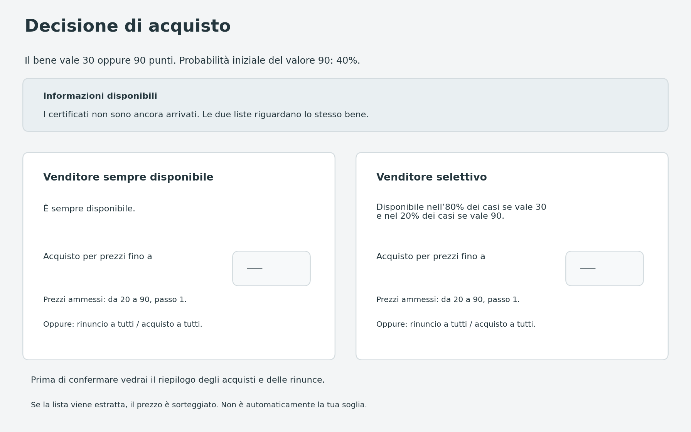
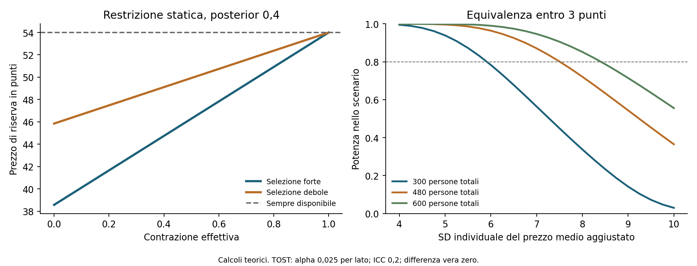
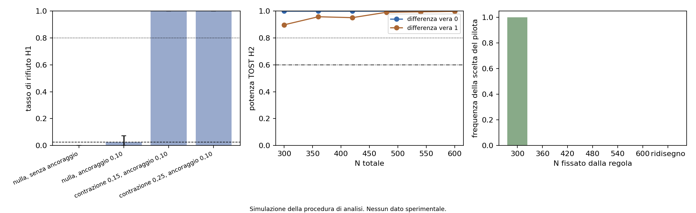

# Decisione di progetto

Il nucleo dell'esperimento diventa una coppia di decisioni di acquisto. Un venditore è sempre disponibile. Un altro è disponibile più spesso quando il bene vale poco. Confrontare i prezzi di riserva consente di distinguere una valutazione del bene da una valutazione della selezione. Due certificati al 60% e al 70% mantengono informazione residua sufficiente per osservare entrambe. Non si chiedono distribuzioni di probabilità e non si usa una scoring rule.

La domanda principale è se il divario tra i due prezzi sia più piccolo di quello implicato dalla selezione, tenendo conto della valutazione individuale del bene. La seconda domanda è se chiedere decisioni intermedie modifichi il prezzo finale. La profondità del ragionamento e il ponte dinamico del preprint rimangono estensioni esplorative. Questa gerarchia permette di discutere il progetto anche se l'identificazione della profondità resta debole.

La revisione conserva tre protocolli assegnati alla diade. F raccoglie solo le decisioni finali. S aggiunge una rilevazione intermedia, scelta fra due momenti. R le raccoglie entrambe. L'ultima rilevazione intermedia termina prima del secondo certificato e almeno trenta secondi prima dell'apertura della decisione finale.

Il campione di pianificazione è di 300 persone, 50 diadi per protocollo, con un pilota separato di 36. Il numero finale segue una regola di potenza dichiarata più avanti. Trecento persone non sono automaticamente sufficienti per l'equivalenza entro tre punti.

Il progetto introduce quattro correzioni alla proposta iniziale in prezzi. La griglia principale ha passo uno e viene trattata come misura per intervalli. La sua posizione varia casualmente per verificare l'ancoraggio. Uno slot inattivo conserva una lotteria di riserva, anziché aumentare il peso della decisione finale. Le scommesse sul partner vengono interpretate come probabilità equivalenti, che possono risentire dell'ambiguità.

La tesi difendibile è precisa. Una decisione aggiuntiva può informare su un meccanismo che l'azione finale nasconde, ma il suo contributo dipende dalla tecnologia con cui la si misura. Le identità teoriche, le restrizioni sul modello di misura e gli effetti causali dei protocolli sono oggetti distinti.

Questo fascicolo contiene un esperimento progettato. I numeri delle tabelle sono calcoli teorici, diagnostiche su un benchmark o scenari di potenza. Non sono stati raccolti dati umani, eseguito un pilota o stimato il ponte Schrödinger-Bass.

# 1 Motivazione e rapporto con il corso

L'apparato parte da un problema economico riconoscibile, la selezione nell'acquisto di un bene di qualità incerta. Il collegamento con il lavoro di Di Cagno, Güth, Lohse, Marazzi e Spadoni (2022) è l'ambiente di acquisizione con informazione asimmetrica. Qui la regola del venditore è programmata e dichiarata. Questo elimina intenzioni strategiche non osservate e rende calcolabile il benchmark. Il prezzo di questa semplificazione è che si studia direttamente la trascuratezza della selezione, non tutta la relazione strategica con un venditore umano.

Il legame con i materiali del corso è nella sequenza fra domanda economica, variazione controllata, decisione incentivata e confronto empirico. La distinzione tra rischio noto, credenze sul partner e preferenze per la fonte dell'incertezza rende inoltre sostanziale il richiamo ai materiali su credenze, rischio e ambiguità. Non si attribuiscono preferenze personali alle valutatrici. La presentazione deve permettere loro di verificare il meccanismo senza dover accettare preliminarmente tutto il preprint.

Il preprint chiede, nella sezione 10.3, nella sezione 12.4 e nelle conclusioni, un esperimento con tempi dei report randomizzati, con un braccio passivo e con report ripetuti a informazione invariata dai quali stimare il rumore di risposta, e il presente disegno attua quella richiesta, poiché il protocollo F costituisce il braccio passivo, il protocollo R il braccio attivo con due rilevazioni intermedie, il protocollo S il trattamento intermedio con una sola rilevazione per prova, mentre la calibrazione a valore certo fornisce la stima del rumore a informazione invariata e la seconda ipotesi verifica l'effetto sistematico di elicitazione formalizzato nella (94) del preprint. Il fascicolo attua la teoria della misura delle sezioni 9 e 10, mentre la batteria dei tre giochi della sezione 12 rimane una sede sperimentale distinta, e il venditore selettivo porta l'associazione fra stato e azione studiata in quella batteria nella forma di una decisione di acquisto con prezzi di riserva.

Danz, Vesterlund e Wilson (2022) documentano deviazioni sistematiche verso il centro con una scoring rule binarizzata e un peggioramento della sincerità quando si fornisce più informazione sugli incentivi. È una ragione pertinente per eliminare il calcolatore della versione precedente e l'esempio della risposta uniforme. Il loro risultato non dimostra che tutte le misure in prezzi siano prive di distorsioni. Questa seconda affermazione sarebbe un salto non giustificato.

La nuova architettura abbandona la scoring rule, ma mantiene un premio monetario binario. Usare una lotteria per pagare una scelta di acquisto non significa assegnare un punteggio a una probabilità dichiarata. La distinzione è sostanziale, anche se la comprensione delle lotterie composte resta un'ipotesi da controllare.

# 2 Verifica della critica alla versione precedente

Gli otto template dipendenti della versione 1.1 combinavano prior 0,4 e 0,6, prezzi 45 e 65, con due ripetizioni. L'enumerazione delle quattro coppie di certificati conferma il problema segnalato.

| Quantità nel vecchio apparato | Certificati 70% e 85% | Certificati 60% e 70% |
|:--|--:|--:|
| Scelte finali discriminanti fra razionale e pienamente cursed su otto prove | 1,05 | 3,40 |
| Report equivalenti a posterior 0,5 nella vecchia S | 4,4755 | 6,2225 |
| Minimo e massimo posterior finale | 0,048 e 0,952 | 0,160 e 0,840 |

La seconda riga media sui tre vecchi momenti di rilevazione e sull'ordine casuale dei certificati. Non riguarda soltanto i report finali. Assumendo errori indipendenti e omoschedastici nelle caselle, il rapporto di informazione è 1,3904 e il rapporto fra errori standard è 0,8481. Sono rispettivamente il 39,0% di informazione in più e il 15,2% di errore standard in meno, all'interno di quella tecnologia di misura. Non sono una previsione di potenza per le nuove liste di prezzi.

L'esempio con soglia 5/12 era corretto prima dei certificati ma poco informativo sulla scelta finale. Viene tolto dalla slide centrale. Nel nuovo esempio si mostrano direttamente tre prezzi e il loro legame con la contrazione, senza conservare una soglia proveniente da un altro calendario informativo.

# 3 Oggetti osservati e livelli di evidenza

Il valore del bene è 30 oppure 90 punti. Indichiamo con $\pi$ la probabilità del valore alto dopo le informazioni disponibili. Il prezzo di riserva per il venditore sempre disponibile è $U$. Quello per il venditore selettivo è $S$. La disponibilità del selettivo è l'evento $J=1$.

| Livello | Che cosa viene sostenuto |
|:--|:--|
| Identità di disegno | Bayes, pagamenti, prezzi ottimali e proprietà del meccanismo sotto ipotesi esplicite |
| Evidenza comportamentale | Prezzi, revisioni e differenze tra protocolli, definiti anche senza stimare il ponte |
| Interpretazione strutturale | Contrazione effettiva e profondità, condizionate al modello di scelta e di misura |
| Dinamica del preprint | Restrizioni sul processo latente e confronto tra modelli di percorso |

Si usa $\psi$ per la contrazione effettiva ricavata dalla restrizione in prezzi. Si riserva $\chi$ al parametro di contrazione del preprint. Nel benchmark statico con posterior corretto $\psi=\chi$. Se il posterior è soggettivo, la stessa uguaglianza richiede di applicare la trasformazione alla congiunta soggettiva costruita con quel posterior e con le probabilità condizionali annunciate. Questa è un'estensione di misura dichiarata. Nel modello dinamico, inoltre, il processo percepito segue una dinamica verso un obiettivo trasformato e non è necessariamente uguale a quell'obiettivo in ogni istante. Un rapporto di prezzi non identifica automaticamente il parametro del drift.

La precisione delle scelte nelle urne, nelle liste di prezzi e nei giochi viene inizialmente stimata separatamente. Una precisione comune ha significato soltanto dopo aver specificato e normalizzato i payoff e il corrispondente kernel di osservazione. Il confronto fra questi parametri è una restrizione da verificare.

# 4 Modulo X

## 4.1 Generazione delle prove

Ogni prova ha un prior annunciato di 0,4 oppure 0,6 sul valore 90. Si estrae il valore e si generano due certificati condizionalmente indipendenti dato il valore. Il certificato debole indica il valore corretto nel 60% dei casi. Quello forte lo indica nel 70%. Le accuratezze sono simmetriche tra valore basso e alto, sono sempre visibili e l'ordine è casuale.

Ogni coppia di liste si riferisce allo stesso bene e alle stesse informazioni. La disponibilità del venditore viene generata dalla regola annunciata e non dipende dal prezzo, dalla risposta o dal momento estratto per il pagamento. Non si mette in competizione un venditore con l'altro. Alla fine può essere implementata una sola lista e una sola riga.

| Tipo di venditore | Disponibile se valore 30 | Disponibile se valore 90 |
|:--|--:|--:|
| Sempre disponibile | 1 | 1 |
| Selezione forte | 0,80 | 0,20 |
| Selezione debole | 0,65 | 0,35 |
| Placebo indipendente | 0,50 | 0,50 |

Le sedici prove comprendono otto prove dipendenti, quattro placebo indipendenti e quattro prove di rivelazione. Le otto dipendenti sono il prodotto di due prior, due intensità e due ripetizioni. Ogni prova presenta il venditore sempre disponibile e uno degli altri venditori. L'ordine delle due liste viene bilanciato entro persona.

Nelle quattro prove di rivelazione, dopo il secondo certificato e prima della lista finale si mostra la disponibilità effettivamente estratta. Non si condiziona artificiosamente il campione a $J=1$. Se il venditore non è disponibile, la sua lista viene disattivata e non si interpreta una soglia inesistente. Il test sul prezzo selettivo condizionato usa soltanto i casi disponibili, con un numero casuale di osservazioni. Il software e il piano di analisi conservano questa selezione nota.

## 4.2 La decisione in prezzi

L'interfaccia chiede a quali prezzi il partecipante acquisterebbe. Una scelta di soglia compila una lista monotona, con acquisto fino alla soglia e rinuncia sopra. Prima della conferma il riepilogo mostra entrambe le regioni. Non vi sono un valore preselezionato o un cursore inizializzato al centro. Sono disponibili anche le scelte di rinunciare a tutti i prezzi o acquistare a tutti.

La griglia ha passo un punto. In metà delle prove va da 20 a 90, nell'altra metà da 30 a 100. Entrambe hanno 71 righe e comprendono tutti i prezzi economicamente possibili tra 30 e 90. Il centro numerico cambia da 55 a 65. L'assegnazione è bilanciata e casuale entro persona, indipendente da prior, selezione e certificati. Rimane uguale nei diversi momenti della stessa prova.

L'interfaccia permette di rispondere alla lista con una sola soglia. Questo non trasforma 71 righe in 71 osservazioni indipendenti. Si osserva una politica di acquisto, non una sequenza di scelte autonome. Imporre la monotonicità è coerente con la dominanza di un prezzo più basso a condizioni identiche. Si perde però la possibilità di usare inversioni interne alla lista come indicatore di errore.

Se l'ultima riga accettata è $k$ e la successiva è rifiutata, il prezzo latente appartiene all'intervallo $[k,k+1]$, a meno di convenzioni sugli estremi che non cambiano l'analisi continua. La stima usa l'intervallo. Il punto medio serve soltanto per grafici descrittivi. Le risposte ai bordi sono censurate, senza estrapolare un prezzo puntuale. Il test di equivalenza usa invece l'indice osservabile definito nella sezione 10.

Il passo cinque proposto inizialmente era troppo grossolano per un rapporto individuale. Per esempio, $U=54$ e $S=42,43$ corrispondono a $\psi=0,25$ con selezione forte. Osservare solo $U\in[50,55]$ e $S\in[40,45]$ è compatibile con valori di $\psi$ approssimativamente fra 0,057 e 0,625, già in assenza di errore stocastico.

{width=6.2in}

## 4.3 Benchmark e identità in prezzi

Indichiamo con $a$ la disponibilità se il valore è alto e con $b$ quella se è basso. La probabilità di disponibilità è

$$A(\pi)=a\pi+b(1-\pi).$$

Il prezzo incondizionato e quello condizionato correttamente sono

$$U(\pi)=30+60\pi,\qquad C_{a,b}(\pi)=30+60\frac{a\pi}{a\pi+b(1-\pi)}.$$

La trasformazione del preprint mescola la congiunta con il prodotto delle sue marginali, mantenendo queste ultime. Sotto tale restrizione il prezzo selettivo è esattamente

$$S(\pi,\chi)=C_{a,b}(\pi)+\chi\,[U(\pi)-C_{a,b}(\pi)].$$

Se il primo prezzo misura il posterior soggettivo $\widetilde\pi=(U-30)/60$, e le probabilità condizionali $a,b$ sono rappresentate correttamente, la contrazione effettiva è

$$\psi=\frac{S-C_{a,b}(\widetilde\pi)}{U-C_{a,b}(\widetilde\pi)}.$$

Il benchmark condizionato va ricalcolato dal posterior implicato dal primo prezzo. Inserire direttamente il posterior oggettivo nel denominatore non eliminerebbe l'errore sul posterior. La separazione richiede inoltre che le due liste condividano la stessa credenza marginale e lo stesso criterio di valutazione.

Il divario disponibile per identificare la contrazione è

$$D_{a,b}(\pi)=U(\pi)-C_{a,b}(\pi)=60\frac{(b-a)\pi(1-\pi)}{a\pi+b(1-\pi)}.$$

È positivo per una selezione negativa e un posterior interno. La trasformazione da posterior e contrazione a due prezzi ha determinante jacobiano $60D_{a,b}(\pi)$, quindi rango due in questi casi. Questa è identificazione locale nella restrizione statica. La precisione empirica dipende dalla dimensione del divario e dall'errore di misura.

| Esempio con posterior 0,4 | Prezzo razionale | Prezzo con contrazione 0,25 | Prezzo con contrazione 1 |
|:--|--:|--:|--:|
| Sempre disponibile | 54,00 | 54,00 | 54,00 |
| Selezione forte | 38,57 | 42,43 | 54,00 |
| Selezione debole | 45,85 | 47,89 | 54,00 |

L'identità viene verificata nel codice sulla congiunta trasformata, non soltanto sostituendo numeri nella stessa formula. L'errore numerico massimo è inferiore a $3\times10^{-14}$.

## 4.4 Restrizioni verificabili

Con un parametro comune, i divari $U-S$ sono proporzionali ai rispettivi $D_{a,b}(\widetilde\pi)$ con pendenza $1-\psi$. Si confrontano la restrizione comune e due coefficienti distinti per selezione forte e debole. Le intensità non sono due misure simultanee dello stesso stato mentale, perché ciascuna prova presenta due venditori, non tre. La comparabilità richiede stabilità del coefficiente e controllo delle diverse storie informative.

Nel placebo indipendente il divario teorico è zero per qualsiasi contrazione. Non si calcola un rapporto con denominatore zero. Dopo la rivelazione di $J=1$, il valore condizionato diventa il nuovo valore atteso per entrambe le liste. I due prezzi devono coincidere al livello correttamente aggiornato e l'ulteriore distorsione della dipendenza non ha più spazio nella restrizione statica. Anche $J=0$ informa il prezzo del venditore sempre disponibile. Il confronto con queste previsioni è un controllo del ruolo della selezione ipotetica, non una prova completa di ogni modello di cursedness sequenziale.

Infine, le stesse informazioni finali producono lo stesso posterior bayesiano in entrambi gli ordini dei certificati. Il confronto d'ordine è quindi un test di percorso. Il disegno conserva questa variazione, pur accettando che certificati meno forti possano ridurre le differenze fra percorsi intermedi.

# 5 Alternative interpretazioni dei prezzi

Eliminare le quattro caselle elimina una specifica occasione di appiattimento, ma non elimina ogni attrazione verso il centro. Supponiamo che un prezzo vero $P$ venga espresso come $(1-z)P+zc$, dove $c$ è un riferimento saliente. Con posterior 0,4, $z=0,10$ e $c=57,5$, un soggetto che incorpora correttamente la selezione produce $\psi$ apparenti pari a 0,1098 nella selezione forte e 0,1072 nella debole. La restrizione fra le due intensità quasi non distingue questo caso da una contrazione comune.

La risposta del protocollo combina un controllo sullo stesso strumento e una variazione nel compito principale. Otto prove finali di calibrazione presentano un valore certo di 36, 48, 66 o 78 punti, una volta per ciascuna griglia. Ogni prova usa un venditore sempre disponibile e uno con disponibilità annunciata, rispettivamente 20%, 65%, 35% o 80% nei quattro valori. Il prezzo di riserva coincide con il valore annunciato per entrambi. La selezione non può creare un diverso valore condizionato quando il valore è certo. Le prove usano la stessa interfaccia e lo stesso pagamento delle decisioni X.

La differenza casuale di dieci punti fra i centri delle griglie viene inoltre usata nei problemi bayesiani stessi. Nel semplice modello di ancoraggio, uno spostamento del centro di dieci punti sposta il prezzo di $10z$. Una deriva del 10% implica un punto di differenza. Questa variazione verifica il trasporto della calibrazione verso il compito difficile, anziché darlo per acquisito.

La variazione delle griglie mantiene costante il numero di righe e la probabilità di estrazione di ciascun prezzo comune. Le righe aggiuntive sotto 30 o sopra 90 sono dominate nelle direzioni note e non cambiano il prezzo di riserva ottimale. Cambiano però la presentazione e alcuni esiti della lotteria complessiva. Un effetto della griglia viene interpretato come sensibilità alla tecnologia di misura, senza attribuirlo unicamente a un meccanismo psicologico di ancoraggio.

Nessun controllo esclude tutte le possibili distorsioni dipendenti dalla difficoltà. Si riportano analisi che moltiplicano per 0,5, 1 e 2 la componente di errore e quella di ancoraggio trasportate dalla calibrazione. L'inferenza sulla contrazione deve essere accompagnata dalla sua sensibilità a queste restrizioni.

# 6 Modulo K

## 6.1 Gioco e batteria preliminare

Due persone della stessa diade scelgono simultaneamente un numero intero negli intervalli mostrati. Il guadagno cresce quanto più il proprio numero si avvicina a un coefficiente moltiplicato per il numero del partner. Si usa una perdita quadratica, normalizzata sullo span dei payoff della specifica matrice. È un adattamento della famiglia di guessing games, non una replica esatta della funzione di pagamento di Costa-Gomes e Crawford (2006).

Per il livello zero si fissa una distribuzione uniforme sui numeri ammessi. Ogni livello successivo risponde ottimamente alla politica del livello precedente. In caso di parità si divide la probabilità in parti uguali. Il livello zero è una distribuzione, non un punto da separare sulla griglia. La tabella mostra le medie delle politiche dei primi tre livelli e il singolo equilibrio puro, verificato sulla griglia intera.

| Gioco e ruolo | Intervallo | Coefficiente | L1 | L2 | L3 | Equilibrio |
|:--|:--|--:|--:|--:|--:|--:|
| K1 A | 10 a 90 | 0,5 | 25 | 32,5 | 16 | 10 |
| K1 B | 10 a 90 | 1,3 | 65 | 32,5 | 42 | 13 |
| K2 A | 10 a 50 | 0,5 | 25 | 22,5 | 19 | 10 |
| K2 B | 10 a 90 | 1,5 | 45 | 37,5 | 34 | 15 |
| K3 A | 10 a 50 | 0,5 | 25 | 19,5 | 16 | 10 |
| K3 B | 10 a 90 | 1,3 | 39 | 32,5 | 25 | 13 |

Una media a metà fra due interi rappresenta una politica con due azioni ottimali. Il vincolo di separazione viene controllato sui supporti, non sulle sole medie. Ogni coppia fra L1, L2, L3 ed equilibrio dista almeno due unità in entrambi i ruoli. Ogni gioco viene ripetuto scambiando i ruoli, per sei prove complessive. Non si dà feedback e il partner resta lo stesso.

Il codice considera intervalli ottenuti da 10 o 30 come limite inferiore e 50 o 90 come superiore, coefficienti 0,5, 0,7, 1,3 e 1,5, ed esclude duplicati per scambio dei ruoli. Venti giochi superano il vincolo. Una selezione greedy sceglie tre giochi massimizzando il minimo dell'informazione efficiente su $\tau$, dopo aver profilato precisione e lapse. La griglia di progetto usa precisioni 4, 12 e 30, profondità 0,7, 1,5 e 2,5 e lapse 0,02 e 0,10.

Il benchmark mescola con pesi di Poisson troncati ai livelli da zero a sei le risposte ricorsive, aggiungendo un'emissione logit normalizzata. Assume estrazioni indipendenti del livello tra giochi ed esclude ponte, scommesse e preferenze per la fonte. È un criterio preliminare, da confrontare con livelli persistenti nel pilota. Nel punto peggiore della griglia, l'informazione efficiente per persona è circa 0,0122 e il limite ideale dell'errore standard di $\tau$ con 300 persone è circa 0,524, prima di dipendenza entro diade e ulteriori nuisance. Questa diagnostica è un motivo per conservare l'analisi esplorativa.

L'11-20 resta un candidato per una validazione esterna. Nella forma standard i livelli iniziali seguono 20, 19, 18 e 17, quindi sono separati da un solo passo, e l'equilibrio è misto. Non soddisfa il vincolo di cinque punti distinti richiesto nella proposta. Non si cambia quel gioco soltanto per dichiarare rispettato il vincolo.

## 6.2 Probabilità equivalenti

Per ogni gioco si scelgono tre soglie fra i supporti delle predizioni sul numero del partner. Per esempio, per il giocatore B in K1 sono 23, 38 e 54. La persona nel ruolo A può scegliere una scommessa che paga il premio se B sceglie almeno 38, oppure una lotteria oggettiva con probabilità annunciata.

Ogni lista confronta l'evento con probabilità da 5% a 95% a passi di 5%. Sono diciannove decisioni contingenti, non tre o quattro. L'interfaccia consente di riassumerle con una soglia e confermare l'intera lista. Non si usa una ricerca adattiva che faccia dipendere le successive offerte dalle risposte. Se la lista viene estratta, ogni riga ha probabilità 1/19 di essere implementata.

Le tre liste stimano intervalli di probabilità equivalente. Non ricostruiscono una distribuzione completa delle azioni o dei livelli. Le soglie riguardano la distribuzione del ruolo del partner, non quella del ruolo del rispondente. Le liste sono presentate in ordine casuale e senza valori preselezionati. Non si forza la coerenza tra soglie diverse, che rimane una diagnostica.

Nei due passaggi di K1 si aggiunge la scommessa complementare alla soglia centrale. Questo permette di verificare se le probabilità equivalenti dell'evento e del suo complemento sommino a uno, tenendo conto della censura. Il controllo può rivelare preferenze per la fonte o incoerenza, ma non identifica ogni modello di ambiguità.

Il meccanismo è compatibile con una credenza probabilistica quando il partecipante valuta le due prospettive attraverso la stessa funzione crescente della probabilità del medesimo premio, senza una preferenza aggiuntiva per la fonte. La sola monotonicità nelle probabilità delle lotterie oggettive non basta. La letteratura sulle matching probabilities mostra precisamente che queste misure possono riflettere anche l'ambiguità.

Di conseguenza, tre punti di cumulata non diventano automaticamente tre punti della distribuzione dei livelli. Per inferire $\tau$ servono politiche di livello specificate, un modello di errore e una mappa dalle credenze sul partner alla profondità rilevante. La profondità propria e quella attribuita al partner vengono inizialmente separate. La loro uguaglianza è una restrizione, non una definizione.

## 6.3 Controlli con un computer

Dopo le sei prove con partner umano, tutti affrontano quattro prove con un computer. Due dichiarano una distribuzione uniforme conosciuta. Due dichiarano un numero deterministico che corrisponde a una risposta di livello uno. Si usa una spiegazione concreta della regola, senza etichette cognitive nelle istruzioni ai partecipanti.

In K1, rispondere al ruolo B uniforme implica scegliere 25 nel ruolo A; rispondere al ruolo A uniforme implica 65 nel ruolo B. Se B sceglie sicuramente 65, le risposte ottimali di A sono 32 e 33. Se un computer nel ruolo A di K3 sceglie 25, le risposte ottimali di B sono 32 e 33. Il quiz controlla la lettura delle regole prima di queste decisioni.

Questi casi eliminano l'incertezza sulla politica del partner. Un errore residuo può dipendere da calcolo, attenzione, incomprensione o rumore di scelta. Non dimostra da solo un'incapacità cognitiva. Il confronto è motivato dalla distinzione fra profondità manifestata e aspettative sulla sofisticazione altrui discussa da Agranov e coautori (2012).

# 7 Ancoraggio della precisione

Sedici decisioni confrontano due urne con cento gettoni e conteggi visibili. Il gettone vincente dà lo stesso premio del resto dell'esperimento. Le differenze fra probabilità di vincita vanno da uno a sedici punti percentuali, una volta per differenza. Il lato migliore è bilanciato e le probabilità di base variano. La durata di progetto è tre minuti, da verificare nel pilota.

Il benchmark è la scelta dell'urna con più gettoni vincenti. Si stima una curva di risposta alla differenza di probabilità, con un eventuale lapse, aggregata o gerarchica. Sedici risposte non giustificano una stima individuale precisa di più parametri liberi.

La pendenza non costituisce automaticamente un limite superiore al rumore nei moduli X e K. Il compito può essere più facile, la percezione delle probabilità può cambiare e il numero di alternative non è identico. È un riferimento su scelte oggettive. L'uguaglianza delle precisioni viene verificata dopo una normalizzazione esplicita, confrontando anche modelli con precisioni separate.

Le otto prove a valore certo della sezione 5 ancorano invece errore e sensibilità al centro nello stesso strumento dei prezzi. Sono necessarie perché una buona performance nelle urne non esclude una distorsione specifica delle soglie di acquisto.

# 8 Protocolli e tempi

La randomizzazione è alla diade e bloccata per sessione. Entrambi i componenti ricevono F, S oppure R. Il modulo X è individuale, mentre K usa il partner reale. L'assegnazione comune evita di mescolare protocolli diversi all'interno dell'interazione.

| Protocollo | Primo momento intermedio | Secondo momento intermedio | Decisione finale |
|:--|:--|:--|:--|
| F | Nessuna misura | Nessuna misura | Sempre |
| S | Uno dei due momenti, bilanciato | Uno dei due momenti, bilanciato | Sempre |
| R | Misura | Misura | Sempre |

In S si estrae un solo momento per prova. Per le otto prove dipendenti X, quattro sono assegnate al primo e quattro al secondo, bilanciando prior e intensità. Nelle finestre inattive informazioni e tempo restano disponibili. Non si introduce un compito di distrazione, che cambierebbe ulteriormente il trattamento.

| Evento nel modulo X | Secondi dall'inizio della prova |
|:--|--:|
| Lettura di prior, valore e regola del venditore | 0 a 10 |
| Prima eventuale coppia di liste | 10 a 30 |
| Primo certificato | 40 |
| Seconda eventuale coppia di liste | 50 a 70 |
| Secondo certificato | 85 |
| Disponibilità rivelata nei soli controlli previsti | 90 |
| Coppia di decisioni finali per tutti | 100 a 120 |

La pausa fra la chiusura dell'ultima misura e l'apertura della finale è di trenta secondi e include un nuovo certificato. Non si prolunga una finestra soltanto per un protocollo. Ogni proroga tecnica viene registrata e, se necessaria per una sessione, applicata in modo comune.

In K non esistono certificati sulla mente del partner. Le finestre per le scommesse sono 10 a 30 e 40 a 60 secondi, mentre il numero finale viene scelto da 80 a 100. Non arriva feedback nelle pause. Non esiste un posterior bayesiano oggettivo sul partner umano. I benchmark corretti sono condizionati ai modelli dichiarati oppure alla politica conosciuta del computer.

I due moduli principali sono controbilanciati tra diadi. Controlli con computer, calibrazione dei prezzi e urne seguono entrambi i moduli principali, prima dei risultati e del pagamento. In questo modo la spiegazione delle risposte del computer non addestra il gioco umano. Anche il possibile affaticamento nei controlli viene registrato e modellato per protocollo.

La durata prevista è circa 85 a 95 minuti, con limite organizzativo annunciato di 105. Le sedici prove X richiedono 32 minuti; le sei K, dieci. Controlli e calibrazioni richiedono circa tredici minuti. Istruzioni, quiz, pratica, pausa e pagamento completano la sessione. Queste sono durate di progetto, non tempi osservati.

# 9 Pagamento

## 9.1 Estrazione della decisione e del premio

Ogni partecipante riceve 8 euro fissi e può ricevere un unico premio aggiuntivo di 16 euro. Prima della sessione è pubblicata la procedura di estrazione. Si seleziona una categoria, poi una prova, l'eventuale venditore o scommessa e una riga. La decisione così selezionata determina l'esito del premio. Gli altri compiti non producono ulteriori pagamenti. L'eventuale sorteggio finale del premio è distinto dalla selezione della decisione, senza creare pagamenti multipli.

| Categoria | Probabilità di estrazione |
|:--|--:|
| Decisione finale X | 30% |
| Numero finale K | 20% |
| Primo slot intermedio X | 8% |
| Secondo slot intermedio X | 8% |
| Primo slot di scommesse K | 6% |
| Secondo slot di scommesse K | 6% |
| Calibrazione dei prezzi | 10% |
| Urne | 6% |
| Computer | 6% |

Le probabilità sommano a uno e sono uguali nei tre protocolli. All'interno di una categoria si estrae uniformemente la prova. Nelle coppie X i venditori hanno probabilità 1/2 e ogni prezzo della griglia probabilità 1/71. Nelle scommesse K si estrae uniformemente una delle tre liste, oppure delle quattro nei casi con complemento, e una delle diciannove righe. Le differenze di numerosità sono identiche fra protocolli.

## 9.2 Acquisti e rischio

Il guadagno in punti dell'acquisto è $J(V-P)$. Se si rinuncia oppure il venditore non è disponibile, è zero. La probabilità di premio è

$$w=0,5+\frac{J(V-P)}{200}$$

per una riga di acquisto, e 0,5 per una rinuncia. Con le due griglie e i valori 30 e 90, le probabilità restano fra 0,15 e 0,85. Nei controlli con valore certo si usa lo stesso schema. Una decisione completata può quindi preservare la lotteria di base rinunciando, ma può migliorarla scegliendo acquisti con guadagno atteso positivo.

Se il partecipante riduce correttamente la lotteria composta e preferisce una maggiore probabilità dello stesso premio, massimizzare la probabilità equivale a massimizzare il guadagno atteso in punti. I prezzi ottimali sono allora i valori attesi indicati nella sezione 4, senza imporre utilità lineare in euro.

Se invece si pagassero direttamente gli esiti monetari dell'acquisto, l'avversione al rischio potrebbe spostare il prezzo di riserva. La prima lista non misurerebbe più da sola il posterior. La conversione in probabilità di premio è quindi una parte dell'identificazione, non un dettaglio contabile. La riduzione delle lotterie e la neutralità rispetto alla fonte restano ipotesi comportamentali, controllate ma non garantite dall'algebra.

## 9.3 Giochi e scommesse

Nei giochi, indicando con $d=|x-py|$ la distanza dal bersaglio e con $D_g$ la massima distanza nella matrice di quel ruolo, la probabilità è $0,9-0,8(d/D_g)^2$. Le matrici selezionate permettono distanza zero e sono normalizzate esattamente come nel codice di selezione. Nelle prove con computer vale la stessa regola.

Una scommessa scelta sul partner paga il premio se l'evento si verifica. La lotteria alternativa lo paga con la probabilità indicata. Non si attribuisce un punteggio all'accuratezza di una dichiarazione. Una scelta nelle urne usa direttamente la composizione visibile dell'urna selezionata.

## 9.4 Slot inattivi e risposte mancanti

Uno slot non previsto dal protocollo assegna una lotteria di riserva con probabilità 0,5. Questa scelta sostituisce la proposta di pagare nuovamente la decisione finale. Con tre slot equiprobabili, il rinvio alla finale le darebbe infatti peso 1 in F, 2/3 in S e 1/3 in R. Il confronto F contro R mescolerebbe la misurazione con un incentivo finale tre volte maggiore.

La riserva ha ora un benchmark operativo. In X equivale a rifiutare tutti gli acquisti. Nelle liste K equivale a scegliere sempre la lotteria oggettiva, perché la media delle probabilità da 5% a 95% è 50%. Una politica ottimale può ottenere almeno altrettanto. Lo slot vuoto non domina le risposte informative come poteva fare la riserva al 75% della versione originaria.

Un timeout in una domanda effettivamente prevista dà invece probabilità zero se quella domanda viene estratta. Un guasto tecnico documentato dà la riserva, senza penalizzare il partecipante. Non si confondono mancata risposta e assegnazione casuale a uno slot inattivo.

Questo schema mantiene uguali gli incentivi marginali delle decisioni comuni. Non rende identico il rendimento atteso totale dei protocolli, perché misure aggiuntive offrono ulteriori occasioni di migliorare rispetto alla riserva. Non si sostiene una neutralizzazione perfetta di ogni effetto di reddito o di percezione del compenso.

In istruzione si spiegano operativamente acquisto, rinuncia, estrazione e premio. Si omette il calcolatore di ottimizzazione e non si mostra una risposta uniforme come strategia rifugio. Le formule complete rimangono disponibili a tutti con la stessa modalità; apertura e tempo di consultazione vengono registrati. Il quiz usa esempi di dominanza e disponibilità, senza suggerire il comportamento da testare.

# 10 Ipotesi e analisi preregistrata

## 10.1 Prima ipotesi

La prima ipotesi è una contrazione effettiva media positiva nelle otto prove dipendenti di S. Si usa la prima e unica rilevazione intermedia prevista in ciascuna prova. Non si aggregano come osservazioni indipendenti i prezzi di una lista o le due persone della diade. L'estimando è la media fra persone del coefficiente $\psi$ nella restrizione statica della sezione 4.

Non si divide direttamente un prezzo rumoroso per un altro prezzo rumoroso per poi calcolare un test t. Il rapporto è non lineare e incorpora errore nella variabile usata per costruire il benchmark. Il piano primario usa una likelihood con censura per intervalli, basata congiuntamente sulle due soglie. La calibrazione e gli effetti della griglia entrano nella stima e vengono ristimati in ogni replica di inferenza.

La specificazione minima è dichiarata prima del pilota. Il logit del posterior soggettivo è una combinazione del logit del prior e dei log likelihood ratio dei certificati già visti, con pesi da stimare e un'intercetta individuale. Un certificato non ancora osservato contribuisce zero. I due prezzi economici latenti sono $U=30+60\widetilde\pi$ e $S=C(\widetilde\pi)+\psi_iD(\widetilde\pi)$. Intercetta individuale e $\psi_i$ hanno una distribuzione normale con correlazione libera.

Le soglie espresse hanno media $(1-z)P+zc$, dove $P$ è il prezzo economico latente e $c$ il centro della griglia. Si aggiunge un errore normale bivariato a media zero per la coppia di liste. Il coefficiente $z$ nei problemi bayesiani viene stimato usando la randomizzazione della griglia; quello nei valori certi viene stimato separatamente. Le scale dell'errore possono differire tra venditori. La specificazione principale trasporta la componente di errore della calibrazione, mentre le analisi di sensibilità ne variano la scala e consentono un'ulteriore componente specifica del compito.

La contribuzione alla likelihood è la probabilità del rettangolo definito dai due intervalli osservati, integrata sugli effetti individuali. Il test sulla media di $\psi_i$ è unilaterale. La stima del coefficiente effettivo è lasciata libera anche fuori dall'intervallo zero a uno. Questi valori non vengono troncati e non vengono interpretati come una distribuzione cursed valida. Servono a rilevare sovrareazione, incoerenza o inadeguatezza della restrizione.

Si usa un bootstrap studentizzato per diade, bloccato per sessione, con 1.999 repliche. La prima soglia di significatività è 0,025. Un limite inferiore unilaterale al 97,5% maggiore di zero sostiene l'ipotesi nel modello dichiarato. I parametri di calibrazione devono essere ristimati e non trattati come noti.

Le verifiche obbligatorie comprendono un modello con coefficienti diversi nelle due intensità, sensibilità del posterior a pendenze individuali e a specificazioni più flessibili degli input, trasporto dell'errore e dell'ancoraggio per fattori 0,5, 1 e 2, e un kernel logit sulle politiche complete di acquisto. Quest'ultimo calcola il valore di ogni politica attraverso l'effettiva estrazione casuale della riga. Non tratta le righe compilate da un'unica soglia come logit indipendenti.

Questa procedura non dà un'identificazione indipendente dal modello di misura. Se il segno dipende dalla specificazione del posterior o dall'errore trasportato, la conclusione è che la contrazione non è separata in modo robusto da tali alternative. Il rapporto algebrico resta utile per spiegare il meccanismo, ma non sostituisce questa verifica.

## 10.2 Seconda ipotesi

La seconda ipotesi è l'equivalenza tra F e R del prezzo finale per il venditore selettivo nelle otto prove dipendenti, con margine di tre punti. Tre punti sono il 5% della distanza tra i valori 30 e 90. Il margine riguarda un esito osservabile del compito, non un limite su ogni differenza individuale o sul parametro $\chi$.

Per evitare un'imputazione del prezzo latente, si definisce l'indice della politica nella griglia comune

$$P^{\mathrm{obs}}=30+\sum_{p=31}^{90}\mathbf{1}\{\text{acquisto al prezzo }p\}.$$

Con una lista monotona interna all'intervallo economico, coincide con il massimo prezzo accettato. È definito anche per le politiche che rifiutano o accettano tutti i prezzi e usa esattamente le stesse sessanta decisioni nei due formati. Perde intenzionalmente informazione sulle risposte esterne al range 30 a 90, che viene comunque conservata nelle diagnostiche e nella likelihood di H1.

Per ciascuna persona si media $P^{\mathrm{obs}}-C_{a,b}(\pi)$ sulle otto prove dipendenti, usando il posterior oggettivo finale per l'aggiustamento. Sottrarre il benchmark noto elimina parte della variazione meccanica delle storie informative senza condizionare su una variabile prodotta dal trattamento. L'effetto di interesse è la differenza media F meno R su questa statistica, con pesi uguali per prior e intensità.

L'analisi principale confronta le medie di diade con effetti fissi di sessione. Il TOST usa alfa 0,025 per ciascun lato, quindi richiede che l'intervallo bilaterale al 95% sia interamente contenuto in $[-3,3]$. Insieme al livello 0,025 della prima ipotesi, questa scelta controlla conservativamente al 5% la famiglia delle due affermazioni primarie.

Il risultato è equivalenza media dei protocolli nel compito e negli incentivi adottati. Non è prova che misurare sia innocuo in ogni condizione. Si mostrano separatamente le due intensità, i due prior, il prezzo del venditore sempre disponibile e la dispersione degli effetti. Un intervallo che oltrepassa il margine è inconcludente sull'equivalenza, anche se la differenza da zero non è significativa.

## 10.3 Analisi secondarie

La prima analisi secondaria è la restrizione di pendenza comune tra le intensità, seguita dai placebo di indipendenza, rivelazione e valore certo. Seguono gli effetti d'ordine, il confronto S con F e R, la persistenza dei coefficienti tra prima rilevazione e finale e la sensibilità al centro della griglia. Si riportano stime e intervalli, con un controllo del false discovery rate separato e dichiarato per questa famiglia. Nessuno di questi risultati può sostituire retroattivamente una primaria non riuscita.

Per K si confrontano livelli ricorsivi, gerarchia cognitiva e versioni con precisioni e lapse separati. Si distingue $\tau$ delle scelte proprie dalla profondità attribuita al partner. La conversione delle scommesse in credenze viene confrontata con una trasformazione affine della probabilità, vincolata a rimanere tra zero e uno, e con le diagnostiche sugli eventi complementari.

Si conserva il confronto predittivo sui percorsi in R come esplorativo. Il modello E usa informazioni pubbliche; T aggiunge l'ultima coppia di prezzi intermedia; P aggiunge entrambe le coppie ordinate; U usa le due coppie senza etichette temporali. Tutti hanno accesso alle informazioni pubbliche finali. Nessuno riceve un prezzo finale come regressore per prevedere il prezzo selettivo finale della stessa prova.

La validazione è esterna al campione di addestramento, con cinque gruppi di diadi e selezione interna degli iperparametri. Il punteggio è la log probabilità dell'intervallo o della categoria di scelta osservata. Si riporta il guadagno per decisione e la sua distribuzione per diade. La soglia di interesse di 0,01 nats resta una convenzione esplorativa, senza una potenza già certificata.

## 10.4 Diagnostiche prima di interpretare i parametri

Per ogni specificazione strutturale si riportano recupero dei parametri su dati simulati, copertura degli intervalli, profili di likelihood, correlazioni tra parametri, autovalori dell'informazione osservata e informazione efficiente dopo i nuisance. Si confrontano scelte finali sole e misure aggiuntive mantenendo la stessa unità di osservazione e la stessa normalizzazione dei payoff.

Non basta un rango numericamente pieno. Una direzione di profondità con errore standard molto grande è debolmente informativa. Una stima sensibile a lapse, ambiguità o definizione di livello zero non dimostra una profondità stabile. Una stima precisa sotto un modello di misura errato non risolve l'identificazione sostanziale.

# 11 Dinamica

Il benchmark del venditore sempre disponibile è $B_t=30+60\pi_t$. Con la struttura informativa annunciata è una martingala. Questo rende osservabile la scala economica delle revisioni bayesiane e permette di confrontarla con le revisioni delle soglie. Nel protocollo R si osservano prezzi iniziali, dopo il primo certificato e dopo il secondo.

Il test operativo confronta direzione e dimensione della revisione del prezzo con quelle di $B_t$. L'ordine dei certificati viene randomizzato. Si analizzano inerzia, eccesso di revisione ed eventuale persistenza dello scarto iniziale, distinguendole dall'effetto dell'interfaccia e dal rumore seriale.

La martingala del benchmark non implica che i prezzi raccolti siano una martingala. Per esempio, se $Y_t=B_t+e_t$ con errori indipendenti di varianza $\sigma^2$, a prior fissato e con due incrementi si ha

$$\mathbb E\!\left[(Y_1-Y_0)^2+(Y_2-Y_1)^2\right]=\operatorname{Var}(B_2)+4\sigma^2,$$

mentre $\operatorname{Var}(Y_2)=\operatorname{Var}(B_2)+\sigma^2$. Confrontare direttamente le due quantità produce uno scarto di $3\sigma^2$ anche quando il benchmark è perfettamente bayesiano. Eteroschedasticità, errori seriali e censura cambiano ulteriormente il confronto.

La verifica della variazione usa quindi il modello di misura e si conduce entro prior, evitando di mescolare la varianza iniziale dei prior 0,4 e 0,6 con quella prodotta dai segnali. Rimane una restrizione martingala, non un'identificazione del Bass lift. Inoltre, la variazione del prezzo del bene riguarda una coordinata di credenza sul valore, non direttamente la coordinata di profondità del preprint.

Una correlazione tra scarto iniziale e finale è compatibile con un tratto stabile, ma anche con ancoraggio o errore seriale. Il test di stabilità riporta queste alternative e non attribuisce automaticamente persistenza al solo parametro individuale.

# 12 Campione e regola del pilota

## 12.1 Numeri e organizzazione

La base di progetto comprende 300 persone in 150 diadi, 50 diadi per protocollo. Dieci sessioni principali da trenta persone hanno cinque diadi F, cinque S e cinque R. Il pilota comprende 36 persone in due sessioni da diciotto, con tre diadi per protocollo in ogni sessione. Il pilota non entra nell'analisi principale.

Il campione principale è dimensionato sulla persona aggregata e sulla diade randomizzata, non sul numero di prezzi, clic o prove. L'affermazione che una misura continua valga due o tre volte un esito binario non viene usata per giustificare N. Il guadagno dipende da distribuzione, rumore, censura ed effetto di interesse.

## 12.2 Scenari di equivalenza

La tabella assume 100 persone per protocollo, correlazione entro diade 0,2, medie di diade normali e varianze uguali, senza effetti aggiuntivi di sessione. Usa l'effettiva probabilità congiunta di superare i due test TOST, integrando l'incertezza della varianza pooled. La deviazione standard è quella della statistica individuale già mediata sulle prove e aggiustata per il benchmark.

| Deviazione standard individuale | Potenza se la differenza vera è zero | Potenza se la differenza vera è un punto |
|--:|--:|--:|
| 4 | 99,5% | 89,2% |
| 5 | 93,9% | 72,4% |
| 6 | 78,3% | 55,7% |
| 7 | 56,4% | 40,1% |
| 8 | 33,8% | 25,0% |
| 10 | 3,0% | 2,4% |

Nello scenario con differenza vera zero, l'80% è raggiunto soltanto per una deviazione standard individuale di circa 5,92 punti o meno. Questa condizione rende trasparente il vincolo del campione da 300. Il file numerico include anche 480 e 600 persone. La tabella è un calcolo analitico sulla statistica individuale. La simulazione completa della procedura, con il generatore strutturale dichiarato nella sezione 10, è riportata nella sezione 12.4.

## 12.3 Criterio prima del congelamento

Il pilota verifica comprensione, completamento delle finestre, censura, sensibilità alla griglia, differenze di errore tra calibrazione e compito, variabilità della media finale e plausibilità delle specificazioni di misura. Le interviste di comprensione seguono le decisioni. Non si usa il segno dell'effetto preliminare per selezionare la primaria.

Si simula quindi l'intera procedura di analisi, inclusi diadi, sessioni, segnali, griglie, errori, missing e rifitting. Per H1 la griglia degli effetti di interesse include una contrazione effettiva media di 0,15 e 0,25, con eterogeneità e alternative di ancoraggio. Per H2 include differenze vere di zero e di un punto. I nuisance usano stime del pilota e scenari conservativi di dispersione e dipendenza.

Il criterio richiede almeno l'80% di potenza per H1 a 0,15 e per H2 a differenza zero, e almeno il 60% per H2 a differenza di un punto. Le simulazioni hanno almeno 2.000 repliche e la soglia è applicata al limite inferiore dell'intervallo Monte Carlo al 95%. Si verifica anche l'errore di primo tipo, inclusi gli scenari di ancoraggio senza contrazione. La tolleranza di progetto per un test nominale 0,025 è un tasso di rifiuto non superiore a 0,035 nel limite superiore dell'intervallo Monte Carlo.

Se N pari a 300 non supera il criterio, si considerano incrementi di sessanta persone fino a 600, mantenendo bilanciamento tra protocolli e sessioni. Se neppure il massimo supera i criteri, si ridisegna prima dei dati principali e si aggiorna il progetto. Non si amplia il margine di equivalenza dopo aver visto i dati e non si presenta un test incapace come confermativo.

Queste simulazioni complete e il pilota non sono stati eseguiti. La consegna contiene le identità verificate, il codice della batteria preliminare e gli scenari analitici. La regola rende il disegno valutabile per il corso senza inventare un'esecuzione o una garanzia empirica.

## 12.4 Simulazione della procedura di analisi

Il programma simulazione_completa.py genera dati dal modello di misura dichiarato nella sezione 10.1 e applica l'intera procedura. Gli effetti individuali di intercetta e contrazione sono normali bivariati, il logit del posterior soggettivo combina prior e certificati visti con pesi stimati, le soglie dichiarate caricano sul centro della griglia con un coefficiente di ancoraggio stimato dalla randomizzazione fra i formati 20-90 e 30-100, l'errore è normale per lista e le risposte sono censurate agli intervalli unitari e ai bordi. Per S la rilevazione intermedia cade al prior oppure dopo il primo certificato, bilanciata su prior e intensità. Per H1 lo stimatore è la likelihood a intervalli con quadratura di Gauss-Hermite sui due effetti individuali e un test del rapporto di verosimiglianza unilaterale al livello 0,025, mentre il bootstrap per diade è calcolato su un dataset di esempio. Per H2 il generatore aggiunge un effetto di diade e uno di sessione, costruisce l'indice osservabile della sezione 10.2, le medie di diade, la regressione con effetti fissi di sessione e i due test unilaterali. La regola del pilota è simulata su 36 persone con la potenza analitica della sezione 12.2.

| Scenario per H1, 100 persone in S | Tasso di rifiuto | Stima media | Ancoraggio stimato |
|:--|--:|--:|--:|
| Contrazione zero, senza ancoraggio | 0 su 40 | -0,003 | 0,004 |
| Contrazione zero, ancoraggio 0,10 | 1 su 40 | 0,005 | 0,098 |
| Contrazione 0,15, ancoraggio 0,10 | 40 su 40 | 0,157 | 0,096 |
| Contrazione 0,25, ancoraggio 0,10 | 40 su 40 | 0,254 | 0,100 |

| Scenario per H2, 300 persone | Differenza vera zero | Differenza vera un punto | Deviazione standard implicita | ICC di diade |
|:--|--:|--:|--:|--:|
| Errore per lista 4, effetto di diade 2 | 100% | 89,7% | 3,9 | 0,21 |
| Errore per lista 6, effetto di diade 3 | 95,3% | 79,0% | 4,6 | 0,32 |

Nel bootstrap di esempio con contrazione vera 0,15 la stima puntuale è 0,160, il limite inferiore percentile al 2,5% è 0,10 e il rapporto di verosimiglianza è 22,5, quindi le due procedure concordano. La regola del pilota sceglie 300 in tutti i 500 piloti simulati, con potenza reale media 0,996, perché la deviazione standard individuale implicata dal modello strutturale resta sotto la soglia di 5,92 in entrambi gli scenari di dispersione. Il vincolo sul campione diventa attivo soltanto se l'errore per lista supera all'incirca otto punti, ed è esattamente la grandezza che il pilota stima nei compiti a valore certo.

Questa corsa è una verifica di progetto e non la corsa certificante della sezione 12.3, poiché usa 40 repliche per H1, 300 per H2, 500 per il pilota e 99 per il bootstrap, con quadratura a cinque nodi per dimensione e correlazione nulla dell'errore fra le due liste, nella versione del programma del 28 ottobre, mentre la versione definitiva stima la correlazione dell'errore con un fattore comune alle due liste e usa sette nodi per gli effetti individuali e cinque per il fattore. Con 40 repliche il limite superiore Monte Carlo dell'errore di primo tipo è 0,07 e la tolleranza di 0,035 non è verificabile. Le numerosità di replica e i nodi sono parametri in testa al programma, la parte criteri applica le soglie della sezione 12.3 ai risultati, e la corsa con 2.000 repliche è il lavoro previsto al momento del pilota. Il materiale sperimentale è pubblico nel repository https://github.com/francescopinna03/experimental_counterpart.

{width=6.2in}

# 13 Dati ed esclusioni

Il campione principale comprende gli assegnati che superano la comprensione prima dei compiti principali. Un secondo tentativo di quiz segue una spiegazione standard identica per tutti. Chi non supera il secondo tentativo riceve la quota fissa e non inizia le prove. Il numero di esclusi e il motivo vengono riportati per sessione, senza sostituire persone sulla base delle risposte economiche.

Una scelta insolita, una soglia ai bordi o un coefficiente fuori da zero a uno non è motivo di esclusione. Si separano risposta economica, timeout e guasto. Il protocollo conserva gli assegnati nella descrizione dei flussi. L'analisi dei dati osservati viene accompagnata da sensibilità ai missing. Per l'equivalenza si calcolano anche limiti usando gli estremi dell'indice osservabile, da 30 a 90. Se i missing impediscono di sostenere l'equivalenza senza ipotesi forti, la conclusione viene qualificata.

I dati sono pseudonimi. La tabella di pagamento con identità reali è separata dalle risposte. Non si raccolgono registrazioni audio, video o tracciamento oculare. I tempi e le modifiche delle soglie descrivono l'interazione con l'interfaccia e non sono trattati come misura diretta del ragionamento.

| Gruppo di campi | Contenuto minimo |
|:--|:--|
| Assegnazione | Persona, diade, sessione, protocollo, ordine dei moduli e ruolo |
| Ambiente X | Prior, valore estratto, disponibilità, intensità, accuratezze, segnali e ordine |
| Misura X | Momento, griglia, venditore, ultima riga acquistata, intervallo, censura e conferma |
| Ambiente K | Gioco, ruolo, matrici normalizzate, soglie degli eventi e identità pseudonima del partner |
| Misura K | Numero finale, scelte contingenti nelle scommesse, intervalli e complemento |
| Controlli | Valore certo, disponibilità annunciata, composizione urne e politica del computer |
| Operatività | Inizio e fine finestre, timeout, problemi tecnici, consultazione dettagli e tentativi di quiz |
| Pagamento | Categoria, prova, lista, riga, esito e probabilità applicata |
| Riproducibilità | Versione delle istruzioni, configurazione, semi casuali e impronta del codice |

Lo stato e i segnali vengono generati prima delle risposte. La disponibilità resta la stessa fra le liste temporali della medesima prova. Le estrazioni di pagamento sono indipendenti dalle risposte. Il programma registra la sequenza necessaria a ricostruire ogni benchmark e ogni pagamento.

# 14 Budget di progetto

I compensi sono massimi teorici, non una previsione del pagamento medio. Le tariffe di assistenza e sviluppo sono ipotesi di pianificazione. Si assume disponibilità del laboratorio senza canone aggiuntivo.

| Voce con 300 persone principali | Calcolo | Euro |
|:--|:--|--:|
| Campione principale | 300 per 24 euro | 7.200 |
| Pilota | 36 per 24 euro | 864 |
| Riserva per trenta presenze non utilizzate | 30 per 8 euro | 240 |
| Due assistenti per dodici sessioni di due ore | 48 ore per 20 euro | 960 |
| Implementazione e verifica software | 40 ore per 30 euro | 1.200 |
| Subtotale | | 10.464 |
| Margine organizzativo del 10% | | 1.046,40 |
| Massimo di progetto | | 11.510,40 |

Con 480 persone e diciotto sessioni complessive, il massimo con le stesse ipotesi è 16.790,40 euro. Con 600 e ventidue sessioni, è 20.310,40 euro. Non si riduce retroattivamente il premio per compensare un campione più grande. Eventuali costi di laboratorio, procedure locali o ulteriore sviluppo richiedono una voce esplicita, non un'assunzione di gratuità nascosta.

# 15 Che cosa si guadagna e che cosa si perde

Il vantaggio principale è la leggibilità economica. Il primo prezzo dà una valutazione del bene; il secondo una valutazione del bene selezionato. Sotto la restrizione dichiarata, la differenza separa errore marginale e trattamento della selezione. I controlli sono decisioni dello stesso tipo e la previsione ha una scala in punti.

Si perde la congiunta a quattro caselle e quindi il controllo diretto sulla preservazione di entrambe le marginali. La selezione nota nelle istruzioni non garantisce che le sue probabilità condizionali siano rappresentate correttamente. Un errore su queste ultime può assomigliare a contrazione. Quiz, placebo e rivelazione aiutano, ma non rendono il meccanismo esclusivo.

Le tre scommesse non ricostruiscono la credenza completa sul partner e introducono una questione di ambiguità. Le urne non forniscono una precisione universale. Le soglie hanno censura ed errore. La variazione del prezzo non è la variazione della profondità cognitiva. Questi limiti vengono dichiarati prima dei risultati.

La conclusione positiva più forte è quindi una contrazione effettiva della selezione robusta ai controlli specificati, accompagnata da un'equivalenza media dei protocolli entro un margine economicamente definito. L'attribuzione al parametro del ponte richiede un ulteriore passaggio strutturale. La nuova versione rende questo passaggio più trasparente, senza dichiararlo già compiuto.

# Appendice A Istruzioni ai partecipanti

## A1 Regole comuni

Riceverai 8 euro per la partecipazione e potrai ottenere un premio aggiuntivo di 16 euro. Durante la sessione prenderai decisioni di acquisto, sceglierai numeri e sceglierai fra scommesse o urne. Alla fine verrà selezionata una sola decisione per determinare il premio. Le percentuali di selezione delle diverse parti sono riportate nel foglio dei pagamenti. Non potrai perdere gli 8 euro di partecipazione.

Lavora individualmente e non comunicare con altri partecipanti. Nelle prove che prevedono un'altra persona, il partner è reale e rimane lo stesso. Nelle prove con un computer, la regola del computer viene dichiarata. Non riceverai risultati delle prove prima della fine delle decisioni.

Puoi chiedere chiarimenti sulle regole alzando la mano. Le spiegazioni tecniche aggiuntive sono disponibili nello stesso formato per tutti. Puoi ritirarti in qualsiasi momento. Il foglio di consenso specifica il trattamento dei dati e del compenso in caso di ritiro.

## A2 Acquisti

Il bene di ciascuna prova può valere 30 oppure 90 punti. Sullo schermo trovi la probabilità iniziale del valore alto. Riceverai due certificati, uno corretto nel 60% dei casi e uno corretto nel 70%. Ciascuno può indicare valore alto oppure basso. Nessun certificato rende certo il valore del bene. L'ordine può cambiare.

Troverai due venditori per lo stesso bene. Il primo è sempre disponibile. La disponibilità del secondo segue la regola mostrata. Se è disponibile, accetta ogni prezzo della lista; se non lo è, non avviene alcun acquisto. La disponibilità non cambia in risposta alle tue decisioni. Le due liste si riferiscono a possibilità alternative; potrà esserne selezionata una sola.

Indica fino a quale prezzo acquisteresti. Il riepilogo mostra tutti i prezzi ai quali compreresti e tutti quelli ai quali rinunceresti. Controllalo e conferma. Puoi anche rinunciare a tutti i prezzi oppure accettarli tutti. La soglia che indichi non è automaticamente il prezzo che pagherai. Se la lista viene selezionata, il computer estrae un prezzo e applica la tua decisione per quel prezzo.

Se compri e il venditore è disponibile, il risultato in punti è il valore del bene meno il prezzo estratto. Se rinunci o il venditore non è disponibile, il risultato è zero. Il risultato modifica la probabilità del premio: zero punti corrispondono al 50%, ogni punto guadagnato aggiunge mezzo punto percentuale e ogni punto perso lo sottrae. Non vengono addebitati euro di perdita.

In alcune prove la disponibilità viene mostrata prima dell'ultima decisione. Se il venditore non è disponibile, la sua lista viene disattivata. In altre prove di controllo il valore è certo e viene scritto chiaramente. In tutte le prove vale la stessa procedura di estrazione.

## A3 Momenti di decisione

Ogni prova ha un calendario. Quando appare una richiesta, rispondi usando le informazioni disponibili in quel momento. Le informazioni rimangono visibili durante la finestra. Una conferma precedente non viene automaticamente copiata nella successiva e nessuna risposta è preselezionata.

Il tuo protocollo può prevedere nessuna richiesta intermedia, una sola richiesta oppure due. Tutti prendono la decisione finale. Nelle pause puoi continuare a leggere le informazioni. Le richieste possono differire fra gruppi, secondo un'assegnazione casuale.

Una decisione prevista e non confermata entro il tempo dà probabilità zero di premio se viene estratta. Uno slot che non faceva parte del tuo protocollo usa invece una lotteria di riserva al 50%. Un problema tecnico va segnalato subito e viene trattato separatamente.

## A4 Numeri e partner

Tu e il partner scegliete contemporaneamente un numero intero negli intervalli mostrati. Per ciascuno è indicato un coefficiente. Il tuo bersaglio è quel coefficiente moltiplicato per il numero del partner. Più il tuo numero è vicino al bersaglio, maggiore è la probabilità di premio. La tabella del gioco e i dettagli del pagamento sono consultabili. Il tuo coefficiente può essere diverso da quello dell'altra persona.

In alcuni momenti potrai scegliere fra una scommessa sul numero finale del partner e una lotteria. Per esempio, una scommessa paga il premio se il numero del partner raggiunge almeno la soglia scritta. La lotteria alternativa paga con la probabilità indicata sulla riga.

Indica quali righe preferisci giocare sull'evento e quali sulla lotteria, poi conferma il riepilogo. Se una lista viene estratta, ogni riga ha la stessa possibilità di essere selezionata. Se scegli la scommessa sul partner, conta il numero finale effettivamente scelto dal partner. Se scegli la lotteria, viene usata la probabilità scritta. Non devi dichiarare una probabilità o distribuire punti fra esiti.

Le prove successive con computer mostrano esattamente come viene generato il suo numero. Le prove con urne mostrano i conteggi dei gettoni vincenti. Scegli una delle due urne; se quella decisione viene selezionata, si estrae un gettone dall'urna scelta.

# Appendice B Quiz e copione riservato

Il quiz precede le prove principali. Non comprende il calcolo del posterior o della selezione, che sono oggetto di misura. Non mostra esempi di prezzo corretto nei problemi bayesiani. Le seguenti soluzioni sono riservate al conduttore.

| Domanda di comprensione | Risposta corretta |
|:--|:--|
| Se indichi una soglia di 60 e viene estratto prezzo 45, quale prezzo determina il risultato se compri? | 45 |
| Se il venditore non è disponibile e avevi scelto acquisto, si realizza una perdita? | No, il risultato è zero |
| Se il bene vale 90 e compri a 70, quanti punti ottieni? | 20 |
| Un certificato corretto al 70% rende certo il valore indicato? | No |
| Se viene selezionata una prova, vengono pagate anche le altre? | No |
| Se scegli la scommessa sul partner, l'esito dipende dalla tua stima o dal suo numero effettivo? | Dal numero effettivo |
| Un computer dichiarato uniforme sceglie ogni numero ammesso con la stessa probabilità? | Sì |
| Nelle urne, a parità di premio e numero totale di gettoni, quale offre maggiore probabilità di vincere? | Quella con più gettoni vincenti |

Il conduttore legge le regole comuni, lascia il tempo per il quiz e usa una spiegazione standard per gli errori. Dopo un secondo tentativo, chi ancora non comprende non avvia i compiti principali. Il criterio è applicato prima di osservare decisioni economiche. Non si interpreta il mancato superamento come un livello cognitivo stimato.

La pratica comprende una lista a valore certo e una scommessa con evento deciso da un computer visibile. Serve a usare l'interfaccia e il riepilogo, non a mostrare la soluzione della selezione. Non è pagata e viene segnalata come pratica.

Durante la sessione non si spiegano le ipotesi di contrazione, livello o ancoraggio. Non si modificano le istruzioni individualmente in base a scelte apparentemente sbagliate. Le richieste di chiarimento e i problemi tecnici sono registrati. Al termine si raccolgono domande di comprensione retrospettiva, si applica l'estrazione e si consegna un riepilogo del pagamento verificabile.

La disponibilità dei venditori segue effettivamente la regola annunciata. I partner sono reali dove dichiarati e i computer sono dichiarati dove usati. Non sono previsti messaggi ingannevoli o risultati inventati.

# Appendice C Traccia della presentazione orale

**Diapositiva 1. Domanda economica.** Un'offerta eccessiva può derivare da una valutazione troppo alta del bene o dal trascurare la selezione del venditore. La scelta finale da sola non separa necessariamente le due spiegazioni.

**Diapositiva 2. La decisione.** Mostrare il bene da 30 o 90, i due venditori e una lista. Spiegare che viene estratto un prezzo, non pagata automaticamente la soglia. I certificati sono al 60% e 70%.

**Diapositiva 3. La predizione.** Usare la tabella con posterior 0,4: prezzo 54 per il sempre disponibile, 38,57 per il selettivo forte, 42,43 se la contrazione è 0,25. Mostrare la retta tra i due benchmark. Non usare il vecchio esempio 5/12 come descrizione del comportamento finale.

**Diapositiva 4. La spiegazione concorrente.** Un'attrazione del 10% verso 57,5 produce coefficienti apparenti quasi uguali nelle due intensità. Mostrare perché servono valori certi e spostamento casuale della griglia. Questa è una verifica del modello, non un'aggiunta decorativa.

**Diapositiva 5. La misurazione come trattamento.** Presentare F, S e R e le due finestre. Evidenziare nuovo certificato e pausa prima della finale. La sua probabilità di pagamento rimane uguale tra protocolli.

**Diapositiva 6. Le due ipotesi.** Contrazione effettiva media in S ed equivalenza media F contro R entro tre punti. Presentare il campione da 300 come base soggetta alla regola del pilota. Una non significatività non basta per l'equivalenza.

**Diapositiva 7. Collegamento con il preprint.** Il disegno osserva informazioni che le scelte finali possono perdere. La profondità e il ponte sono esplorativi. Distinguere chiaramente parametro statico, errore di misura e dinamica latente.

In riserva tenere identità in prezzi, pagamenti, batteria K, diagnostiche Fisher, calcolo del TOST e limiti della verifica martingala. La presentazione principale parte da una decisione comprensibile e arriva all'identificazione, senza iniziare dal ponte.

# Appendice D Materiali e riproducibilità

Il pacchetto comprende il testo completo modificabile, estratti di istruzioni e piano di analisi, una nota delle modifiche, due programmi Python e i loro risultati numerici. I file CSV riportano l'enumerazione dei posterior, i template X, la batteria K, le diagnostiche e gli scenari di potenza. Il codice usa Python, numpy, scipy e matplotlib.

Il primo programma ricostruisce i confronti fra segnali, verifica l'identità sulla congiunta trasformata, produce il controesempio di ancoraggio e calcola la potenza TOST nello scenario dichiarato. Il secondo seleziona la batteria K e profila precisione e lapse nel benchmark ricorsivo. Nessuno dei due genera risultati attribuiti a partecipanti umani.

Non sono inclusi un'app di raccolta pronta, un pilota eseguito o la stima del modello principale. Il software operativo deve applicare la specifica di questo fascicolo e superare i controlli di pagamento, temporizzazione, randomizzazione e registrazione prima di un'eventuale esecuzione. Per la consegna del corso, il prodotto è il disegno completo con una regola esplicita per il suo congelamento.

# Bibliografia

Pinna, F. (2026). *Dynamic Identification of Behavioral Reasoning in Finite Games*. SSRN Working Paper 7251718, versione dell'8 agosto 2026. [SSRN](https://papers.ssrn.com/sol3/papers.cfm?abstract_id=7251718). La trasformazione della congiunta nella sezione 4.2, con le Proposizioni 4.2 e 4.3, l'osservazione dei processi nel Teorema 9.1 e l'informazione efficiente nella (77) e nella sezione 13.1 motivano il progetto. Il presente fascicolo non modifica le dimostrazioni del preprint.

Di Cagno, D., Güth, W., Lohse, T., Marazzi, F., e Spadoni, L. (2022). *Who Cares When Value (Mis)reporting May Be Found Out? An Acquiring-a-Company Experiment with Value Messages and Information Leaks*. CEIS Research Paper 531. [SSRN](https://papers.ssrn.com/sol3/papers.cfm?abstract_id=4022439).

Materiali didattici del corso Experimental and Behavioural Economics. *How to Design and Run an Economics Experiment*. *Eliciting beliefs*. *Eliciting risk and ambiguity*. *Deception*. *The Conditional Contribution experiment*. Sono riferimenti per variazione controllata, incentivi, comprensione e coerenza fra misura e ipotesi.

Danz, D., Vesterlund, L., e Wilson, A. J. (2022). Belief Elicitation and Behavioral Incentive Compatibility. *American Economic Review*, 112(9), 2851-2883. [DOI](https://doi.org/10.1257/aer.20201248).

Hossain, T., e Okui, R. (2013). The Binarized Scoring Rule. *Review of Economic Studies*, 80, 984-1001. [DOI](https://doi.org/10.1093/restud/rdt006). Riferimento per la versione precedente e per distinguere validità teorica e prestazione comportamentale del meccanismo.

Eyster, E., e Rabin, M. (2005). Cursed Equilibrium. *Econometrica*, 73, 1623-1672. [DOI](https://doi.org/10.1111/j.1468-0262.2005.00631.x).

Enke, B., e Graeber, T. (2023). Cognitive Uncertainty. *Quarterly Journal of Economics*, 138(4), 2021-2067. [DOI](https://doi.org/10.1093/qje/qjad025). L'ancoraggio lineare dei prezzi qui esaminato è una specificazione operativa del progetto, non un risultato attribuito a questo articolo.

Costa-Gomes, M. A., e Crawford, V. P. (2006). Cognition and Behavior in Two-Person Guessing Games: An Experimental Study. *American Economic Review*, 96(5), 1737-1768. [Testo degli autori](https://econweb.ucsd.edu/~vcrawfor/CGCAER06.pdf).

Arad, A., e Rubinstein, A. (2012). The 11-20 Money Request Game: A Level-k Reasoning Study. *American Economic Review*, 102(7), 3561-3573. [Testo degli autori](https://arielrubinstein.org/papers/88.pdf).

Agranov, M., Potamites, E., Schotter, A., e Tergiman, C. (2012). Beliefs and endogenous cognitive levels: An experimental study. *Games and Economic Behavior*, 75(2), 449-463. [Archivio istituzionale](https://authors.library.caltech.edu/records/2cjnm-s1q33).

Karni, E. (2009). A Mechanism for Eliciting Probabilities. *Econometrica*, 77(2), 603-606. [DOI](https://doi.org/10.3982/ECTA7833). Il protocollo usa liste fisse di scelte contingenti e dichiara separatamente le ipotesi necessarie per interpretarne le soglie.

Li, C., Turmunkh, U., e Wakker, P. P. (2019). Trust as a decision under ambiguity. *Experimental Economics*, 22, 51-75. [DOI](https://doi.org/10.1007/s10683-018-9582-3). Il lavoro chiarisce il ruolo congiunto di credenze e atteggiamenti verso l'ambiguità nelle probabilità equivalenti relative a un partner.

Camerer, C. F., Ho, T.-H., e Chong, J.-K. (2004). A Cognitive Hierarchy Model of Games. *Quarterly Journal of Economics*, 119, 861-898.
